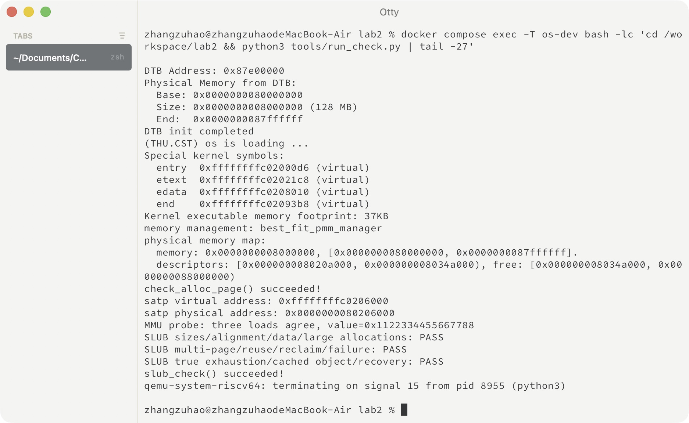
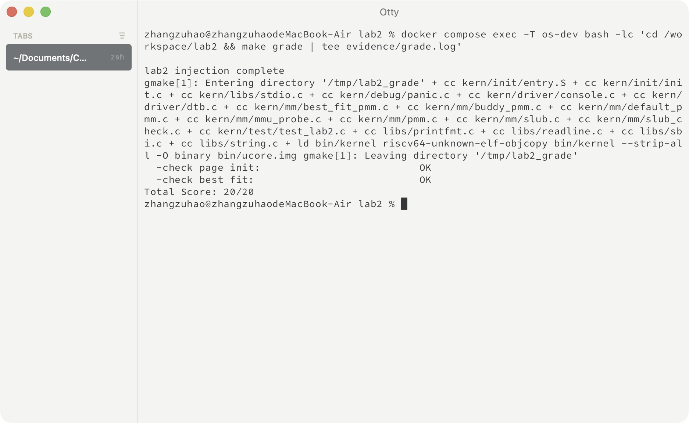
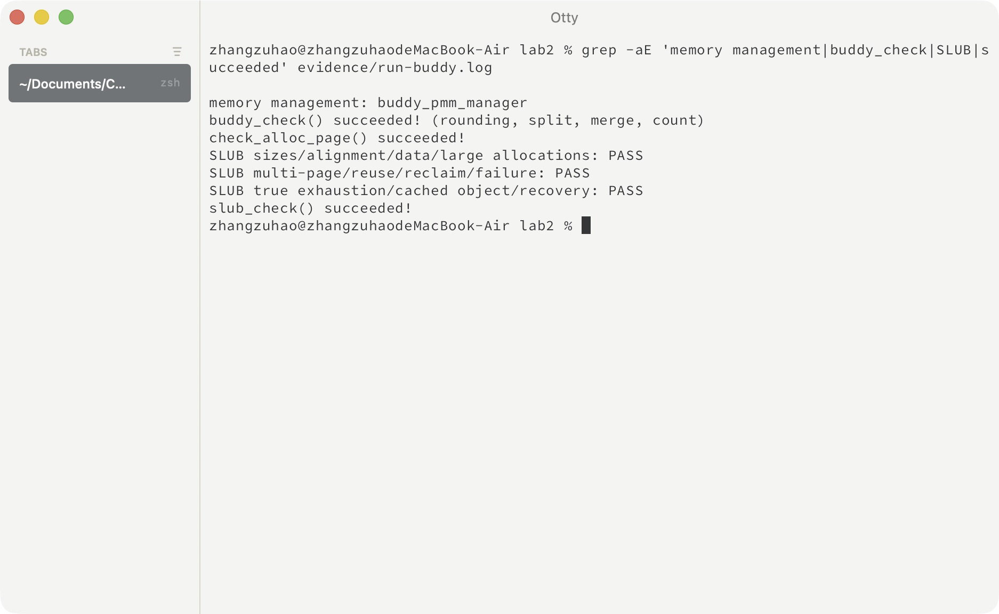
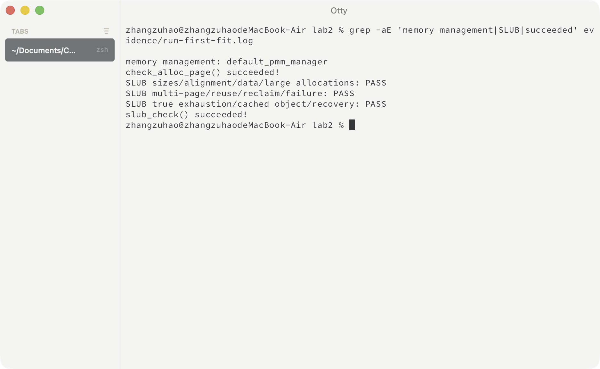
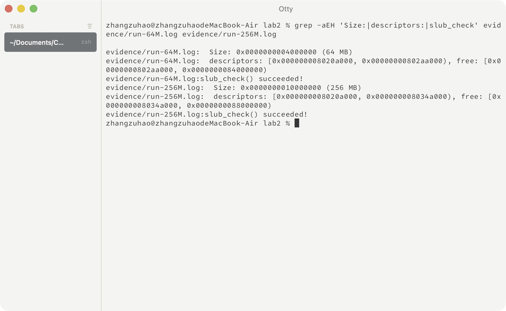
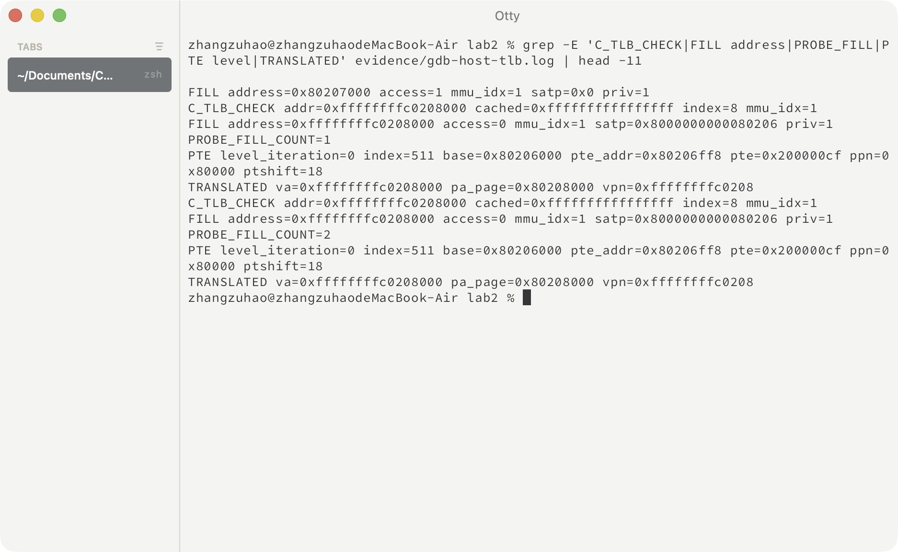
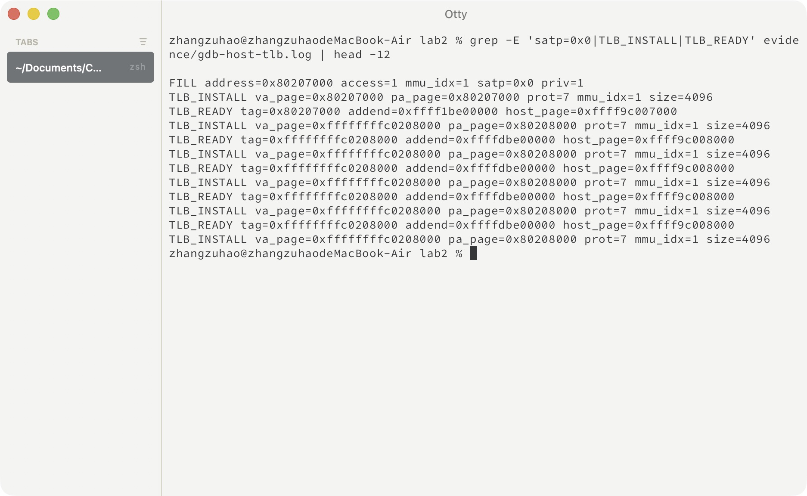
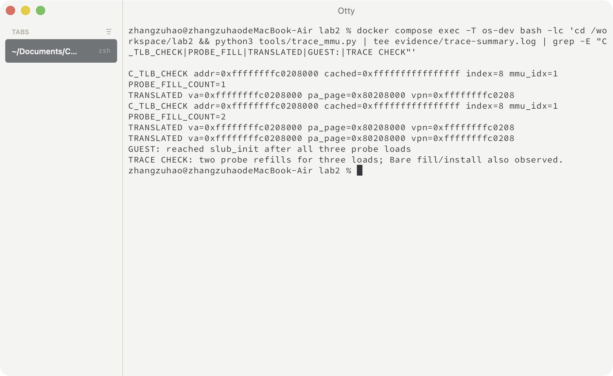
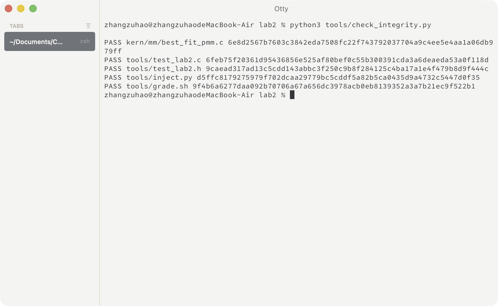

# 操作系统实验报告

## 实验基本信息

| 项目 | 内容 |
| --- | --- |
| 实验名称 | Lab2：物理内存和页表 |
| 本部分作者 | 2410849－张祖浩（组员 B） |
| 完成日期 | 2026-10-22；提示词补充整理于 2026-10-24 |
| 本部分范围 | Best-Fit、SLUB、GDB 调试要求 3 和 4 |

### 小组分工

| 成员 | 负责的练习/模块 |
| --- | --- |
| 组员 A | 物理内存探测与页描述符初始化；获取物理内存范围的思考题；First-Fit；GDB 1、2 |
| 组员 B：2410849－张祖浩 | Best-Fit、SLUB；GDB 3、4 |
| 组员 C | Buddy System；GDB 5、6，并协助要求 1 |

这份文档是我的个人部分，供合并到小组报告。为了能单独运行和验证，当前副本也补齐了初始化和 Buddy；它们的正式报告仍由对应成员负责。下面的四份提示词由 AI 协助，按指导书格式和现有接口补充整理，用于复核需求和复现实验，不是最初开发对话的逐字记录。代码实现和运行验证完成于 10 月 22 日，提示词整理于 10 月 24 日。独立版本见 [prompt.md](prompt.md)。下文提示词中的源码路径均以 `lab/code/` 为工程目录。

## 一、实验目的

本实验先建立物理页管理，再通过页表把虚拟地址映射到物理地址。我的工作主要是实现 Best-Fit 和一个简化的 SLUB，再通过调试 QEMU 观察 TLB 查询与填充。页表机制负责地址映射，分配器负责组织可用内存，这两部分需要分清。

## 二、实验环境

| 成员 | AI 编程工具 | 底层模型 | 备注 |
| --- | --- | --- | --- |
| 张祖浩 | Codex 桌面应用 | 本轮具体模型标识未单独记录 | 辅助代码实现、运行验证、源码分析与报告整理 |

| 项目 | 本次实际环境 |
| --- | --- |
| 宿主机 | Apple Silicon macOS |
| 开发环境 | Docker 内的 ARM64 Ubuntu 24.04 |
| 交叉编译器 | riscv64-unknown-elf-gcc 13.2.0 |
| GDB | GNU GDB / gdb-multiarch 15.1 |
| 常规运行 | QEMU 8.2.2，OpenSBI 1.3 |
| 源码调试 | 单独编译的 QEMU 4.1.1，带调试符号，使用其附带的 OpenSBI 0.4 |
| 模拟平台 | RISC-V virt，默认 128 MiB RAM |

实际版本记录在本地 `evidence/environment.log`。调试 QEMU 的 GDB 面向 ARM64 宿主进程，调试内核的 GDB 面向 RISC-V。两个会话调试的对象不同。

## 三、实验整体逻辑分析

### 3.1 本章节的逻辑主线

内核启动时先建立页表，使高地址的代码和数据可以访问。进入 C 代码后，读取设备树中的内存起点和大小，建立 `Page` 描述符，再把排除 OpenSBI、内核和描述符数组后的完整页面交给物理页分配器。

此后，`alloc_pages(n)` 请求连续的物理页，`free_pages()` 负责回收。SLUB 使用这些页面，为较小对象提供分配接口。访问分配到的内存时，CPU 使用的地址还要经过当前地址翻译机制，TLB 用来缓存翻译结果。

### 3.2 功能的逐步实现

框架中的主要调用关系为：

```text
entry.S 建立启动页表并开启分页
  → kern_init() → dtb_init()
  → pmm_init() → init_pmm_manager() → page_init()
  → init_memmap() 注册空闲物理页
  → 页面分配器检查
  → mmu_probe() 进行访存观察
  → slub_init()、slub_check()
```

实现时先完成物理页分配，再接入对象分配。调试选择一个确定会访问的地址，用条件断点观察未命中、查表和填充，避免每次访存都中断。

## 四、实验内容与实现

### 功能模块：Best-Fit 连续物理内存分配

负责人：2410849－张祖浩。

#### 模块功能描述

主要函数位于 [best_fit_pmm.c](../code/kern/mm/best_fit_pmm.c)：

```c
static void best_fit_init(void);
static void best_fit_init_memmap(struct Page *base, size_t n);
static struct Page *best_fit_alloc_pages(size_t n);
static void best_fit_free_pages(struct Page *base, size_t n);
static size_t best_fit_nr_free_pages(void);
static void best_fit_check(void);  /* 框架原有测试 */
```

我沿用按地址排序的空闲块链表。每个空闲块只有头部 `Page` 放入链表，`property` 表示块中连续页数，`nr_free` 统计全部空闲页。

申请 n 页时遍历链表，在所有 `property >= n` 的块中选择最小块。遇到刚好 n 页的块可以直接停止。如果选中的块更大，就从前部取出 n 页，把剩余部分作为新空闲块留在原位置。

```c
if (p->property >= n) {
    if (page == NULL || p->property < page->property) {
        page = p;
        if (p->property == n) break;
    }
}
```

比如按地址顺序有 12、7、9 页三个空闲块，申请 6 页时，First-Fit 会选 12 页块；这里会选 7 页块。释放时仍按地址插入，这样能直接检查前后相邻块，满足物理连续条件就合并。合并掉的块头需要清除 `PageProperty` 并移出链表，不能留下两个重叠的空闲块。

最后定义 `best_fit_pmm_manager`，把这些函数注册到 `pmm_manager` 接口。`pmm.c` 默认选择它，因此运行输出应出现 `memory management: best_fit_pmm_manager`。只补好文件而不切换管理器，测试到的仍可能是 First-Fit。

#### 最终提示词

````markdown
[PROMPT]
**任务**：我负责 Lab2 的 Best-Fit。请补全 `kern/mm/best_fit_pmm.c`，并在 `kern/mm/pmm.c` 的 `init_pmm_manager()` 中接入，让默认配置真正使用 Best-Fit。

**操作要求**：必须修改项目里的实际文件。保留框架中的 `basic_check()`、`best_fit_check()` 和官方评分文件，不要通过改测试来让结果通过。保留 First-Fit、Buddy 的切换方式，只修改这个模块需要的位置。

**输出要求**：先核对下面的接口与工程是否一致，再完成实现、编译和检查。说明选块、拆分、合并及空闲页计数如何保持一致，给出实际运行结果；没有运行的检查要说明。最后结合这份链表实现，简要说明 Best-Fit 的改进空间。

[RELY]
`memlayout.h` 中的相关定义是：
```c
struct Page {
    int ref;
    uint64_t flags;
    unsigned int property;
    list_entry_t page_link;
};
typedef struct {
    list_entry_t free_list;
    unsigned int nr_free;
} free_area_t;
```
`Page` 是物理页描述符，连续描述符对应连续物理页，不是可直接读写的页面数据。空闲块的头页设置 `PageProperty`，`property` 记录连续页数。可以使用 `PageReserved`、`PageProperty`、`SetPageProperty`、`ClearPageProperty`、`set_page_ref()`、`le2page()` 和 `list.h` 的链表操作。

`pmm_manager` 在 `pmm.h` 中包含 `name`、`init`、`init_memmap`、`alloc_pages`、`free_pages`、`nr_free_pages`、`check`。现有测试会直接使用模块内的 `free_list` 和 `nr_free`，需要保留兼容的状态定义。

[GUARANTEE]
需要实现的函数及注册对象：
```c
static void best_fit_init(void);
static void best_fit_init_memmap(struct Page *base, size_t n);
static struct Page *best_fit_alloc_pages(size_t n);
static void best_fit_free_pages(struct Page *base, size_t n);
static size_t best_fit_nr_free_pages(void);
extern const struct pmm_manager best_fit_pmm_manager;
```
需要修改 `pmm.c` 中的 `static void init_pmm_manager(void)`，默认选择该管理器。`best_fit_pmm_manager.check` 仍指向原有 `best_fit_check()`。可以添加模块内部的静态辅助函数，不改变公开接口。

[SPECIFICATION]
## best_fit_init
**Pre-Condition**：物理页管理器开始初始化，尚未登记可分配页面。
**Post-Condition**：空闲链表为空，空闲页数为 0，可以继续注册空闲区。

## best_fit_init_memmap
**Pre-Condition**：`n > 0`，`base` 起的 n 个描述符有效、连续，且仍为保留状态；这段区域不与已登记区域重叠。
**Post-Condition**：这 n 页解除保留，引用计数清零；以 `base` 为头登记一个 n 页空闲块，空闲页数增加 n。链表按地址递增，已有空闲块不丢失。插入到空表、表头、中间或表尾都应正确结束。

## best_fit_alloc_pages
**Pre-Condition**：`n > 0`；空闲链表和计数有效。
**Post-Condition**：成功时返回至少包含 n 个连续物理页的起始描述符，本模块实际分配 n 页；这些页不再属于空闲块，空闲总数减少 n，其他空闲区保持有效。
**Case 1**：有多个块能满足请求时，选择页数最少的块；大小相同则保留地址靠前的块。不能遇到第一个够大的块就返回。
**Case 2**：选中块恰好为 n 页时移除整个块；大于 n 时取出前 n 页，剩余部分作为空闲块保留，链表仍按地址排序。
**Case 3**：总空闲页不足，或虽然总数足够但没有足够大的连续块时，返回 NULL，链表和计数不变。

## best_fit_free_pages
**Pre-Condition**：`n > 0`；这段连续页由本管理器分配，尚未释放，且不包含保留页。调用者负责传入合法范围。
**Post-Condition**：页面引用计数恢复为 0，空闲页总数增加 n；空闲链表按地址排序，不包含重叠的块。只把实际物理连续的块合并，合并后只保留一个有效块头及正确页数。
**Case 1**：与前后都不连续时独立插入。
**Case 2**：只与一侧连续时合并该侧；两侧都连续时合并成一个块。被合并掉的块头应移出链表，并清除其 `PageProperty` 标志。

## best_fit_nr_free_pages
**Pre-Condition**：管理器已经初始化。
**Post-Condition**：返回全部空闲页数，不改变链表和计数。

## init_pmm_manager 与管理器注册
**Pre-Condition**：物理内存初始化将选择页分配器。
**Post-Condition**：默认配置选择 `best_fit_pmm_manager`，函数指针与上述接口对应；显式选择 First-Fit 或 Buddy 的配置仍可使用。
**Requirements**：运行时核对管理器名称，再执行原有自检和 `make grade`。分别解释通过了哪些检查；不要把官方评分当成 SLUB 和全部调试任务的评分。
````

#### 实现与检查过程

代码先补齐内部状态、管理接口和注册结构，再接入内核。`basic_check()` 和 `best_fit_check()` 保持官方版本不变。它们会检查独立页面分配、失败返回、块拆分、Best-Fit 选择，以及回收前后的计数恢复。

检查链表插入时，我还补上了尾部插入后的退出，避免继续遍历刚加入的节点。当前初始化只有一段空闲内存，不能因此认为多段插入逻辑可以省略。

官方 `make grade` 的初始化和 Best-Fit 两项都通过，总分为 20/20。评分范围只有这两项，SLUB 和调试部分需要另外验证。

#### 思考：Best-Fit 还有哪些改进空间

现在一次分配最多要遍历全部空闲块，时间与块数有关。可以按块大小建立索引来加快查找，但释放时又需要知道哪些块在地址上相邻，所以还要维护额外结构。对这次实验而言，地址有序链表比较容易检查，代价是查找较慢。

Best-Fit 也可能留下很多很小的剩余块。它只保证本次选中的空闲块最贴合请求，不能保证长期运行中的碎片一定最少。

### Challenge：SLUB 任意大小对象分配

负责人：2410849－张祖浩。

#### 模块功能描述

实现位于 [slub.c](../code/kern/mm/slub.c)，测试单独放在 [slub_check.c](../code/kern/mm/slub_check.c)。接口为：

```c
void slub_init(void);
void *kmalloc(size_t size);
void kfree(void *ptr);
size_t slub_pages_in_use(void);
void slub_check(void);
```

底层仍通过 `alloc_pages()` 申请页面，上层把页面分成固定规格的对象槽位。我选了 16、32、64、128、256、512、1024、2048 字节八种规格，申请时向上选择能容纳对象的最小规格。例如 48 字节使用 64 字节槽位，申请者仍可使用至少 48 字节。

每页开始处是管理头，记录规格、占用数、容量、空闲对象链表和分配位图。头部按 16 字节对齐，返回的对象地址也保持 16 字节对齐。空闲槽位前几个字节用来放下一个空闲对象的指针；对象分配出去后，这部分空间由调用者使用。

每种规格维护有空位的页面链表。分配对象时从空闲对象链表取一个槽位；页面用满后移出可分配链表。释放后，如果原来是满页，就重新放回链表；当占用数降为零，整页立即归还底层分配器。分配位图用于检查重复释放和槽位是否合法。

超过 2048 字节的请求走连续页分配，管理头同样放在开头，释放时根据页数归还。考虑到 Buddy 会向上取整，大对象记录的是本次实际扣除的页数，避免把“申请了几页”和“底层占了几页”混为一谈。

`kmalloc(0)` 返回 NULL，`kfree(NULL)` 不做操作；无法满足请求或尺寸计算溢出时返回 NULL。这是单核简化版本，满足实验的两层分配要求，没有实现 Linux SLUB 的全部机制。

#### 最终提示词：实现

````markdown
[PROMPT]
**任务**：请在 Lab2 中实现一个简化 SLUB，代码放在 `kern/mm/slub.c`，接口放在 `kern/mm/slub.h`，并在 `kern/init/init.c` 接入初始化。指导书允许简化，只要体现“底层分配页，上层分配对象”这两层关系即可。

**操作要求**：必须修改实际文件，保留现有页分配器、自检和启动逻辑。实现与测试分开，这份先完成分配器，不把测试写进分配函数。按单核实验考虑，不添加完整 Linux SLUB 的机制。

**输出要求**：说明小对象、大对象分别怎么申请和回收，特别检查整页回收及失败时是否泄漏。完成后编译，列出修改的文件和实际检查结果。

[RELY]
工程已经有以下页分配接口：
```c
struct Page *alloc_pages(size_t n);
void free_pages(struct Page *base, size_t n);
size_t nr_free_pages(void);
```
还有 `alloc_page()`、`free_page()`、`PGSIZE`（4096）、`page2pa()`、`pa2page()`、`PADDR()`、`va_pa_offset`、链表、断言和 `memset()`。页面数据的内核地址可以由 `page2pa(p) + va_pa_offset` 得到，不能直接把 `struct Page *` 当成对象空间。

底层可切换 Best-Fit、First-Fit、Buddy。Buddy 可能向上取整，所以连续页请求占用的实际页数可能大于参数 n。

[GUARANTEE]
```c
void slub_init(void);
void *kmalloc(size_t size);
void kfree(void *ptr);
size_t slub_pages_in_use(void);
```
在头文件声明接口；在 `int kern_init(void)` 中于 `pmm_init()` 后调用初始化，保留原有调用顺序。允许增加静态辅助函数和模块内部结构，不改变底层页管理接口。

[SPECIFICATION]
## slub_init
**Pre-Condition**：页管理器已完成初始化；SLUB 尚无存活对象，启动时调用一次。
**Post-Condition**：各规格的可分配页面链表为空，SLUB 持有页数为 0，后续可以调用分配和释放接口。

## kmalloc
**Pre-Condition**：SLUB 已初始化，当前为单核、无并发调用的环境。
**Post-Condition**：成功时返回至少可用 size 字节、按 16 字节对齐的地址，使用区间不与其他存活对象重叠。分配新对象不能破坏已有对象数据。
**Case 1**：size 为 0 时返回 NULL，不申请页面。
**Case 2**：1—2048 字节使用 16、32、64、128、256、512、1024、2048 这八种规格，选择不小于请求的最小规格。已有页面有空槽时先复用，没有空槽时再申请新页。每页容量应扣除管理头占用的空间，不能把元数据也分配给对象。
**Case 3**：超过 2048 字节时申请连续页，预留管理头后仍能容纳请求。记录底层实际分配的页数，释放时能完整归还，兼容 Buddy 的向上取整。
**Case 4**：尺寸计算溢出或页面不足时返回 NULL，不泄漏页面，不改变已有对象和有效计数。

## kfree
**Pre-Condition**：ptr 为 NULL，或是本接口返回且尚未释放的完整对象指针；不要求支持任意非法地址。
**Post-Condition**：释放对象后，它不再占用对象槽位或大对象页面；其他存活对象仍可正常读写，页数统计与实际占用一致。
**Case 1**：NULL 不做操作。
**Case 2**：小对象槽位重新可用；原本满的页面重新进入可分配状态。页面最后一个对象释放后，整页立即归还底层。
**Case 3**：大对象按保存的实际页数一次归还，不能只归还最初请求的页数。
**Requirements**：用必要的标记和分配位图检查对象槽位及重复释放；断言用于暴露调用错误，不宣称分配器能安全处理所有非法指针。

## slub_pages_in_use
**Pre-Condition**：SLUB 已初始化。
**Post-Condition**：返回 SLUB 当前实际占用的物理页数，包括小对象页和大对象页，不改变分配状态；全部对象释放后为 0。

## kern_init 接入
**Pre-Condition**：保留原框架的内存、控制台及页管理初始化。
**Post-Condition**：SLUB 在页管理器可用后初始化，原有页管理检查仍执行；测试可以在此后单独接入。
````

#### 最终提示词：测试

````markdown
[PROMPT]
**任务**：请给 Lab2 的 SLUB 单独写测试，放在 `kern/mm/slub_check.c`，在 `slub.h` 声明并在 `kern_init()` 中于 `slub_init()` 后调用。我需要能说明每组测试检查什么，而不只是看到一次“分配成功”。

**操作要求**：必须修改实际文件。测试通过公开接口检查，不读取分配器私有结构，也不为了通过测试修改 Best-Fit、Buddy、SLUB 实现或官方评分器。发现实现问题时先给出失败位置和原因。

**输出要求**：实际编译运行，保留断言和分组输出。说明尺寸边界、数据隔离、复用、回收、失败这几类用例各能发现什么错误，并分别在三个底层分配器配置下验证。没有执行的配置不要写成通过。

[RELY]
SLUB 的公开接口是：
```c
void slub_init(void);
void *kmalloc(size_t size);
void kfree(void *ptr);
size_t slub_pages_in_use(void);
```
约定：正尺寸成功时至少有 size 字节、16 字节对齐；`kmalloc(0)` 返回 NULL；`kfree(NULL)` 不做操作；最后一个对象释放后归还所在页面；失败不破坏已有对象。小对象规格为 16 到 2048 的八个 2 的幂规格，较大对象走连续页。

还可以使用 `nr_free_pages()`、`alloc_page()`、`free_page()`、`PGSIZE`、`Page.page_link`、`le2page()`、链表、`assert()`、`cprintf()` 和 `memset()`。测试开始时 SLUB 没有存活对象。

[GUARANTEE]
```c
void slub_check(void);
```
在 `slub.h` 增加声明，在 `int kern_init(void)` 中接入。允许静态辅助函数和静态对象指针数组，避免把几百个指针放到有限的内核栈上。

[SPECIFICATION]
## slub_check
**Pre-Condition**：页管理器和 SLUB 已初始化；没有其他对象分配或并发活动。记录测试前的空闲页数，起始 SLUB 占用为 0。
**Post-Condition**：全部断言通过时，所有测试对象和测试临时占用页均已释放，SLUB 占用回到 0，底层空闲页数恢复到测试前。分组打印结果，最后打印 `slub_check() succeeded!`。

**Case 1：尺寸、对齐、数据隔离。** 使用 1、15、16、17、31、32、33、63、64、65、127、128、129、255、256、257、511、512、513、1023、1024、1025、2047、2048、2049、4096、8193，共 27 种尺寸。同时保留对象，检查非空、16 字节对齐及使用区间两两不重叠；给各对象写入不同模式，全部申请后再核对。释放后检查页数恢复。

**Case 2：多页、复用、回收。** 同时申请 600 个 16 字节对象，确认至少使用 3 页。每个对象写入模式，释放一个已满页面中的槽位后重新申请，检查该槽位能够复用，再检查其他对象的数据。按先偶数、后奇数下标释放全部对象，核对 SLUB 和底层页数恢复。

**Case 3：特殊参数和大请求失败。** 检查零长度、NULL 释放、最大 size_t 导致的尺寸溢出，以及申请超过当前可用物理页的请求。应返回 NULL 或按约定不操作，且不丢失页面。

**Case 4：真正耗尽底层页面。** 先申请一个 16 字节对象保留其数据，再用 `alloc_page()` 申请走剩余全部页，记录这些页以便回收。底层空闲为 0 时，同规格已有页面里的空槽仍应能分配；新规格 32 字节和大对象 8193 字节应失败，原对象数据保持。释放对象，再归还所有临时物理页，核对最终计数恢复。

**Requirements**：切换 Best-Fit、First-Fit、Buddy 前分别清理再编译，运行同一套测试。测试失败不能继续打印成功；不执行会故意触发内核断言、从而中止后续检查的非法释放用例。

## kern_init 测试接入
**Pre-Condition**：保留现有启动流程，已经调用 `slub_init()`。
**Post-Condition**：调用 `slub_check()`，不省略原来的页管理自检；测试结束后维持框架的停留行为。
````

#### 实现与测试过程

先完成单页内的槽位分配、释放和整页回收，再加入跨页面、大对象和失败路径。测试使用公开的 `kmalloc()`、`kfree()`、页计数接口检查结果，不直接依赖内部链表布局。

| 检查内容 | 用例与判断依据 |
| --- | --- |
| 尺寸边界 | 27 种请求尺寸，包含每种规格附近和大于一页的请求 |
| 对齐与不重叠 | 检查 16 字节对齐，并比较全部对象的实际使用区间 |
| 数据完整性 | 对每个对象写入不同字节，再逐字节核对，检查相互覆盖 |
| 多页申请 | 同时申请 600 个 16 字节对象，确认分配器使用了多个页面 |
| 满页释放后复用 | 释放其中一个槽位再申请，检查该位置能重新使用 |
| 回收 | 分批释放后检查 SLUB 页面数为零，底层空闲页数恢复 |
| 大请求失败 | 申请超过可用页面数量的对象，确认返回 NULL 且计数不变 |
| 真正耗尽 | 把剩余页面全部申请走，检查已有 slab 的空位仍可用，新规格和大对象分配失败；最后全部释放并核对恢复 |

这些测试分别针对容量选择、空间隔离、空闲槽位管理和底层页面回收。运行输出如下：

```text
SLUB sizes/alignment/data/large allocations: PASS
SLUB multi-page/reuse/reclaim/failure: PASS
SLUB true exhaustion/cached object/recovery: PASS
slub_check() succeeded!
```

同样的对象测试在 Best-Fit、First-Fit 和 Buddy 三种配置下都通过。本次没有做性能计时，结果只能说明这些功能和边界用例通过。

### 分支任务：GDB 调试要求 3、4

负责人：2410849－张祖浩。

#### 调试准备

按指导书单独构建 QEMU 4.1.1，使用 `--enable-debug`，没有执行 `make install`。为兼容当前编译环境关闭了警告视为错误及不需要的图形界面组件；调试涉及的 QEMU 源码未修改。

在内核里加了 `mmu_probe()`，对同一个数据地址执行三次 `ld`。第一次之前执行 `sfence.vma`，第二次直接读取，第三次之前再次执行 `sfence.vma`。三次结果都必须为 `0x1122334455667788`。这样可以观察缓存填充和复用，而不必从大量随机访存中寻找目标。

自动脚本 [trace_mmu.py](../code/tools/trace_mmu.py) 启动两个真实 GDB 会话：宿主 GDB 调试 QEMU，多架构 GDB 连接内核。内核在 `slub_init()` 停下时，三次读取已经完成。宿主断点只关心目标地址，记录到 `evidence/gdb-host-tlb.log`。

#### 提示词设计

````markdown
[PROMPT]
**任务**：我负责指导书 GDB 要求 3、4。请基于带调试符号的 QEMU 4.1.1，帮我实际观察 TLB 查询、未命中后的翻译与填充，以及 Bare 模式下 QEMU 为什么仍使用软件 TLB。用 `kern/mm/mmu_probe.c` 提供可重复的访存，用 `tools/trace_mmu.py` 保存两个 GDB 会话的记录。

**操作要求**：必须修改项目实际文件，在 `kern/init/init.c` 声明并调用探针；保留现有内核和分配器自检。QEMU 使用单独的调试构建，不改它的地址翻译源码，不替换系统安装。只分析指导书要求 3、4 所需路径。

**输出要求**：给出真实命令、日志和相关源码位置；把观察到的值与解释对应起来。分清宿主 GDB 和客体 GDB，说明命中与未命中的差别，以及软件 TLB 和硬件 TLB 的用途差别。不能用写死的打印代替真实断点，也不能预先假定本次一定走完三级页表。

[RELY]
实验在 ARM64 Ubuntu 容器运行，内核为 RISC-V 64 位。宿主 `gdb` 调试 ARM64 的 QEMU 进程，`gdb-multiarch` 通过 QEMU stub 调试 `bin/kernel`。已有 `tools/build_debug_qemu.sh` 可构建 QEMU 4.1.1，默认源码目录为 `/tmp/lab2-qemu/qemu-4.1.1`。

需要查看的 QEMU 4.1.1 源码主要是 `accel/tcg/cputlb.c`、`target/riscv/cpu_helper.c` 和 ARM64 后端 `tcg/aarch64/tcg-target.inc.c`。关注 `load_helper()`、`riscv_cpu_tlb_fill()`、`get_physical_address()`、`tlb_set_page()`、`tlb_set_page_with_attrs()` 和 `tcg_out_tlb_read()`。

工程已有 `pmm_init()`，SLUB 初始化在它之后；内核符号可用 `riscv64-unknown-elf-nm bin/kernel` 读取。`boot_hartid` 在开启分页前写入，可以用来观察 Bare 模式。当前高地址映射使用根层的 1 GiB 叶子项。

[GUARANTEE]
内核接口：
```c
void mmu_probe(void);
int kern_init(void);
```
新增探针数据符号 `lab2_probe_value`，以及三条读取指令的位置符号 `lab2_probe_first`、`lab2_probe_second`、`lab2_probe_third`。

脚本接口：`python3 tools/trace_mmu.py --qemu-root <QEMU源码目录>`。生成 `evidence/host-trace.gdb`、`guest-trace.gdb`，记录 `gdb-host-tlb.log`、`gdb-guest.log`、`gdb-qemu-console.log`。可以增加脚本内部辅助逻辑，不改变原有内核接口。

[SPECIFICATION]
## mmu_probe
**Pre-Condition**：启动映射和页管理初始化已完成，探针数据可访问；当前为单核环境。
**Post-Condition**：对同一个、按页对齐的 `volatile uint64_t` 数据执行三条实际 `ld`，三次结果均为 `0x1122334455667788`，用断言核对并打印结果。
**Case 1**：第一次读取前执行 `sfence.vma`。
**Case 2**：第二次直接读取同一地址，不主动刷新，让它有机会复用已有 TLB 条目。
**Case 3**：第三次之前再执行 `sfence.vma`，观察重新填充。
**Requirements**：通过内联汇编和正确的寄存器约束保留这三次真实读取，避免被编译器合并，也不要让输出寄存器覆盖后续读取所需的地址。

## kern_init 探针接入
**Pre-Condition**：原有初始化和页管理自检不变。
**Post-Condition**：在 `pmm_init()` 后、`slub_init()` 前执行 `mmu_probe()`，便于客体 GDB 在 `slub_init()` 停下时检查三次读取已完成。

## trace_mmu.py
**Pre-Condition**：内核已编译，QEMU 4.1.1 调试构建及相应源码可用，两个 GDB 可执行，回环调试端口可用。
**Post-Condition**：从实际内核符号确定探针和 `boot_hartid` 地址，启动两个 GDB 并留下完整记录；结束或失败时清理自己启动的调试进程。日志与判断都来自本次执行。

**Case 1：Sv39 访存。** 用目标地址条件断点记录 C 查询的标签、索引、mmu_idx，以及填充时的 satp、权限模式、实际读取的 PTE 和翻译结果。按 PTE 的真实叶子层级解释物理地址，不能把根层大页也写成三次页表读取。

**Case 2：命中与刷新。** 核对三次读取结果和目标数据填充次数。本探针预期两次填充，第二次读取可走生成的宿主快路径；结合 `tcg_out_tlb_read()` 解释，不能要求每次 load 都进入 C 慢路径。GDB 自己查看内存造成的调试翻译，不算成内核多执行了一条 load。

**Case 3：Bare 模式。** 观察开启分页前保存 `boot_hartid` 时 `satp=0` 的访问，记录客体地址、物理地址和 TLB 安装，并观察 addend 或对应宿主页地址。说明客体不查 Sv39 页表时，QEMU 仍需定位宿主 RAM；宿主地址随进程变化，不能当作固定常量。

**Case 4：运行不符合预期。** 调试器退出、连接超时或缺少必要记录时报告失败，保留已有日志供检查，不补造输出或把失败写成通过。

**Requirements**：stub 只监听回环地址；断点行号与地址以当前源码、符号为准。说明实测支持到什么程度，保留可复核的命令与输出。
````

#### 要求 3：TLB 查询代码和调试细节

QEMU 4.1.1 的 C 查询逻辑在 `accel/tcg/cputlb.c` 的 `load_helper()` 中。它根据地址和 `mmu_idx` 找到 TLB 条目，取出 `addr_read` 或 `addr_code`，调用 `tlb_hit()` 检查。未命中时还会检查 victim TLB，仍未命中才进入填充。

这次 64 位加载的慢路径调用栈实际为：

```text
code_gen_buffer
  → helper_le_ldq_mmu / load_helper
  → tlb_fill
  → riscv_cpu_tlb_fill
  → get_physical_address
  → tlb_set_page
```

第一次目标数据访问的记录是：

```text
C_TLB_CHECK addr=0xffffffffc0208000 cached=0xffffffffffffffff index=8 mmu_idx=1
FILL address=0xffffffffc0208000 access=0 mmu_idx=1 satp=0x8000000000080206 priv=1
PROBE_FILL_COUNT=1
PTE level_iteration=0 index=511 base=0x80206000 pte_addr=0x80206ff8 pte=0x200000cf ppn=0x80000 ptshift=18
TRANSLATED va=0xffffffffc0208000 pa_page=0x80208000 vpn=0xffffffffc0208
```

这里 `cached` 全 1 表示条目尚未提供有效映射。`satp` 的 MODE 为 Sv39，根页表物理地址是 `0x80206000`，目标地址的根索引是 511。

本内核的高地址映射使用 1 GiB 叶子项，所以遍历在根层就找到了叶子，没有继续读取另外两层。不能因为 Sv39 支持三级，就把本次运行写成实际查询了三层。结合 PTE 的物理页号和该大页内的偏移，得到 `0x80208000`。

三条 `ld` 一共只触发两次目标数据填充。第二次读取没有进入 C 慢路径；第三次在 `sfence.vma` 之后重新进入，日志出现 `PROBE_FILL_COUNT=2`。

还需要区分 C 源码与运行中的快路径。ARM64 宿主上的 `tcg/aarch64/tcg-target.inc.c` 中，`tcg_out_tlb_read()` 会生成读取标签、比较和未命中跳转的宿主指令。命中时可以直接走这些生成的指令，因此不能要求每次 load 都停在 `load_helper()`。三次数据一致、两次填充的记录与这个路径相符。

#### 要求 4：QEMU TLB 与真实 CPU TLB 的区别

真实 CPU 的 TLB 缓存地址翻译及访问属性；QEMU 还需要把客体内存访问落实到模拟器进程的内存中。`tlb_set_page_with_attrs()` 会计算宿主地址，并把偏移存入 `CPUTLBEntry.addend`。对普通 RAM 快路径，可用客体地址加上该偏移找到宿主内存。

本次同时观察了内核入口保存 `boot_hartid` 的访问。当时还没有开启分页：

```text
FILL address=0x80207000 access=1 mmu_idx=1 satp=0x0 priv=1
TLB_INSTALL va_page=0x80207000 pa_page=0x80207000 prot=7 mmu_idx=1 size=4096
```

这说明 Bare 模式下，QEMU 仍然经过软件 TLB 填充，只是客体地址翻译阶段直接得到相同的物理地址，没有遍历 Sv39 页表。之后仍需确定它在宿主进程中的内存位置。

| 对比项 | 真实 CPU 的地址翻译 TLB | 本次 QEMU 软件 TLB |
| --- | --- | --- |
| 地址用途 | 缓存处理器需要的地址翻译和权限 | 同时帮助模拟器定位宿主 RAM，保存 addend 等信息 |
| Bare 模式 | 不需要按 Sv39 页表进行翻译 | 仍可查询、填充软件缓存以加速模拟访存 |
| 实现形式 | 硬件结构 | C 数据结构和生成的宿主指令 |

日志中的宿主地址受进程布局影响，不应当成固定实验常量；报告里的虚实地址也对应本次构建。GDB 查看客体内存本身还会调用调试翻译接口，因此日志尾部可能出现额外 PTE 输出。计数使用的是目标数据 `riscv_cpu_tlb_fill()`，没有把这些调试读取算成内核又执行了一次 load。

#### 实际遇到的问题

第一次运行只看到 OpenSBI 输出，内核没有打印。检查入口页表时发现原框架只映射了高地址：写入 `satp` 后，CPU 还要在当前低地址执行 `sfence.vma` 和跳转准备，这段取指缺少映射。补入覆盖 `0x80000000` 的恒等映射后，两个版本 QEMU 都能进入内核。高地址映射仍保留在根索引 511。

调试中也不能只看“页表函数没有再次命中断点”就下结论。这次把 C 查询、填充计数、三条真实指令和读取结果对应起来，并查了 ARM64 生成快路径的位置，才解释了第二次读取的去向。

## 五、测试与验证

以下截图均来自真实 Otty 终端。编译、默认运行、官方评分和调试脚本重新运行为现场截图；Buddy、不同 RAM 配置及 GDB 明细是原始日志回看，图注分别说明。原始日志保存在本地 `evidence/`，本次公开提交提供报告、提示词和 13 张截图，截图索引见 [images/README.md](images/README.md)。

### 5.1 编译与默认运行




### 5.2 官方评分



评分器与官方测试文件均未修改。它只覆盖初始化和 Best-Fit，不把这个分数解释为所有扩展任务都已验证。

### 5.3 切换底层分配器与 RAM 配置







64 MiB 配置检查较小内存下的初始化和分配；256 MiB 配置检查内存探测结果超过框架上限时是否正确截断。后者的空闲区上界仍是 `0x88000000`。

### 5.4 指导书版本与 GDB 调试








### 5.5 对象分配测试与代码约束




此次实测覆盖三种底层分配器，以及 64、128、256 MiB 内存配置。本地评分日志为 `evidence/grade.log`，完整性核对记录为 `evidence/integrity.md`。仓库保留了完整性检查脚本和官方测试哈希，可用 `python3 tools/check_integrity.py` 重新核对。

## 六、实验总结与收获

### 对操作系统的理解

| 本实验内容 | 对应的原理与本次实现 |
| --- | --- |
| Best-Fit | 连续内存分配；在满足请求的空闲块中选择最小块，仍需处理拆分、合并和外部碎片 |
| SLUB | 页级分配之上的对象分配；对象规格减少整页分配的浪费，但也有规格取整和元数据开销 |
| Sv39 页表 | 虚拟页到物理页的映射；本次内核启动使用大页叶子，地址计算要考虑所在层级 |
| TLB | 缓存翻译结果；未命中需要继续处理，并不直接等同于缺页异常 |
| QEMU 调试 | 用软件模拟观察硬件语义；软件 TLB 还承担客体到宿主内存访问的加速工作 |

课程原理中的进程地址空间切换、按需分配和页面置换，在本实验中没有形成完整功能。这里主要是启动映射、物理页管理和对象分配，不能把它描述成已经完成了整个虚拟内存系统。

### AI 协作开发的经验

这次先由 AI 辅助完成实现和验证，再结合已有代码补充整理提示词。整理时，四段式格式要求把依赖、接口和函数前后状态分别写清楚。比如 SLUB 的大对象不能只写“释放申请的页数”，还要考虑 Buddy 实际扣除了多少页；否则接口看似能用，回收计数却可能对不上。补充的提示词用于复核和复现，报告没有据此编写不存在的历史迭代次数。

对分配器而言，“实现 Best-Fit”几个字还不够，测试依赖的状态和接入方式同样需要明确。调试也是如此：给定 QEMU 版本、目标地址和具体访存，远比只要求“解释一下 TLB”更容易核对结果。代码通过测试后，还需要逐项理解这些约束，答辩时才能说明为什么这样写。
