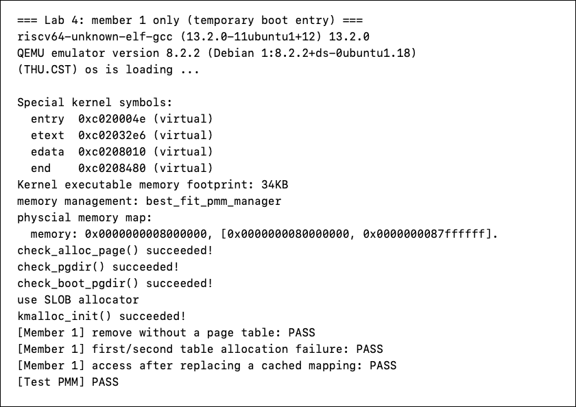
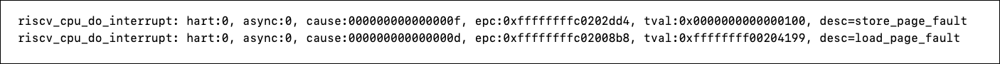
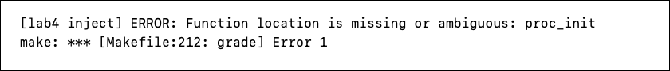
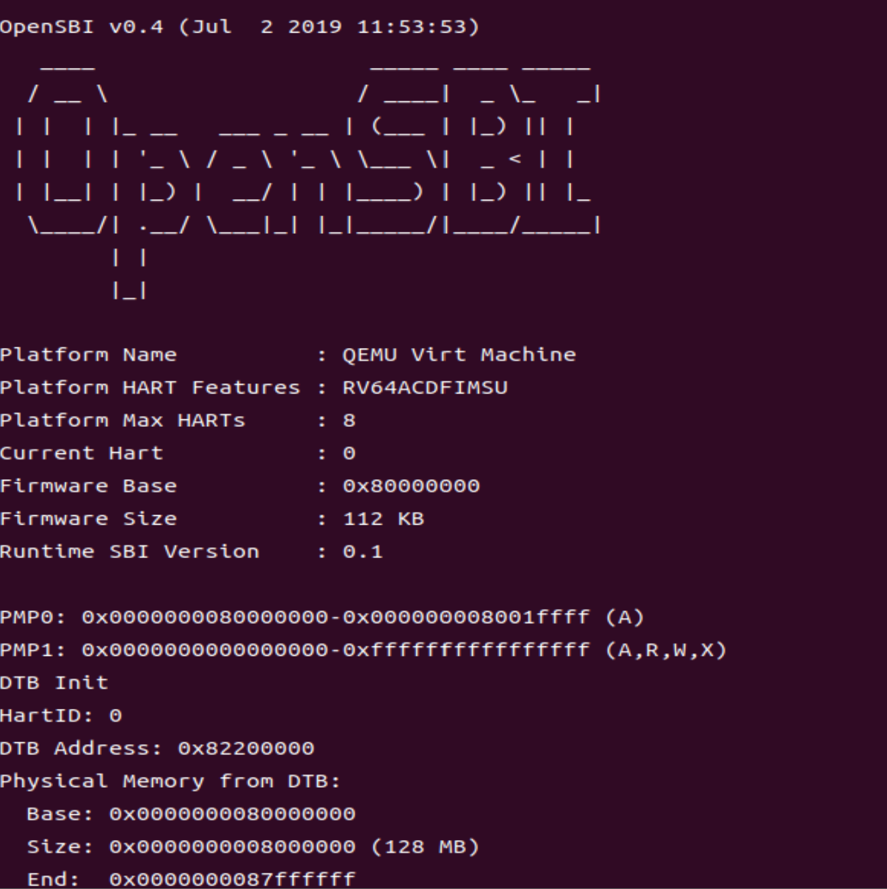
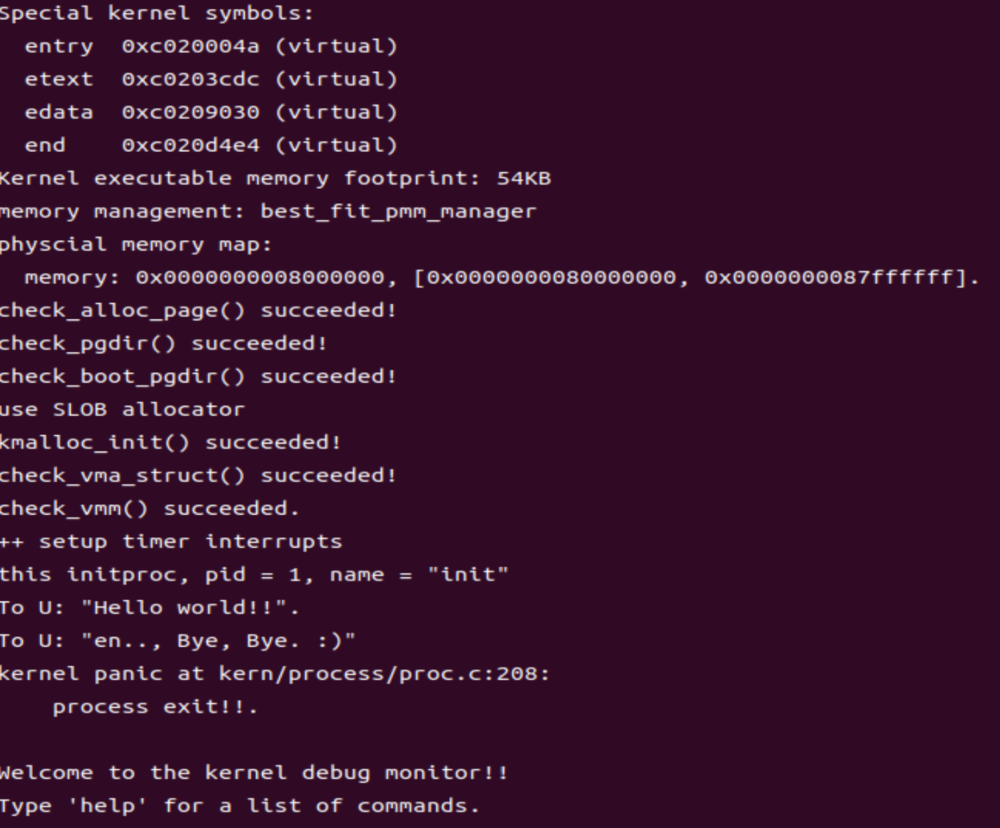
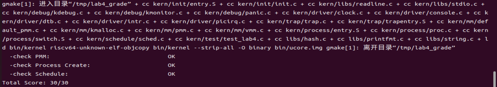

# 操作系统实验报告

## 实验基本信息

| 项目 | 内容 |
| --- | --- |
| **实验名称** | Lab 4：进程管理 |
| **小组成员** | 2410878-吕明诺、2410849-张祖浩、2410625-吴宇轩 |
| **完成日期** | 2026-11-20 |

### 小组分工

| 成员 | 负责的练习/模块 |
| --- | --- |
| 2410878-吕明诺（A） | 功能模块二：进程创建及初始化（`alloc_proc`、`proc_init`、`kernel_thread`、`do_fork`、`copy_thread`、`copy_mm`） |
| 2410849-张祖浩（B） | 功能模块一：虚拟内存页操作（`page_insert`、`page_remove`）+ 扩展练习 Challenge 2（`get_pte` 与 sv32/sv39/sv48） |
| 2410625-吴宇轩（C） | 功能模块三：进程调度（`cpu_idle`、`schedule`、`proc_run`、`switch_to`）+ 扩展练习 Challenge 1（中断开关的原子性） |

**实验报告分工：** 本实验报告由小组三名成员共同完成。各成员分别负责本人所承担模块的代码实现、测试验证、实验过程记录及对应报告内容的撰写。


---

## 一、实验目的

本实验的主要目的是：

1. 理解虚拟内存管理的基本结构，掌握虚拟内存的组织与管理方式。通过引入虚拟内存描述结构（`struct mm_struct`）与虚拟内存区域结构（`struct vma_struct`），为每个执行实体提供逻辑上的运行空间；理解本实验采用"预映射"方式（在建立地址空间时一次性完成所有需要的页表映射），与后续实验中按需分页、缺页异常处理和页面置换的区别。并对照 Sv32、Sv39、Sv48 三种分页模式，理解多级页表遍历中哪些步骤重复、哪些细节随模式变化。
2. 掌握页表映射的建立与撤销方法。`page_insert` 与 `page_remove` 需要在现有多级页表框架上完成最基本的映射维护，其难点不在于"写页表项"，而在于保持**页表项内容、物理页引用计数、TLB 状态**三者同步：插入时要正确处理"原地址已映射到同一物理页"与"已映射到其他物理页"两种情况，删除时要允许目标地址本来就没有映射，且任何页表更新后都必须让对应 TLB 失效。
3. 了解内核线程的创建与执行的管理过程。理解进程控制块（`struct proc_struct`）如何描述一个可被调度的执行实体，内核栈如何分配与使用，以及一份伪造的 `trapframe` 如何让一个从未运行过的函数第一次被"从中断返回"到入口。
4. 了解内核线程的切换和基本调度过程。理解 `switch_to` 只负责被调用者保存寄存器的保存与恢复，`schedule` 负责从就绪链表中选出下一个线程，`proc_run` 负责更新当前线程并切换页表，`cpu_idle` 作为空闲线程持续等待调度需求；理解整个切换过程为什么必须在关中断的临界区内完成。
5. 理解内核线程与用户进程的区别：内核线程仅在内核态运行、共享内核地址空间；用户进程在用户态与内核态之间切换、拥有独立的用户虚拟地址空间。由于 ucore 对线程和进程做了统一处理，且所有内核线程共享同一个内核地址空间，因此它们从属于同一个唯一的内核进程，即 ucore 内核本身。
6. 学习在 AI 辅助下进行内核代码的编写、分析与调试，掌握编写明确任务规格与提示词的方法，能够识别 AI 生成代码中的潜在问题，并通过实际编译、运行和测试结果验证代码的正确性。

---

## 二、实验环境

### 使用的 AI 工具

| 成员 | AI 编程工具 | 底层模型 | 备注 |
|------|------------|---------|------|
| 2410625-吴宇轩 |codex CTL|GPT 5.6 Sol | 以提供的源码分析和 GDB 实测记录为依据 |
| 2410849-张祖浩 | Codex 桌面应用 | GPT 6.1 Sol | 辅助环境配置、代码分析；使用 Otty 记录实验结果 |
| 2410878-吕明诺 | DeepSeek Harness | DeepSeek-V4-Flash | 辅助调用链与构建流程分析 |

---

## 三、实验整体逻辑分析

### 3.1 本章节的逻辑主线

Lab2 让内核"知道了自己有多少物理内存"，Lab3 让内核"能在发生中断/异常时正确地保存与恢复现场"。Lab4 要解决的问题是：**内核怎样从只有一条执行流，发展为能够创建、管理和调度多个内核线程的系统，并为后续实现具有独立用户地址空间的进程提供基础。**

本章按"虚拟内存页操作 → 进程创建与初始化 → 进程调度"三条主线展开，对应的内核初始化与运行链条可以概括为：

```
kern_init()
    → pmm_init()            物理内存管理与页表基础设施
    → pic_init() / idt_init()   中断控制器与异常入口
    → vmm_init()            地址空间结构（mm_struct / vma_struct）
    → proc_init()           进程表、idleproc、initproc
    → cpu_idle()            空闲线程开始循环
    → schedule()            选出下一个可运行线程
    → proc_run()            切换当前线程与页表
    → switch_to()           底层的寄存器上下文保存与恢复
```

其中**前半段负责把地址空间准备好**（页表可写、映射可建可撤、地址空间结构可用），**后半段负责让第一个可运行线程真正跑起来**（有实体可创建、有上下文可恢复、有调度器把 CPU 交出去）。

和前面几个实验相比，Lab4 最大的变化是"执行现场"变成了私有财产。Lab1～Lab3 的代码全部运行在一个固定的执行流中，`sp` 指向哪里、`satp` 指向哪张页表都是全局唯一的；从 Lab4 开始，这些东西都要跟着进程走：每个线程有自己的内核栈，`context` 记录它的寄存器现场，`pgdir` 记录它使用的页表。也正因为如此，本章才会出现"切换必须原子"这个新问题——如果保存旧现场与恢复新现场之间被打断，`current`、页表寄存器和实际执行现场三者就会不一致。

三条主线之间的关系不是串行堆叠，而是层层依赖：**没有可靠的页表映射维护，就没有能用的地址空间**；**没有地址空间与 PCB，就没有可运行实体**；**没有调度与上下文切换，可运行实体也只是一堆静止的结构体**。

### 3.2 功能的逐步实现

本次实验各部分之间存在依赖关系，因此按照"先让地址空间可用，再让实体存在，最后让实体真正跑起来"的顺序完成：

1. **首先实现功能模块一：虚拟内存页操作。** 提供 `page_insert` 与 `page_remove` 两个动作，负责把物理页挂到指定线性地址上、以及把已有映射安全撤销。之所以先做这一步，是因为后续所有工作都建立在"页表可以被正确修改"之上：`vmm_init()` 的地址空间检查、boot 页表的静态内核映射检查，以及以后用户进程的地址空间复制，都要调用这两个接口。这一步的关键是三者同步（页表项、引用计数、TLB），并且要能正确处理同一物理页的重复映射、已有映射的替换，以及目标地址不存在映射等情况。

2. **接着实现功能模块二：进程创建及初始化。** 有了可用的地址空间，就要回答"谁在上面跑"。这一步负责：分配并初始化 PCB、建立进程管理全局结构（进程链表与 pid 哈希表）、创建 `idleproc` 与 `initproc` 两个内核线程、把 PCB 与内核栈和页表组装成可运行实体、在栈上布置首次运行所需的 `trapframe` 与 `context`。之所以必须排在模块一之后，是因为内核栈要由页分配器提供、`pgdir` 要指向一张有效的页表；排在模块三之前，是因为调度器需要一个已经登记在进程链表里、状态为可运行的对象才能开始工作。

3. **然后实现功能模块三：进程调度。** 有了静态的可运行实体，就要解决"谁先跑、跑多久、怎么换"的问题：`cpu_idle` 作为空闲线程持续循环并检查 `need_resched`，`schedule` 从进程链表中选出下一个可运行线程并在找不到时退回 idle，`proc_run` 在临界区内更新 `current`、切换页表并调用 `switch_to`，`switch_to` 根据 RISC-V 函数调用约定，保存旧线程的 ra、sp、s0～s11，并恢复新线程的对应寄存器，完成上下文切换。之所以放在最后，是因为它依赖模块二已经建立好 `proc_list`、`context`、`trapframe` 这些前提；同时它也是"整章能否真正跑起来"的最后一环——只有切换成功，`initproc` 才会被真正执行。

4. **最后完成扩展练习 Challenge 与联调。** Challenge 2 讨论 `get_pte()` 中两段形式相似代码与 sv32/sv39/sv48 的关系，以及"查表"和"分配页表页"是否应该拆开；Challenge 1 解释 `local_intr_save()` 与 `local_intr_restore()` 如何保存、关闭与恢复本地中断状态，从而保护进程切换中的关键临界区。此外，由于本实验建立在 Lab2、Lab3 之上，还需要把 lab2 的 best-fit 分配器与 `page_init()`、lab3 的 trap 入口与中断/异常处理合并回本实验的工程，才能完成一次完整的 `make` 与 `make grade`。

---

## 四、实验内容与实现

### 功能模块一：虚拟内存页操作

**负责人：** 2410849-张祖浩

#### 模块功能描述

**需要实现/修改的函数：**

```c
int page_insert(pde_t *pgdir, struct Page *page, uintptr_t la, uint32_t perm);
void page_remove(pde_t *pgdir, uintptr_t la);
```

**功能说明：**

`page_insert` 先找叶项槽位，分配失败就返回 `-E_NO_MEM`。已有映射如果指向同一物理页，只更新权限；如果换页，先增加新页引用，再写入叶项、失效旧的 TLB 翻译，最后减少旧页引用。

`page_remove` 不为未映射地址分配页表。有映射时，清空叶项并失效 TLB，再减少物理页引用。以两个虚拟地址映射到同一页为例，第一次撤销使引用从 2 降到 1，第二次才降到 0 并释放该页。上级页表页不在这个函数里回收。

#### 最终提示词

以下是经过迭代优化后，最终成功实现该功能的提示词：

````markdown
[任务] 在课程 Lab 4 框架中实现 page_insert 和 page_remove。复用 Lab 2 的物理内存管理和 Lab 3 的 Trap 代码，保持进程创建与调度接口不变。
[已有接口] 先核对 get_pte 的 create 参数、get_page、pte_create/ptd_create、页引用接口和 sfence.vma 的现有实现，再读 check_pgdir、check_boot_pgdir 与官方 test_lab4_pmm_basic 的断言。
[规格] 首次映射加引用，同页改权限不增减，异页替换后才释放旧页。删除不存在的映射不得分配页表。写 PTE 后做 TLB 失效，最后再回收旧页。页表分配失败返回 -E_NO_MEM，不能留下新映射或泄漏刚申请的上级页表页。Sv39 中间项只作目录指针，不沿用叶项的权限位。
[验证] 用 QEMU 运行官方 PMM 测试，另测删除未映射地址、两级页表各自分配失败和替换缓存中的旧映射。保留评分脚本不变。
````

#### 实现迭代过程

本模块的实现经历了三次迭代，过程如下：

---

##### 第一次迭代

**遇到的问题：** 镜像编译成功，但启动停在 OpenSBI。裸镜像从 `0x80200000` 开始执行，不能只靠 ELF 的入口字段。

**问题解决策略：** 沿用 Lab 3 的启动修正：把 `kern_entry` 放在镜像开头，建立开启分页时仍可取指的恒等映射，完整计算栈顶后再跳到 `kern_init`。

---

##### 第二次迭代

**遇到的问题：** `check_pgdir` 已通过，但第一次写 `0x100` 时触发 `store_page_fault`。原框架给两级非叶项设置了 `PTE_U`，而 Sv39 要求非叶项的 `U/A/D` 清零。

**问题解决策略：** 用 `ptd_create` 生成目录项并同步修正内置断言。叶项仍按调用者给出的权限写入，官方评分脚本和测试源不变。

---

##### 第三次迭代

**遇到的问题：** 缺两级页表却只剩一页时，提前写入根目录项会留下未完成的路径。

**问题解决策略：** 下一级也分配成功后再发布根目录项。若第二次分配失败，则释放临时页。

**最终结果：** 交叉编译成功，QEMU 页表自检、课程 PMM 测试和补充用例通过。

---

### Challenge 2：不同分页模式与 `get_pte`

**负责人：** 2410849-张祖浩

#### 两段代码为什么相像？

| 模式 | 页表层数 | 每级 VPN 索引 | PTE 宽度 | 一张 4 KiB 表容纳 |
|---|---:|---:|---:|---:|
| Sv32（RV32） | 2 | 10 位 | 4 字节 | 1024 项 |
| Sv39（RV64） | 3 | 9 位 | 8 字节 | 512 项 |
| Sv48（RV64） | 4 | 9 位 | 8 字节 | 512 项 |

三种模式的页内偏移都是 `VA[11:0]`。以 Sv39 为例，`PDX1`、`PDX0` 和 `PTX` 分别取第 38–30、29–21、20–12 位。前两级用各自的索引找到目录项，再通过 `KADDR` 访问下一级页表。若目录项无效，允许创建就分配并清零一页，否则返回空指针。两段代码只差一级下标；最后一级找到叶项槽位，留给调用方更新。

只看 4 KiB 页，Sv32 要走一次目录再找叶项，Sv39 要走两次，Sv48 多用一段 `VA[47:39]`，因此要走三次。MMU 也能在上层遇到合法叶项时提前结束，例如 Sv39 的 2 MiB、1 GiB 大页。本实验的 `get_pte` 是面向普通 4 KiB 页的辅助函数，不能把启动时的 1 GiB 叶项当成下一张表来走。

#### 查找与分配要不要分开？

我倾向于保留共用的遍历过程。`get_pte(..., 0)` 和 `get_pte(..., 1)` 用的是同一条索引路径，差别只在遇到空目录之后。为这点差别复制两套遍历，后面改页表格式时容易只改一处。

但两个操作对调用者的承诺不同：查找不修改页表；创建可能分配内存，也必须处理失败回滚。本实验有两个调用方向，常量参数还能看清意图。如果将来要区分大页冲突与内存不足，或加入锁、回收策略和多种分页模式，可以对外提供“查找叶项”和“确保存在叶项”两个名字明确的接口，内部仍共用遍历代码。没必要把查找和分配硬拆成两套实现。

---

---

### 功能模块二：进程创建及初始化

**负责人：** 2410878-吕明诺

#### 模块功能描述

**需要实现/修改的函数：**

```c
/* kern/process/proc.c */
static struct proc_struct *alloc_proc(void);
void proc_init(void);
int kernel_thread(int (*fn)(void *), void *arg, uint32_t clone_flags);
int do_fork(uint32_t clone_flags, uintptr_t stack, struct trapframe *tf);
static void copy_thread(struct proc_struct *proc, uintptr_t esp, struct trapframe *tf);
static int copy_mm(uint32_t clone_flags, struct proc_struct *proc);
```

**`kern/process/proc.h` 不需要修改。** 三个全局函数 `proc_init`、`kernel_thread`、`do_fork` 在骨架里已经有声明；`alloc_proc`、`copy_thread`、`copy_mm` 是 `static` 内部辅助函数，不进入头文件。

**功能说明：**

本模块负责把内核从"能运行内核代码"推进到"能创建并登记多个内核线程"。具体承担四项职责：

1. **PCB 的生命周期起点。** `alloc_proc` 是全系统唯一分配 `struct proc_struct` 的地方，它决定了"一个新进程最初长什么样"。
2. **进程管理全局结构的初始化。** `proc_init` 建立 `proc_list`（全进程链表）与 `hash_list`（按 pid 的哈希表），并创建 `idleproc` 与 `initproc` 两个内核线程。
3. **可运行实体的组装。** `do_fork` 把 PCB、内核栈、地址空间（本阶段为空）、执行现场、pid 与链表登记组合成一个"调度器可以直接捡起来跑"的对象，并保证任一步失败都能完整回滚。
4. **首次运行现场的布置。** `copy_thread` 在新线程自己的内核栈上伪造一份 `trapframe`，并设置 `context` 的入口为 `forkret`，使"第一次被调度"和"从异常返回"走完全相同的代码路径。

需要处理的主要场景与约束：

- `idleproc`不是通过` do_fork `创建的，而是将当前内核执行现场包装成线程。其 `PID `为0，沿用启动阶段的` bootstack`，初始化为 `PROC_RUNNABLE`，并将` need_resched `置为1。由于它不需要通过新线程的首次恢复路径启动，因此不必像` initproc `一样专门构造初始 `trapframe `和 `context`。
- `initproc` 必须由 `kernel_thread` 创建，`pid` 为 1，`parent` 指向 `idleproc`，将`context.ra` 设置为 `forkret `的入口地址，`context.sp` 设置为初始中断帧所在位置。
- `trapframe` 的槽位布局必须与 `kern/trap/trapentry.S` 中 `SAVE_ALL` 保存的 36 个槽位严格一致（32 个通用寄存器 + `sstatus`/`sepc`/`stval`/`scause`）。
- `do_fork` 的失败路径不得泄漏内核栈或 PCB：`setup_kstack` 失败只回收 PCB，`copy_mm` 失败还要回收内核栈。
- pid 分配、哈希表插入、链表插入、`nr_process` 自增必须作为一个整体处于关中断的临界区内。

与其他模块的交互关系：

- **与模块三（调度）的交互：** 模块三依赖本模块产出的 `context`（`ra = forkret`、`sp = trapframe`）与 `trapframe` 初值；`proc_run` 需要 `proc->kstack`、`proc->pgdir` 已经正确；`schedule` 依赖 `proc_list` 与 `PROC_RUNNABLE` 状态，这些都由 `proc_init` 和 `do_fork` 建立。
- **与模块一的交互：** 内核栈由 `alloc_pages(KSTACKPAGE)` 提供，页表操作依赖 `page_insert`/`page_remove` 的正确性；本阶段虽然不做用户地址空间复制，但 `pgdir` 指向的 boot 页表正是模块一维护的那张。
- **与 `kern/process/entry.S` 的交互：** `kernel_thread_entry` 用 `s0` 当函数指针、`s1` 当参数，`kernel_thread` 必须按这个约定填 `trapframe`。
- **与 `kern/trap/trapentry.S` 的交互：** `copy_thread` 布置的 trapframe 会被 `forkrets`（`move sp, a0; j __trapret`）恢复；`RESTORE_ALL` 的槽位顺序决定了 `struct trapframe` 的布局不能随意改动。
- **与判分脚本的交互：** `tools/inject.py` 会把 `tools/test_lab4.c` 中的 `test_lab4_process_create()` 注入到 `proc_init()` 末尾执行，因此 `proc_init` 结束时的全局状态必须满足该测试的全部断言。

#### 最终提示词

以下是本次实验最终使用的提示词（迭代过程见下一节）：

````markdown

# 功能模块二：进程创建及初始化——最终提示词

## [PROMPT]

**任务：**

修改 `kern/process/proc.c`，完成 uCore Lab4 的进程创建与初始化功能，使内核能够创建、登记和管理多个可调度的内核线程。

本模块需要完成 PCB 的分配与初始化、进程管理结构的建立、空闲线程 `idleproc` 和初始化线程 `initproc` 的创建、内核栈分配、初始执行现场构造、进程登记及状态管理等功能。

**操作要求：**

1. 直接修改项目中的 `kern/process/proc.c` 文件，不仅输出代码示例。
2. 保留原有代码和函数声明，只补全 `LAB4 function2` 对应的6个函数。
3. 不修改模块一的虚拟内存页操作和模块三的进程调度代码，不随意修改其他已有接口。
4. 正确处理内存分配失败、进程数量达到上限等情况，避免资源泄漏和进程状态不一致。

**输出要求：**

按照下面 `[RELY]`、`[GUARANTEE]` 和 `[SPECIFICATION]` 的要求完成代码，保留实验要求的注释，为关键操作添加简要中文注释。完成后说明各函数的作用、调用关系及需要验证的关键条件，不引入无关功能。

## [RELY]

本模块依赖已有的物理内存管理、Trap处理及进程管理框架，不重新实现底层内存分配、链表和上下文切换机制。

### 1. 数据结构

- `struct proc_struct`：进程控制块，包含 `state`、`pid`、`runs`、`kstack`、`need_resched`、`parent`、`mm`、`context`、`tf`、`pgdir`、`flags`、`name`、`list_link`、`hash_link` 等成员。
- `struct trapframe`：保存通用寄存器及Trap相关状态，包含 `gpr`、`status`、`epc` 等字段。
- `struct context`：保存线程切换所需的 `ra`、`sp`、`s0`～`s11` 等寄存器。
- `list_entry_t`：用于维护进程链表和PID哈希表。

所有结构体的实际字段和布局以工程头文件为准，不允许自行修改结构体定义。

### 2. 宏定义和常量

```c
PROC_UNINIT
PROC_RUNNABLE
MAX_PROCESS
MAX_PID
KSTACKPAGE
KSTACKSIZE
PROC_NAME_LEN
CLONE_VM
E_NO_MEM
E_NO_FREE_PROC

SSTATUS_SPP
SSTATUS_SPIE
SSTATUS_SIE
```

使用工程已有宏，不重新定义相同功能的常量。

### 3. 全局变量

```c
proc_list
hash_list
idleproc
initproc
current
nr_process
bootstack
boot_pgdir_pa
```

其中 `current` 指向当前运行的进程，`idleproc` 和 `initproc` 分别表示第0个和第1个内核线程。

### 4. 可依赖的已有函数

内存分配与释放：

```c
kmalloc()
kfree()
alloc_pages()
free_pages()
page2kva()
kva2page()
setup_kstack()
put_kstack()
```

进程管理与链表操作：

```c
get_pid()
hash_proc()
find_proc()
set_proc_name()
wakeup_proc()
list_init()
list_add()
```

中断控制与执行现场：

```c
local_intr_save()
local_intr_restore()
read_csr(sstatus)
kernel_thread_entry()
forkret()
forkrets()
```

其中 `setup_kstack()` 负责分配内核栈，`get_pid()` 负责分配不重复的PID，`wakeup_proc()` 负责使线程进入就绪状态。

模块三将通过 `schedule()`、`proc_run()` 和 `switch_to()` 调度本模块创建的线程，本模块不负责实现这些函数。

## [GUARANTEE]

必须在 `kern/process/proc.c` 中实现以下6个函数，并保持函数签名不变：

```c
static struct proc_struct *alloc_proc(void);

void proc_init(void);

int kernel_thread(int (*fn)(void *),
                  void *arg,
                  uint32_t clone_flags);

int do_fork(uint32_t clone_flags,
            uintptr_t stack,
            struct trapframe *tf);

static void copy_thread(struct proc_struct *proc,
                        uintptr_t esp,
                        struct trapframe *tf);

static int copy_mm(uint32_t clone_flags,
                   struct proc_struct *proc);
```

上述函数共同完成内核线程从PCB分配、资源初始化、首次运行现场构造到进入就绪状态的完整过程。

允许使用已有辅助函数，不得重复定义工程中已经存在的函数或修改其公开接口。

## [SPECIFICATION]

### 1. alloc_proc()

**Pre-Condition：**

- 内核动态内存分配机制已经初始化。
- `struct proc_struct` 的定义及相关常量可用。

**Post-Condition：**

- 成功时返回一个已经完成基础初始化的PCB指针。
- PCB的全部成员处于确定且安全的初始状态。
- 此时进程尚未分配正式PID、内核栈，也没有进入就绪状态。

**Case 1：内存分配成功**

- PCB状态为 `PROC_UNINIT`，PID为-1，运行次数为0。
- 内核栈地址和调度标志初始化为0。
- 父进程、内存管理结构和中断帧指针初始化为 `NULL`。
- `context` 和进程名称初始化为0。
- `pgdir` 指向现有内核页表根地址。
- 进程链表节点和哈希链表节点完成初始化。

**Case 2：内存分配失败**

- 不访问无效指针。
- 返回 `NULL`，不产生部分初始化的PCB。

**Requirements：**

- 不在本函数中分配内核栈或正式PID。
- 不将PCB加入全局进程链表。
- 不将未完成初始化的进程设置为可运行状态。

### 2. proc_init()

**Pre-Condition：**

- 物理内存管理和内核页表已经初始化。
- 内核启动栈 `bootstack` 可用。
- 进程管理相关的全局变量和辅助函数已经定义。

**Post-Condition：**

- 全局进程链表和PID哈希表完成初始化。
- 成功创建 `idleproc` 和 `initproc`。
- `current` 指向 `idleproc`。
- `initproc` 具有合法PID、独立内核栈和初始执行现场，可供后续调度器选择。

**Case 1：创建 idleproc**

- 将当前内核执行现场包装成第0个内核线程。
- PID设置为0，状态为 `PROC_RUNNABLE`。
- 使用已有 `bootstack`，不重新分配内核栈。
- 将 `need_resched` 设置为1，使后续空闲循环能够触发调度。
- 设置进程名称并更新进程数量。

**Case 2：创建 initproc**

- 创建执行 `init_main` 的内核线程，并传入指定参数。
- 新线程应具有独立的PCB、内核栈和执行现场。
- 根据返回的PID获取对应PCB，并将其设置为 `initproc`。
- 完成进程名称设置。

**Case 3：初始化失败**

- 如果idleproc的PCB分配失败，终止初始化。
- 如果initproc创建失败或无法根据PID查找到PCB，终止初始化，避免继续使用无效进程指针。

**Requirements：**

- idleproc不是通过普通fork流程创建的，而是继承当前执行现场。
- initproc必须通过内核线程创建接口建立。
- 两个内核线程共享内核地址空间。
- 函数结束后，进程管理系统应具备后续调度所需的基本数据结构。

### 3. kernel_thread()

**Pre-Condition：**

- 传入的 `fn` 是有效的内核函数入口。
- Trapframe结构及RISC-V相关状态位已经定义。
- 内核线程创建所依赖的进程管理机制可用。

**Post-Condition：**

- 构造出用于新线程首次执行的有效临时Trapframe。
- 执行入口、函数参数和处理器状态设置正确。
- 创建成功时返回新线程PID，失败时返回相应错误码。

**Case 1：正常创建**

- 临时中断帧完成清零初始化。
- 将目标函数地址和参数保存到与 `kernel_thread_entry` 汇编约定一致的寄存器字段。
- 将 `epc` 设置为 `kernel_thread_entry` 的地址。
- 设置SPP和SPIE，清除保存状态中的SIE，使首次Trap返回进入正确的内核执行状态。
- 使用 `CLONE_VM` 标志创建共享内核地址空间的线程。

**Case 2：线程创建失败**

- 将底层创建函数返回的错误码传递给调用者。
- 不留下指向临时Trapframe的无效引用。

**Requirements：**

- 临时Trapframe仅作为创建模板，新线程必须保存独立副本。
- 函数入口和参数寄存器必须符合 `kernel_thread_entry` 中的调用约定。
- 不直接执行目标函数，而是使其能够在首次调度后运行。

### 4. copy_mm()

**Pre-Condition：**

- 当前执行实体为内核线程。
- `current` 和目标PCB均有效。
- 当前线程不存在独立的用户地址空间，即 `current->mm == NULL`。

**Post-Condition：**

- 目标线程保持共享内核地址空间的运行方式。
- 不额外分配或复制用户页表及内存管理结构。
- 正常返回0。

**Case 1：创建内核线程**

- 保留已有内核地址空间。
- 不进行用户内存复制。
- 返回成功。

**Requirements：**

- 保留原有函数签名。
- 不实现后续用户进程实验中的地址空间复制逻辑。
- 不分配不必要的物理页面。

### 5. copy_thread()

**Pre-Condition：**

- 新线程的PCB已经创建。
- 新线程的内核栈已成功分配。
- 传入的Trapframe有效。
- `struct trapframe` 的布局与Trap入口汇编的保存和恢复约定一致。

**Post-Condition：**

- 新线程拥有保存在自身内核栈上的独立Trapframe。
- 初始栈指针和Context配置正确。
- 新线程第一次被调度时能够进入 `forkret`，并通过Trap返回路径执行指定函数。

**Case 1：正常初始化**

- 在新线程内核栈顶部预留足够空间保存Trapframe。
- 将传入的临时Trapframe完整复制到新线程的栈中。
- 根据传入的栈参数设置初始栈指针。
- 将 `context.ra` 设置为 `forkret` 的入口地址。
- 将 `context.sp` 设置为初始Trapframe所在位置。

**Requirements：**

- Trapframe必须完整位于分配的内核栈范围内。
- Trapframe大小及关键成员偏移必须与汇编保存和恢复布局一致。
- 保证RISC-V所需的栈对齐条件。
- 不直接执行新线程的目标函数。
- 新线程不得长期引用创建函数中的临时Trapframe。

### 6. do_fork()

**Pre-Condition：**

- 进程管理系统已初始化，`current` 指向有效PCB。
- 传入的Trapframe有效。
- 物理内存管理、内核栈分配和进程链表操作接口可用。

**Post-Condition：**

- 成功时创建一个具有独立PCB、内核栈、合法PID和正确执行现场的新线程。
- 新线程正确加入PID哈希表和进程链表，状态为 `PROC_RUNNABLE`。
- 成功返回新线程PID；失败返回负错误码。
- 失败时不泄漏已分配资源，也不留下部分登记的进程。

**Case 1：进程数量达到上限**

- 不继续分配资源。
- 返回 `-E_NO_FREE_PROC`。
- 不修改已有进程管理结构。

**Case 2：PCB分配失败**

- 返回 `-E_NO_MEM`。
- 不访问无效PCB指针。

**Case 3：内核栈分配失败**

- 释放已经分配的PCB。
- 返回内存不足错误码。
- 不增加进程数量。

**Case 4：内存管理结构处理失败**

- 释放已经分配的内核栈和PCB。
- 不将失败的进程加入全局管理结构。

**Case 5：线程创建成功**

- 正确建立新线程与当前线程的父子关系。
- 为新线程准备内核栈、Trapframe和Context。
- 分配唯一且合法的PID。
- 将线程加入PID哈希表和全局进程链表。
- 更新进程数量。
- 设置线程为 `PROC_RUNNABLE`，使其能够被调度。
- 返回新线程PID。

**Requirements：**

- 进程数量不能超过 `MAX_PROCESS`。
- PID不得与已登记的进程重复。
- PID分配、哈希表登记、进程链表修改及进程数量更新必须处于受保护的临界区。
- 新线程的运行资源准备完成后才能进入就绪状态。
- 资源获取失败时按照已分配资源的实际情况进行清理。
- 不在本函数中直接调度或执行新线程。

### 整体功能验收要求

1. `proc_init()` 执行后，`idleproc` 和 `initproc` 均已成功创建，`current` 指向 `idleproc`。
2. `idleproc` 的PID为0，使用已有启动栈；`initproc` 具有合法PID和独立内核栈。
3. `initproc` 能够通过PID查找到对应PCB，且状态为 `PROC_RUNNABLE`。
4. `initproc` 的Trapframe和Context满足首次执行所需的寄存器、入口地址与栈布局要求。
5. 模块三完成后，调度器能够从 `idleproc` 切换到 `initproc`，执行 `init_main`。
6. 模块二不得造成内存泄漏、非法指针访问、进程链表损坏或错误的状态转换。
7. 最终通过实际编译、QEMU运行及实验提供的测试脚本验证实现结果。

````

#### 实现迭代过程

本模块的实现经历了一次迭代，过程如下：

---

##### 第一次迭代

**遇到的问题：**

- 问题1：`PCB `初始化需要进一步完善。 `alloc_proc `中需要确保 `context`、进程名称和链表节点等成员全部正确初始化，否则可能因使用 `kmalloc` 分配的未初始化内存，导致后续上下文切换或进程管理出现异常。

- 问题2：`initproc `查找结果缺少空指针检查。` proc_init `中通过 `find_proc(pid)` 获取新线程的 PCB 后，直接调用 `set_proc_name`。如果查找失败返回 NULL，就可能造成空指针访问。

- 问题3：新线程的 Trapframe 布局和栈对齐缺少检查。 copy_thread 需要在内核栈顶部保存 Trapframe，如果结构体大小、栈空间或对齐方式不符合要求，可能导致后续寄存器恢复出现错误。

**问题解决策略：**

- 针对问题1： 检查 `alloc_proc` 中各字段的初始化情况，使用 `memset` 清零 context 和进程名称，使用 `list_init `初始化两个链表节点，确保 PCB 在创建后处于安全的初始状态。同时在提示词的 [SPECIFICATION] 中明确 PCB 的初始化要求。

- 针对问题2： 在 `find_proc(pid) `后增加 `initproc == NULL `判断，如果查找失败则调用 `panic() `报告错误，避免继续访问无效指针，并在提示词中补充进程查找失败时的处理要求。

- 针对问题3： 在 `copy_thread` 中增加编译期断言，检查 Trapframe 的大小是否符合预期、是否能够完整放入内核栈，以及栈地址是否满足16字节对齐要求。同时在 [RELY] 和 [SPECIFICATION] 中明确 Trapframe 与汇编代码的布局约束。

**最终结果：**

经过上述迭代，该模块最终：

- ✅ 代码完成，`kern/process/proc.c` 单独编译通过（0 error、0 warning）
- ⚠️ 整卷链接尚缺模块一、模块三的符号，运行时测试（`make grade`）待组员代码合并后执行
- ✅ 功能符合预期

**关键改进点总结（如有）：**

1. 在 [SPECIFICATION] 中明确 PCB 各成员的初始状态，避免使用未初始化的数据。

2. 补充 find_proc 查找失败的异常处理要求，防止空指针访问。

3. 在 [RELY] 中明确 Trapframe、内核栈和汇编恢复代码之间的依赖关系。

4. 在 [SPECIFICATION] 中补充 Trapframe 大小、栈空间及对齐检查，使关键约束能够通过编译期断言验证。

---

### 功能模块三：进程调度与上下文切换

**负责人：** 2410625-吴宇轩

#### 模块功能描述

| 函数 | 实现位置 | 功能与关键约定 |
| --- | --- | --- |
| `cpu_idle()` | `kern/process/proc.c` | 持续检测 `need_resched`，有请求即调度。启动时 PID 0 的请求由进程初始化预置。 |
| `schedule()` | `kern/schedule/sched.c` | 在关中断区内清标志、搜索、计数和分派。普通线程从自身后继开始，回绕时跳过表头；idle 从表头之后开始。只接受 `PROC_RUNNABLE`，找不到候选时回退到 idle。被选线程的 `runs` 加一，自选时省去实际切换。 |
| `proc_run()` | `kern/process/proc.c` | 在切换前保留旧 PCB，更新 `current`，将目标物理页表根编码为 Sv39 `satp`。目标值与当前 CSR 不同时写入并执行 `sfence.vma`，随后切换上下文。 |
| `switch_to()` | `kern/process/switch.S` | `a0` 和 `a1` 分别指向源和目标 `struct context`。按 `REGBYTES` 步长保存及恢复 `ra`、`sp`、`s0` 至 `s11`，最后由 `ret` 接续目标执行流。 |

#### 关键代码与分支分析

链表 `proc_list` 是带哨兵的循环双向链表。普通线程 A 从后继开始找，绕行一圈可以最后选回 A。例如 A 可运行、B 睡眠、C 为僵尸时，选回 A 后只增加 `runs`，无需切换栈。如果 A 也处于不可运行状态，则回退到 idle。以哨兵为起点时，空链表的第一步即回到哨兵，也能结束。这里的轮转由显式调度点推进，时钟中断没有给普通线程分配时间片。

RV64 Sv39 的 `satp.MODE` 位于 `[63:60]`，设置为 8，ASID 使用 0，页表根物理页号由 `proc->pgdir >> RISCV_PGSHIFT` 得出。不同根页表沿用 ASID 0 时，切换后通过全量 `sfence.vma` 同步地址翻译。普通内核线程共享内核页表时，读出的 `satp` 与目标值相同，只需切换软件上下文。不同页表之间切换的前提是它们都映射切换代码、PCB 和切换期间访问的内核栈。（参考：[2026 实验指导书：练习](http://oslab.mobisys.top/lab2026/_book/lab4/lab4_2_1_exercises.html)）

#### Challenge 1：保存与恢复中断状态

`local_intr_save(intr_flag)` 调用 `kern/sync/sync.h` 中的 `__intr_save()`，读取 `sstatus.SIE`。原来开启时，`intr_disable()` 清除 SIE，并返回 `true` 给调用者；原来关闭时，直接返回 `false`。`local_intr_restore(intr_flag)` 仅在标志为 `true` 时调用 `intr_enable()` 重新设置 SIE。一个调用者保存的标志属于自己的执行现场，因此它恢复的是进入自己这层临界区时的状态。

以进入 `schedule()` 前 SIE=1 为例，外层保存 `true` 并关闭中断，随后 `proc_run()` 再保存时得到 `false`。当原线程被重新选中、从自己的 `switch_to()` 返回时，内层恢复保持中断关闭，外层退出才重新开启。若进入外层前 SIE=0，外层也不会开启中断。切到首次运行的线程时，其初始中断状态由预置 TrapFrame 和 `sret` 决定。这样可以避免本 hart 的中断处理在 `current` 已经指向目标、但页表或栈还处于交接过程时进入。SIE 只控制本 hart 的监督级中断使能，多核同时访问调度数据还需要独立的同步设计。（参考：[2026 实验指导书：扩展练习](http://oslab.mobisys.top/lab2026/_book/lab4/lab4_2_1_exercises.html)）

#### 最终提示词

完整的四段式提示词（`[PROMPT]`/`[RELY]`/`[GUARANTEE]`/`[SPECIFICATION]`）见文末附录"2410625-吴宇轩：进程调度与上下文切换"；该附录同时保留了六轮提示词追问与技术讨论的完整记录。

#### 实现迭代过程

以下六轮按 Lab 3 的"遇到的问题—问题解决策略"格式记录。提问和答复为依据课程指导书、源码检查与本次操作整理的技术问答，保留决策理由和证据范围。

##### 第一次迭代

**遇到的问题：** 模块三怎样承接模块二？假如 `initproc` 已经是 `PROC_RUNNABLE`，为什么还不能直接说它运行过？

**问题解决策略：** AI 沿 `kern_init()`、`proc_init()`、`cpu_idle()` 追踪：模块二发布 PCB、链表节点和初始现场，`current` 此时仍是 idle。模块三受理 idle 的 `need_resched` 后，才由 `schedule()` 选择 init，并在 `proc_run()` 中更新 `current`。继续追问是否应该让 idle 先执行 `wfi`：初始调度请求已经置位，如果先等待硬件事件，就给首次启动引入额外依赖。最终保持课程框架的循环，检测到请求立即调度。验证时将"创建检查输出"与"线程实际执行输出"分别作为证据：前者来自 `proc_init()` 后，后者来自 `init_main()` 的打印。

##### 第二次迭代

**遇到的问题：** 为什么每次从表头选第一个可运行线程不够？当当前线程是表尾，或者链表中只有当前线程可运行时，怎样确定搜索应该在哪里结束？

**问题解决策略：** 用 A、B、C 三个节点推演。固定从表头出发时，只要 A 一直可运行，A 主动调用 `schedule()` 后仍可能重复选中自己，后面的 B 和 C 无法前进。于是以当前节点为起点，先查后继，跨表尾时跳过哨兵，至多扫描一圈。若只有当前线程可运行，绕回时允许选中自己；若所有普通线程都睡眠或退出，则选 idle。继续核对评分代码发现，两个测试线程都反复主动调用 `schedule()`，因此必须保证每个可运行线程在不断出现调度点时都有机会执行。最终把自选时的计数和真正的上下文切换分开处理。

##### 第三次迭代

**遇到的问题：** `libs/riscv.h` 已经给出 `lsatp()`，直接传 `proc->pgdir` 是否足够？两个线程共用页表时，每次都刷新翻译缓存是否必要？

**问题解决策略：** 对照 `lsatp(unsigned int)`、`enable_paging()` 和指导书指出，`lsatp()` 使用 Sv32 的模式位，参数宽度也无法完整表达 RV64 的物理地址。误用可能导致页表模式设置错误，甚至使切换后的取指或栈访问落到错误地址。继续检查 `boot_pgdir_pa` 的来源，确认字段约定是物理基址，先右移 12 位取得 PPN，再以 `uintptr_t` 构造高位模式字段。实现比较目标值和真实 CSR，改变时才写入并全量刷新。共享页表线程的 QEMU 测试可以覆盖切换本身；改变页表根的路径在本次提交中依据编码和调用顺序审查。

##### 第四次迭代

**遇到的问题：** `schedule()` 已关闭中断，`proc_run()` 里面再次保存是不是多余？如果目标线程在旧线程恢复之前开始执行，两次 `restore` 会不会提前打开中断？

**问题解决策略：** 把 SIE 和两层标志分别代入：外层保存 `true`，内层读到关闭状态、保存 `false`。真正换栈后，挂起的调用链仍留在原线程自己的栈上。该线程以后被选回时，内层恢复不打开中断，外层恢复才把 SIE 设回进入调度器时的状态。若 `proc_run()` 从其他路径单独被调用，它也需要保护更新 `current` 到交接现场之间的窗口。进一步沿首次运行路径查到 `forkret`，确认新线程没有上一轮 `proc_run()` 栈帧，初始中断状态随自己的 TrapFrame 进入 `sret`。这组推演写入 Challenge 1。

##### 第五次迭代

**遇到的问题：** Lab 3 的 TrapFrame 保存了完整的通用寄存器，这里为什么只处理十四个槽？`ra` 在调用约定中属于调用方保存，为什么仍然要保存它？

**问题解决策略：** 按两个入口的性质解释：Trap 可能在任意指令处到来，`switch_to()` 则通过常规函数调用到达。编译器会处理跨调用仍需使用的调用方保存寄存器，汇编需要保护 `s0` 至 `s11`，同时记录内核栈 `sp` 和本次挂起调用的继续地址 `ra`。再对照 `struct context` 核对 `ra`、`sp` 和 `s11` 在 RV64 下的偏移分别是 0、8、104。恢复目标 `sp` 后，剩余槽位仍通过 `a1` 寻址，最后 `ret` 用目标 `ra` 决定落点。首次被选中的线程应走 `forkret`，已经运行过的线程应回到先前挂起的调用点，这两条路径必须同时成立。

##### 第六次迭代

**遇到的问题：** 模块一、二的占位代码还在，怎样避免把前置依赖的编译错误误判成调度器错误？只看到一次 `init_main()` 输出又能证明多少？

**问题解决策略：** 先用 RISC-V GCC 分别编译模块三的三个目标文件，再在临时副本补齐 Lab 2、Lab 3 和模块一、二的联调依赖，使用课程注入脚本运行调度用例。要求把证据对应到现象：一次 init 打印只能证明 idle 至新线程的首轮切换；测试中两个工作线程都写入运行标志、且 init 能回到断言位置，才覆盖多线程轮转和旧上下文恢复。实际操作中，PowerShell 传给 `wslpath` 的 Windows 路径丢失反斜杠，改为直接传 `/mnt/c/...` 路径后，三个文件均成功交叉编译。课程框架中尚待小组整合的代码和临时联调依赖保留各自的来源。

首次联调时，OpenSBI 给出的入口已经是 `0x80200000`，内核仍然没有打印。用 QEMU 异常跟踪定位到 `0x80200038` 的取指缺页，对照反汇编发现这是写入 `satp` 后紧接着执行的指令。临时副本复用了 Lab 3 启动页表的物理地址恒等映射，顺利进入内核。随后，页表自检写入 `0x100` 又触发存储缺页。检查低地址的两个非叶页表项，发现它们带有 `PTE_U`，在临时副本的低地址别名测试前清除这两位并刷新 TLB 后，自检和调度测试均可继续。两次缺页都发生在调度前，处理步骤用于本机联调，团队集成时需要结合课程运行环境处理。

---

## 五、测试与验证

### 5.1 编译与构建

**三模块合并后（Ubuntu 虚拟机；RISC-V GCC 10.2.0；QEMU 4.1.1）**

```bash
cd ~/lab4
make
```

结果：生成 `bin/kernel`（238 KB）与 `bin/ucore.img`，编译阶段零 error；唯一告警是骨架自带的 `kern/mm/kmalloc.c:92`（`kva2page` 实参类型），与三个模块的实现无关。

**模块一单独验证（ARM64 Ubuntu 24.04 容器；RISC-V GCC 13.2.0；QEMU 8.2.2；OpenSBI 1.3）**：见 5.2。

### 5.2 模块一的页映射测试

为了在小组合并前单独验证页映射，在代码副本中调整启动顺序，让内核执行完 `pmm_init` 后直接运行 PMM 测试，不进入进程初始化和调度。测试通过 `make qemu` 运行，原启动入口保持不变。

| 测试 | 结果 |
| --- | --- |
| 内置页表自检、双地址读写同一物理页 | 通过 |
| 课程 PMM 测试（重映射、引用计数与重复删除） | 通过 |
| 删除未建立页表的地址 | 通过，空闲页数不变 |
| 第一级或第二级页表分配失败 | 通过，返回 `-E_NO_MEM`，不遗留映射或占用页 |
| 替换已访问过的映射 | 通过，同一地址随后读到新页中的数据 |



图 1 对应测试日志。修正非叶项之前，QEMU 首次报告的页故障是 `store_page_fault`，访问地址为 `0x100`，与 `check_boot_pgdir` 第一次写入低地址别名的位置一致。



> 合并前的 `make grade` 曾在测试注入阶段报"未找到 `proc_init` 的定义"——因为当时只完成了页映射模块，进程创建与调度仍是空标记。三个模块合并后该问题已消失，结果见 5.3。



### 5.3 三模块合并后的整体测试

三个模块合并后，在 Ubuntu 虚拟机中从头构建并运行：

```bash
cd ~/lab4
make clean && make
make grade
```

`make qemu` 的启动输出（关键部分）：

```text
DTB init completed
(THU.CST) os is loading ...
memory management: best_fit_pmm_manager
physcial memory map:
  memory: 0x0000000008000000, [0x0000000080000000, 0x0000000087ffffff].
check_alloc_page() succeeded!
check_pgdir() succeeded!
check_boot_pgdir() succeeded!
use SLOB allocator
kmalloc_init() succeeded!
check_vma_struct() succeeded!
check_vmm() succeeded.
++ setup timer interrupts
this initproc, pid = 1, name = "init"
To U: "Hello world!!".
To U: "en.., Bye, Bye. :)"
kernel panic at kern/process/proc.c:208:
    process exit!!.
```

`init_main` 打印完毕后才走到 `do_exit` 的占位实现并 panic，属于课程框架的预期行为（进程退出留给后续实验），不是故障。

启动过程的两张截图：图 4 为 OpenSBI 交接与 DTB 内存探测，图 5 为内核一路自检通过、`initproc` 打印问候后进入 `process exit` 占位 panic 的现场。





`make grade` 结果：**退出码 0，Total Score: 30/30**。

```text
  -check PMM:                                OK
  -check Process Create:                     OK
  -check Schedule:                           OK
Total Score: 30/30
```

输出与验证目标的对应关系：

| 观察点 | 能证明什么 |
| --- | --- |
| `[Test PMM] OK` | 模块一：重映射、引用计数与重复删除的语义正确 |
| `[Test Process Create] OK` | 模块二：`proc_init` 结束时 idleproc / initproc 的状态断言全部成立 |
| `[Test Schedule] OK` | 模块三：两个工作线程都获得过 CPU，且 init 能从被挂起的调度调用恢复执行 |
| `this initproc, pid = 1` | idle 至新线程的首轮切换成功（`forkret → forkrets → sret` 链路有效） |
| `To U: ...` 两行 | `init_main` 拿到正确参数并正常返回，说明 trapframe 中 `s0`/`s1` 与栈的布置正确 |
| `memory management: best_fit_pmm_manager` | Lab2 的 best-fit 正确接入 Lab4 的 `default_pmm_manager` 位置 |

**测试截图：** 图 6 为三模块合并后 `make grade` 的评分结果，三个测试全部 `OK`、`Total Score: 30/30`；图 1～图 3 为模块一合并前的单独验证截图。



### 5.4 证据范围与边界

1. **异页表切换未实测。** 本次测试的工作线程共享内核页表，`proc_run` 中"写入新 `satp` + `sfence.vma`"的分支依据编码与调用顺序审查；不同页表根之间的切换需要后续用户进程实验验证。
2. **单 hart 边界。** 所有验证在单核下完成，`local_intr_save` 只屏蔽本 hart 的监督级中断；多核的 TLB shootdown 与并发访问调度数据不在本次验证范围内。
3. **QEMU 版本差异。** 虚拟机中使用 QEMU 4.1.1，`Makefile` 里 `-device loader,file=...,addr=0x80200000` 的加载方式可用；较新的 QEMU + OpenSBI 组合需要改用 `-kernel`，否则会停在 OpenSBI 不进入内核（模块一第一次迭代遇到的就是这类启动问题）。
4. **评分范围。** `30/30` 只覆盖课程注入的三个测试（PMM / Process Create / Schedule），不包含 Challenge，也不代表对后续实验（缺页、进程退出、文件系统）的验证。

---

## 六、实验总结与收获

### 6.1 重要知识点与 OS 原理的联系、差异

| 实验知识点 | 对应 OS 原理 | 含义、联系与差异 |
| --- | --- | --- |
| `page_insert` / `page_remove` | 页表映射的建立与撤销 | 本实验要求在写页表项的同时维护物理页引用计数并刷新 TLB，体现"页表项—引用计数—TLB 三者同步"这一真实约束；真实内核还要处理大页、权限升级/降级与并发（页表锁）。 |
| 虚拟地址与物理页帧多对一 | 地址空间与页框管理 | 同一物理页可以挂到多个虚拟地址，撤销其中一个地址不能立即释放它（由引用计数决定）；这正是 `check_boot_pgdir` 中两个别名读到同一份内容的原因。 |
| `struct mm_struct` / `struct vma_struct` | 进程地址空间描述 | 本实验用"一个 mm + 一组按地址排序的 vma"描述地址空间；Linux 的 `mm_struct` 还要管理页表锁、RSS 统计、反向映射、anon_vma 等。 |
| `struct proc_struct`（PCB） | 进程控制块 | 本实验用一个结构体承载状态、内核栈、页表、上下文、父子关系；真实内核的 `task_struct` 规模大一个数量级，但"一个结构体描述一个可调度实体"的抽象一致。 |
| `proc_list`、`PROC_RUNNABLE` 与 idle | 就绪集合与调度策略 | PCB 进程链表同时作为搜索空间，通过状态过滤就绪项。线性搜索最多遍历一圈，具备轮转顺序；时间片分配需要额外的计时与触发机制，本实验没有实现。 |
| `PROC_UNINIT/RUNNABLE/SLEEPING/ZOMBIE` | 进程状态机 | 本实验只有四个状态且未真正实现 `SLEEPING`；真实系统状态更多，且状态与就绪队列联动。 |
| `kernel_thread` + 伪造 trapframe | 内核线程创建（`kthread_create`） | 本实验用"伪造 trapframe 让 `sret` 跳进函数"创建线程；Linux 的 `copy_thread` 同样在内核栈上布置"刚从系统调用返回"的现场，但支持用户态返回与完整 `pt_regs`。 |
| `context`、内核栈与 `switch_to` | 线程执行现场与上下文切换 | PCB 里的寄存器快照和线程私有的内核栈共同维持挂起的调用链；初始现场使同一套恢复逻辑也能启动新线程。只保存被调用者保存寄存器，是因为 `switch_to` 处于普通函数调用边界。 |
| `switch_to → forkret → forkrets → sret` | 首次调度与恢复现场 | 本实验让"新线程第一次运行"复用"从中断返回"的路径；真实内核还要处理 FPU/SIMD 状态、地址空间切换（写 `satp`）与 ASID。 |
| Sv39 `satp` 与 `sfence.vma` | 虚拟地址空间与翻译缓存 | 页表决定当前虚拟地址的翻译，地址空间交接与寄存器交接是两项独立工作。内核线程共享页表时仍需更换寄存器与栈；`lsatp()` 是 Sv32 编码，RV64 需自行构造 `satp`。 |
| `copy_mm` 占位 | 地址空间复制 / 进程隔离 | 本实验所有线程共享内核地址空间，`mm` 恒为 `NULL`；真实 fork 需要复制页表并实现 COW。 |
| `local_intr_save/restore`（保存并恢复 SIE） | 临界区与并发控制 | 保存旧状态支持嵌套保护：外层保存 `true`、内层保存 `false`，恢复顺序保证退出最外层才重新开中断，从而避免"`current` 已指向新线程、现场仍在交接时被中断"。SIE 只约束本 hart，多核还需独立同步。 |
| 编译期断言固定 ABI 约定 | 接口契约 | 用 `static_assert` 把"trapframe 槽位数""栈容量""栈对齐"钉死，是防止接口漂移的低成本手段；真实内核用 `BUILD_BUG_ON`/`static_assert` 做同类事情。 |

### 6.2 OS 原理中很重要、但本实验没有对应上的知识点

1. **进程退出与回收。** `do_exit` 在本实验中仍是 `panic("process exit!!")` 占位，`PROC_ZOMBIE`、父进程回收、`do_wait` 都没有实现，进程生命周期是不完整的；`init_main` 返回后直接进入调试监视器就是直接证据。
2. **地址空间隔离与按需分页。** 所有内核线程共享内核地址空间，`copy_mm` 只占位；本实验采用预映射，没有用户态页表、没有缺页异常处理、没有页面置换与 COW。
3. **用户态与系统调用。** 本阶段没有用户进程，特权级切换、`ecall`、用户指针合法性检查都没有涉及；独立用户地址空间、退出回收与父进程等待要留到后续实验。
4. **真正的睡眠与唤醒。** `SLEEPING` 状态虽在枚举里，但没有睡眠队列与 `do_sleep`/`do_wait`，`wakeup_proc` 只是一个状态赋值。
5. **定时抢占与时间片管理。** 普通线程只在显式调度点交出 CPU，本实验未维护时间片、动态优先级和调度延迟指标。
6. **多核调度与并发。** 每核运行队列、负载均衡、迁移、调度锁与跨核 TLB shootdown 不在单 hart 验证范围内；也没有 per-CPU 运行队列、RCU 与锁竞争。

### 6.3 AI 协作开发的经验

1. **先找"判分文件"，再写代码。** 本次最大的效率来源不是让 AI 写函数，而是先让它读 `tools/test_lab4.c` 和 `tools/inject.py`，把 13 条断言翻译成 Post-Condition。这样"要不要给 idleproc 分配 trapframe""context 要不要清零"这类问题在写代码前就有确定答案，而不是等 panic 再猜。
2. **提示词先写依赖和边界，再写可观察的结果。** 链表哨兵、idle 的搜索起点、`pgdir` 的物理地址语义、`struct context` 的字段顺序都直接决定实现正确性；把这些写进 `[RELY]` 比事后解释便宜得多。
3. **讲义/注释里的字段列表可能与骨架代码不一致。** `proc.c` 顶部的注释块提到了 `cptr`/`optr`/`yptr`，但 `struct proc_struct` 里根本没有这三个字段（那是 x86 版 ucore 的设计）。如果照注释写 `proc->cptr = NULL`，编译会直接失败。**注释不是接口，结构体定义才是。**
4. **"只改一个文件"不等于"只依赖一个文件"。** 模块二只改 `proc.c`，但依赖 `entry.S` 的寄存器约定、`trapentry.S` 的槽位布局、`clock.h` 的全局变量、模块三的 `switch_to`；模块三只改三个文件，但依赖模块二产出的初始现场。
5. **构建证据与运行证据回答不同的问题。** 编译通过说明 C 与汇编之间的接口签名一致（例如 `switch_to` 的入参、`struct context` 的偏移），QEMU 中的多线程用例才能说明交接与恢复真的成立，二者不能互相替代。
6. **讨论中断时要分别追踪三样东西：硬件 SIE、局部保存标志、正在运行的栈。** 只有把"哪一层恢复代码属于哪条执行流"画出来，才能判断两次 `restore` 会不会提前开中断——这也是 Challenge 1 的结论来源。
7. **失败路径要单独设计，而不是"应该不会失败"。** `do_fork` 的失败路径按阶段拆成两个清理标签，是照着"每一步都可能失败"的思路写的；AI 初版只写了 `kfree(proc)`，漏掉内核栈，属于典型的"只考虑成功路径"。
8. **诚实标注验证边界。** 本报告区分了"单文件编译通过""目标文件构建成功""QEMU 单项 PASS""完整 `make grade`"四种证据等级，并说明临时联调副本与正式集成的差别。把其中一种扩大解释成另一种，是这类实验报告里最容易犯也最没有价值的错误。
9. **软件不变量与硬件行为要分别验证。** 页表模块最容易忽略的是框架里的一条断言：它检查根目录项的 `U` 位，软件测试能过，但 MMU 实际走表会报 `store_page_fault`。因此提示词里要同时写出软件不变量和一条真实访存测试；调试时把最后一条成功输出与第一条异常对起来，比从 panic 倒猜原因更快。

---

### 参考资料

- [课程 Lab 4 练习与 Challenge](http://oslab.mobisys.top/lab2026/_book/lab4/lab4_2_1_exercises.html)
- [RISC-V Privileged Architecture：Supervisor-Level ISA](https://docs.riscv.org/reference/isa/priv/supervisor.html)，参见 Sv32、Sv39、Sv48 与 `SFENCE.VMA`。

---

## 附录：2410625-吴宇轩：进程调度与上下文切换

### 四段式提示词

````text
[PROMPT]
我负责 Lab 4 的功能模块三与 Challenge 1。先阅读 2026 课程练习页，
再对照 proc.c、proc.h、sched.c、switch.S、sync.h、pmm.c 和 test_lab4.c。
实现 cpu_idle、schedule、proc_run、switch_to，保留 LAB4 function3 标记，
将模块三处的 YOUR CODE 替换为学号 2410625。解释一次首次切换、一次
恢复切换和两层中断保护的全过程。

[RELY]
1. proc_init 提供 current、idleproc 与初始化后的 proc_list，普通可调度
   线程已链接到该链表。idle 初始 need_resched 为真。
2. context 按 ra、sp、s0 到 s11 排列，汇编可以使用 LOAD、STORE、REGBYTES。
3. pgdir 表示根页表物理地址。使用 read_csr、write_csr 和 flush_tlb，
   参考 enable_paging 的 Sv39 编码。首次启动依赖预置的 forkret 与 TrapFrame。
4. 当前实验为单 hart。sync.h 提供 local_intr_save 和 local_intr_restore。

[GUARANTEE]
沿用现有函数签名、PCB、链表与 TrapFrame 布局。保护调度和切换临界区，
保证已有线程继续上次的执行点，新线程进入已有的首次运行入口。

[SPECIFICATION]
情况一：idle 检测到 need_resched 时调用 schedule。schedule 在临界区内清
请求标志，从当前普通节点之后或从表头之后扫描，跳过哨兵，最多绕行一圈。
选择首个 PROC_RUNNABLE；找不到时回退到 idle。目标 runs 加一；目标就是
当前线程时不做上下文切换。

情况二：proc_run 处理不同目标时保留旧 PCB，更新 current；按 Sv39 编码
目标 satp，CSR 值变化时写入并刷新 TLB，再调用 switch_to。原调用流恢复
运行后，按其保存的标志恢复中断状态。

情况三：switch_to 按 context 字段顺序保存旧线程和恢复新线程的 ra、sp、
s0 至 s11，最后 ret。用实际偏移解释 a0/a1 和第一次运行的返回地址。

情况四：Challenge 1 解释 SIE 原本开启、原本关闭和嵌套调用三种情况，
追踪 switch_to 延后返回及新线程经 sret 启动时的中断状态。

[验证要求]
先交叉编译模块三目标文件，再用课程调度用例检查两个工作线程均能运行、
init 能从切换处恢复并打印。记录真实输出，标明临时联调依赖和测试边界。
````

### 提示词追问与技术讨论

以下问答按源码分析和联调过程整理，用来说明如何从初始提示词推导边界条件、修正判断，并确定验证方法。

#### 第 1 轮：循环链表什么时候算查完？

**我：** 假设进程链表是 `表头 → A → B → C → 表头`，当前线程是 C，A 在睡眠，B 可运行。我推演的扫描顺序是"表头、A、B"，其中表头只用于绕回。要是把"到达表头"当作结束条件，C 就会直接退回 idle，尽管 B 还能运行。这个例子能否用来约束循环的退出条件？

**AI：** 可以。普通线程以自己的节点为扫描起点，遇到表头时跳过，回到起点才表示完成一圈。idle 的起点是表头，因此空链表下调用一次 `list_next()` 就会回到起点。代码只对真实线程节点调用 `le2proc()`。

**我：** 那么 B 也睡眠时，还要检查绕回的 C。如果 C 仍可运行，就继续运行 C；如果 C 已经睡眠，才由 idle 接管。我会把这两种情况都写进 Spec，避免把"其他线程都不能运行"和"所有普通线程都不能运行"混在一起。

#### 第 2 轮：调度请求、调度次数和实际切换如何区分？

**我：** 如果 C 是唯一可运行的线程，`schedule()` 清掉 C 的 `need_resched` 后又选中 C，此时没有换栈，`runs` 为什么仍然加一？我觉得要先说清这个字段统计的事件，才知道自选分支该放在哪里。

**AI：** 当前实现的计数点在选择结果确定之后、调用 `proc_run()` 之前，因此 `runs` 记录被调度器选中的次数，包括自选。`need_resched` 则是一条待处理请求。C 获得一次调度决定，即使它继续占用 CPU，这条请求也已经处理完毕。

**我：** 我会在报告里用一个可检查的后置条件表述：自选时 `need_resched` 清零，`runs` 增加一，`current` 和实际运行栈保持原值。以后如果要统计实际换栈次数，计数点应该放在不同线程之间发生切换的路径上。

#### 第 3 轮：写入新页表后，旧线程的栈还能访问吗？

**我：** 我看到 `proc_run()` 先更新 `satp`，`switch_to()` 才恢复目标的 `sp`。两步之间 CPU 仍在旧线程的内核栈上。我想确认，如果目标页表映射了新栈，却漏掉旧栈或旧 PCB，是否会在执行 `ret` 之前就失败？

**AI：** 会有这个风险。写入 `satp` 后的指令获取、可能发生的栈访问，以及向旧 `context` 写寄存器的操作都依赖目标页表里的有效映射。所以除了用物理页号正确构造 Sv39 的 `satp`，还要把共享内核映射作为切换的前置条件。

**我：** 这和联调中启动阶段的取指缺页可以相互印证。写完 `satp` 后，下一条指令也依赖新页表能翻译当前地址。我会用启动日志解释这个约束，同时把异页表切换注明为源码分析，因为本次测试线程共享内核页表。

#### 第 4 轮：切换回来时，谁负责恢复中断？

**我：** 假设 A 在 SIE=1 时进入 `schedule()`，随后切到 B。A 的外层保存值为真，内层为假。B 开始执行后，A 的 `local_intr_restore()` 是否还要等到 A 被重新选中才会执行？我想把两个线程的调用栈分开画出来判断。

**AI：** 对。`switch_to()` 恢复 B 的 `sp` 和 `ra`，所以 CPU 从 B 的栈和继续地址执行。A 的调用链仍挂起。A 之后恢复时，先从自己的 `switch_to()` 返回，内层看到假，SIE 保持关闭，再由外层看到真并开启。如果 B 首次运行，走的是 B 的 `forkret` 和 `sret`，SIE 由 B 的初始 TrapFrame 中的 SPIE 决定。

**我：** 这样就能解释为什么不能把恢复步骤提前到 `switch_to()` 之前。如果 `current` 已经指向 B，CPU 还使用 A 的栈，这时打开中断，处理程序看到的线程身份和执行现场可能不一致。Challenge 1 应明确写出这个具体窗口。

#### 第 5 轮：保存寄存器是否就保存了整个执行现场？

**我：** `switch_to()` 用 `a0`、`a1` 保存和读取两个 `context`，却没有给这两个寄存器分配槽位。假如 A 在 C 代码里有一个跨调用仍会用到的指针，我怎样判断恢复 A 后该指针还能正确使用？

**AI：** `switch_to()` 是普通的函数调用边界。编译器知道调用可能覆盖 `a0`、`a1` 等调用方保存寄存器，会把需要跨调用保留的值放在栈里，或移入被调用方保存寄存器。汇编负责保存 `sp` 和 `s0` 到 `s11`，所以两种存放方式都随 A 的执行现场一起恢复。保存 `ra` 则是为了记录 A 在该调用之后的继续地址。

**我：** 我会把这个判断和 Lab 3 的 TrapFrame 对照。同步调用有编译器和 ABI 约定作为前提，异步中断可能发生在两条普通指令之间，保存范围需要覆盖当时可能仍有用的寄存器。第一次切换使用预置的 `ra`，后续切换使用曾经保存的 `ra`，两条路径最终都能用同一条 `ret`。

#### 第 6 轮：怎样解释一次 PASS 的证据范围？

**我：** 如果串口只显示 init 的问候，我能证明第一次从 idle 切进了 init，但还没有看到旧线程恢复。我想把课程测试拆成三个观察点：两个工作线程分别置位，init 再次获得 CPU，最后 init 继续输出。这样能否判断调度器通过了回切路径？

**AI：** 可以。两个运行标志说明两个工作线程都获得过 CPU。断言和 `[Test Schedule] PASS` 出现在 init 的调度循环之后，表明 init 从之前挂起的调度调用继续执行。串口顺序也能把调度完成与 `init_main()` 返回后触发的 `do_exit()` 框架行为区分开。

**我：** 我会按这个因果顺序解释输出，并保留验证边界。现有用例能覆盖多线程主动让出、首次进入和恢复原调用点。链表空表、所有候选不可运行以及不同页表根，我分别用代码推演说明，联调结果只写实际经过的部分。
