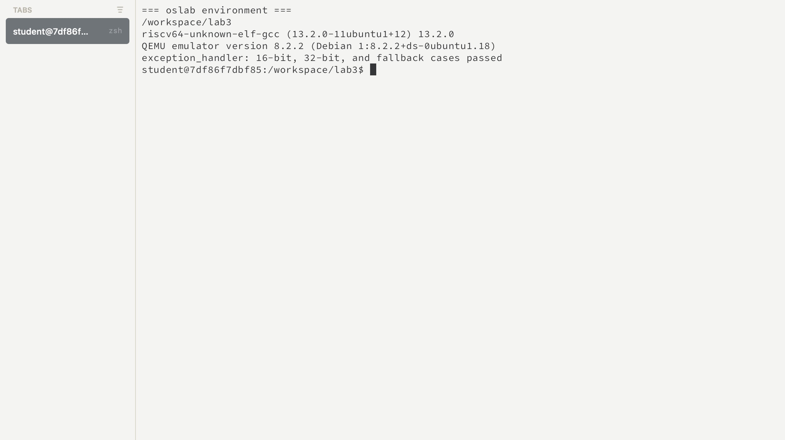
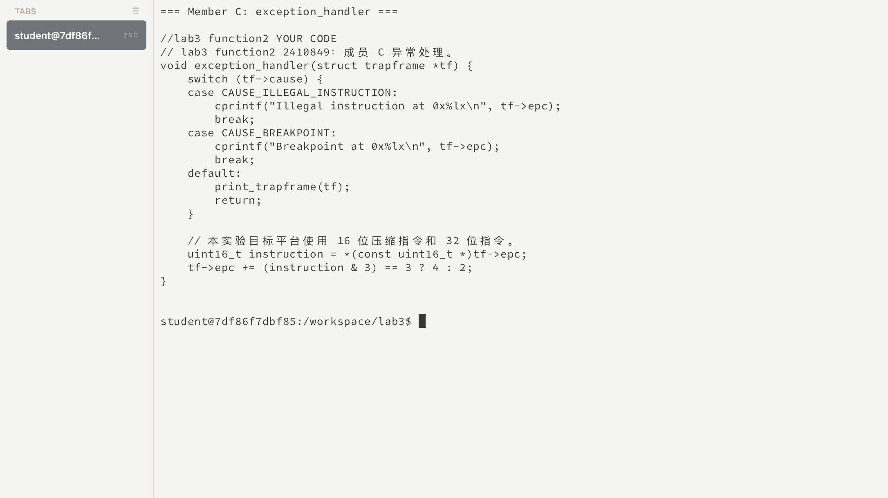
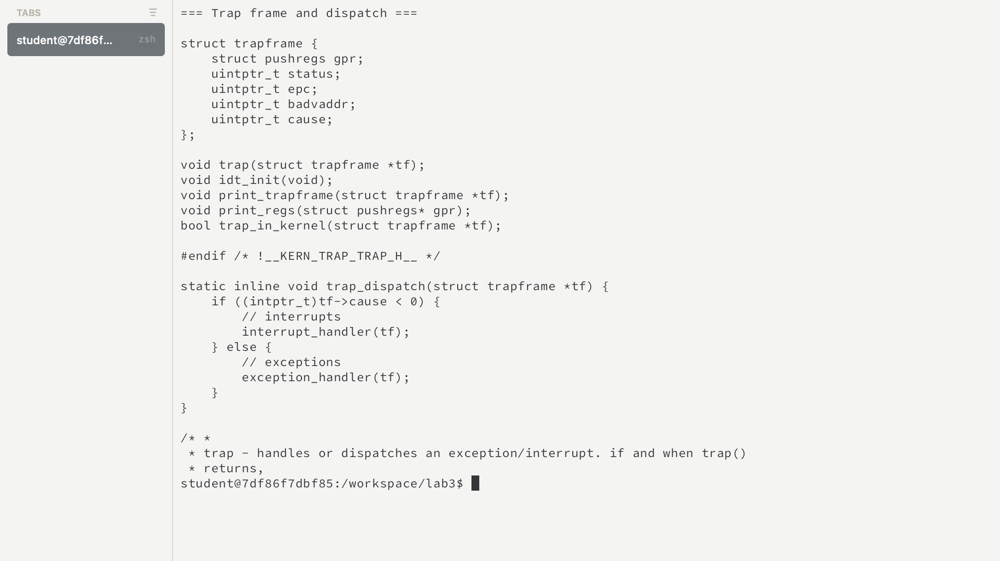
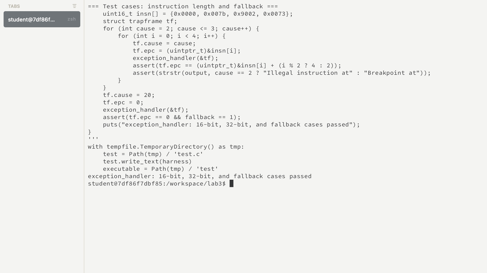
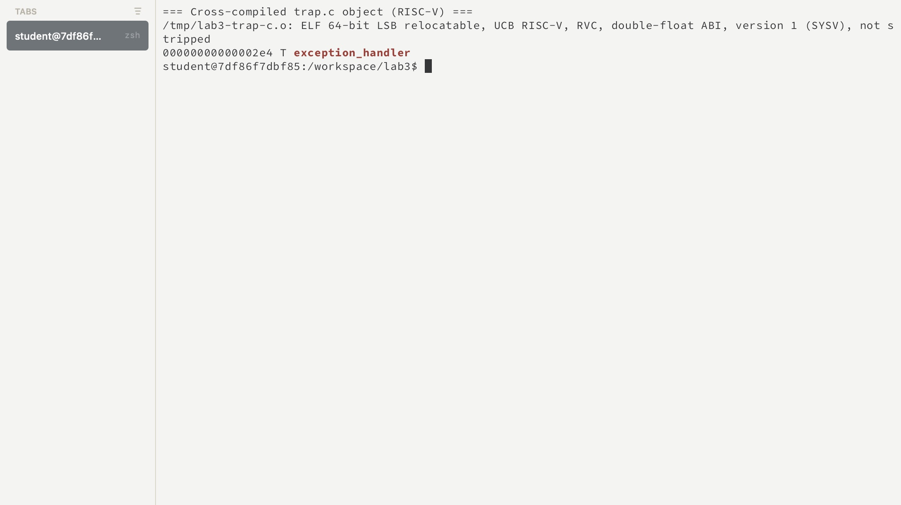
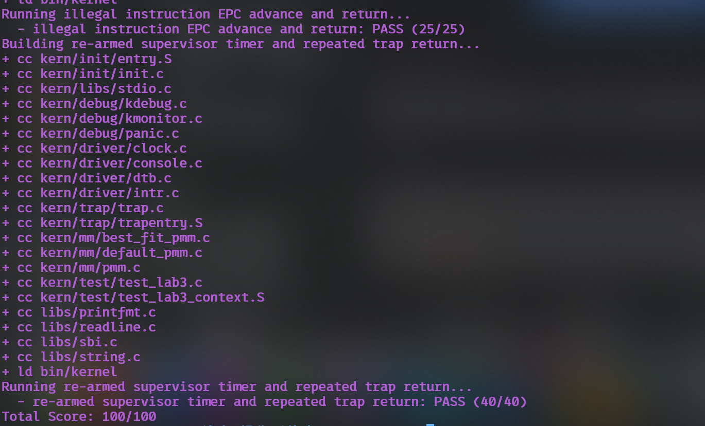
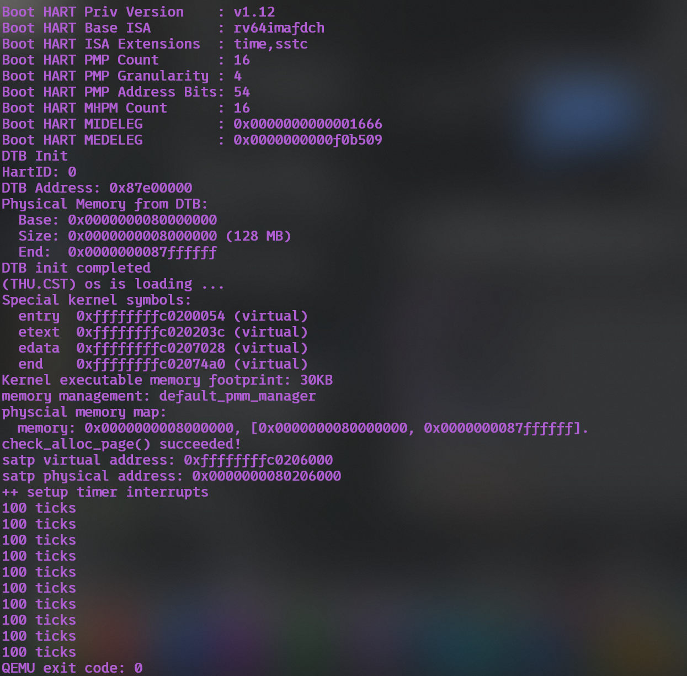

# 操作系统实验报告

## 实验基本信息

| 项目 | 内容 |
|------|------|
| **实验名称** | Lab 3：断，都可以断（中断与异常处理） |
| **小组成员** | 2410878-吕明诺、2410849-张祖浩、2410625-吴宇轩 |
| **完成日期** | 2026-11-07 |

### 小组分工

练习如何分工？

| 成员 | 负责的练习/模块 |
|------|----------------|
| 2410878-吕明诺 | 功能模块一：Trap 上下文恢复与 Trap 入口（练习一，`RESTORE_ALL` / `__alltraps`） |
| 2410849-张祖浩 | 功能模块二：异常处理与返回地址调整（`exception_handler()`）、异常单元测试与整合测试记录 |
| 2410625-吴宇轩 | 功能模块三：中断处理与时钟中断（`interrupt_handler()`） |

实验报告如何分工？

本报告由各成员分别撰写本人负责模块的内容（代码实现、提示词迭代、测试验证、问题记录），最后由小组成员共同检查完整性与准确性。其中，功能模块一与整体逻辑分析、测试汇总由吕明诺整理；功能模块二（异常处理）及其单元测试由张祖浩完成；功能模块三（中断与时钟）由吴宇轩完成。

---

## 一、实验目的

本实验的主要目的是：

1. 理解 RISC-V 架构中的中断与异常处理机制，掌握 Trap 的基本概念、分类以及相关 CSR 寄存器的作用，了解不同特权级下的 Trap 处理过程。

2. 掌握 Trap 发生时 CPU 上下文的保存与恢复方法，理解 TrapFrame 数据结构的作用，以及汇编代码与 C 语言中断处理程序之间的调用关系。

3. 掌握中断与异常的分类及处理方法，能够根据 Trap 原因进行相应处理，实现时钟中断、非法指令异常和断点异常等基本功能。

4. 理解时钟中断的工作原理，掌握时钟初始化、中断使能、定时事件设置和中断计数等操作，验证操作系统能够持续响应时钟中断。

5. 通过编写和调试内核代码，熟悉 RISC-V 操作系统中断处理的完整执行流程，提高对操作系统底层运行机制的理解和实际编程能力。

---

## 二、实验环境

### 使用的 AI 工具

| 成员 | AI 编程工具 | 底层模型 | 备注 |
|------|------------|---------|------|
| 2410625-吴宇轩 |codex CTL|GPT 5.6 Sol | 以提供的源码分析和 GDB 实测记录为依据 |
| 2410849-张祖浩 | Codex 桌面应用 | GPT 6.1 Sol | 辅助环境配置、代码分析；使用 Otty 记录实验结果 |
| 2410878-吕明诺 | DeepSeek Harness | DeepSeek-V4-Flash | 辅助调用链与构建流程分析 |


---

## 三、实验整体逻辑分析

### 3.1 本章节的逻辑主线

本章实验主要围绕 RISC-V 操作系统的中断与异常处理机制展开。在前两个实验中，我们已经完成了最小内核的启动和基本的内存管理功能，但此时内核还缺少对中断和异常的完整处理能力。因此，本章需要在已有内核的基础上，实现 Trap 的上下文保存与恢复、中断和异常的分类处理，以及时钟中断等功能。

整个实验的核心是建立一套完整的 Trap 处理流程。当 CPU 发生中断或异常时，首先由硬件记录相关状态，并跳转到指定的 Trap 入口；然后通过汇编代码保存当前执行环境，进入 C 语言处理函数，根据 Trap 类型执行对应的操作；最后恢复原来的寄存器状态，通过 sret 返回被中断的执行流。

通过这一过程，操作系统就能够在不破坏原有执行状态的情况下处理中断和异常，为后续实现进程调度、系统调用等功能提供基础。

### 3.2 功能的逐步实现

本章实验按照“Trap 上下文管理 → Trap 入口与返回 → 中断和异常处理 → 功能测试”的顺序完成，各部分之间存在一定的依赖关系。

1. Trap 上下文的保存与恢复

首先，需要建立完整的上下文管理机制。实验框架已经提供了 SAVE_ALL 宏，可以将 Trap 发生时的通用寄存器和相关 CSR 保存到栈上的 TrapFrame 中。我们需要在此基础上实现 RESTORE_ALL，根据已有的保存布局恢复寄存器状态，并正确处理栈指针 sp。

之所以先完成这部分，是因为无论发生中断还是异常，都需要保证处理完成后能够恢复原来的执行环境，这是整个 Trap 处理流程正常运行的基础。

2. Trap 入口与返回功能

接着，完善 __alltraps 入口，使系统能够在保存上下文后，将 TrapFrame 的地址按照 RISC-V 函数调用约定传递给 C 语言的 trap() 函数。处理完成后，再通过 __trapret 执行 RESTORE_ALL 和 sret，返回原来的执行流。

这一步主要解决汇编代码与 C 语言处理函数之间的衔接问题，使 Trap 处理能够形成完整的进入和返回流程。

3. 中断与异常的分类处理

在完成底层 Trap 处理框架后，进一步实现 interrupt_handler() 和 exception_handler()。

其中，interrupt_handler() 主要负责处理中断，重点是时钟中断。每次发生时钟中断时，需要更新计数器、设置下一次时钟事件，并在达到规定条件时输出统计信息和执行关机操作。

exception_handler() 主要负责处理非法指令异常和断点异常，根据异常原因输出相应信息，并正确调整 tf->epc，避免处理完成后重复执行触发异常的指令。

这一步使内核不仅能够进入 Trap 处理程序，还能够根据不同的中断和异常类型执行对应的处理逻辑。

4. 整体功能测试与验证

最后，将各部分代码整合并进行编译运行，重点检查 Trap 入口和返回流程是否正常、寄存器状态是否能够正确恢复、时钟中断是否能够持续触发，以及非法指令和断点异常能否得到正确处理。

通过这些测试，验证各个模块之间能否正常配合，确保内核具备基本的中断与异常处理能力，为后续实验打下基础。

---

## 四、实验内容与实现

### 功能模块一：Trap 上下文恢复与 Trap 入口（练习一）

**负责人：** 2410878-吕明诺

#### 模块功能描述

**需要实现/修改的符号（`kern/trap/trapentry.S`）：**

```asm
    .macro RESTORE_ALL      # 从 TrapFrame 恢复处理器状态，与 SAVE_ALL 严格对称
        ...
    .endm

    .globl __alltraps       # Trap 入口点（stvec 指向这里）
__alltraps:
        SAVE_ALL
        ...                 # 把 TrapFrame 基址按调用约定传给 trap()
```

**功能说明：**

本模块负责 Trap 从"进入内核"到"返回原执行流"之间最底层的上下文管理，是整个实验的"地基"：上面的 `interrupt_handler`/`exception_handler` 写得再对，只要上下文恢复错一个寄存器，系统也无法正常运行。

（1）**数据布局：TrapFrame 的 36 个槽位。** `struct trapframe` 由 `struct pushregs`（32 个 `uintptr_t`，依次对应 `x0~x31`）和 4 个 CSR 字段组成，在 RV64 下每个 `uintptr_t` 占 8 字节（`REGBYTES`），所以总大小是 `36 * 8 = 288` 字节：


（2）**`RESTORE_ALL` 要做什么。** 它是 `SAVE_ALL` 的逆操作，但不是简单的"每条 `STORE` 反过来写一条 `LOAD`"，因为有两类东西要特殊对待：**CSR 不能直接从内存写**（RISC-V 只能"通用寄存器 ↔ CSR"），所以必须先用临时寄存器把 `32~35` 槽的值读出来再 `csrw` 回 CSR；**`x2`（sp）不能随手恢复**，因为整个恢复过程都要用 sp 作为基址去寻址，sp 一动，后面所有偏移全错。

（3）**`__alltraps` 要做什么。** 它是 `stvec` 指向的唯一入口（Direct 模式，所有中断与异常都跳到这里）。它做三件事：`SAVE_ALL` 保存现场；把此时 sp 指向的地址作为 `struct trapframe *` 按 RISC-V 调用约定放进 `a0`，调用 `trap()`；`trap()` 返回后落到 `__trapret`，执行 `RESTORE_ALL` 与 `sret`。`jal trap` 会覆盖 `ra`，但 `ra` 已经在 `SAVE_ALL` 里存进 1 号槽，`RESTORE_ALL` 会把它恢复回来，所以不冲突。

（4）**与其它模块的交互。** 向下依赖硬件写好的 `sepc/scause/stval` 与 `sstatus` 的 `SPP/SPIE` 语义；向上供 `kern/trap/trap.c` 中的 `trap()` 使用——`trap()` 只做分发，它可能修改 `tf->epc`（异常处理后要跳过出错指令），所以 `sepc` 的写回必须发生在 `trap()` **返回之后**，否则修改会丢。

（5）**一个必须说清的语义前提。** 本实验 `SAVE_ALL` 第一句就执行 `csrw sscratch, sp`，把陷入前的 sp 写进 `sscratch`，随后 `csrrw s0, sscratch, x0` 把它取出来存到 2 号槽并把 `sscratch` 清 0。因此 **2 号槽里存的是陷入前的 sp，不是 0**。这一点决定了 `x2` 有两种等价恢复方式。


#### 最终提示词

以下是经过迭代后最终使用的提示词（迭代过程见下一节）：

````markdown
# 练习一：Trap 上下文恢复与 Trap 入口功能

## [PROMPT]

**任务：**

修改 `kern/trap/trapentry.S` 文件，完成 Trap 上下文恢复与 Trap 入口功能，主要包括 `RESTORE_ALL` 和 `__alltraps` 两部分。

当 CPU 发生中断或异常时，已有的 `SAVE_ALL` 会将寄存器状态保存到栈上的 TrapFrame 中。需要在此基础上实现上下文恢复，并建立汇编入口与 C 语言 `trap()` 函数之间的调用关系，使系统能够正确完成 Trap 的进入、处理和返回过程。

**操作要求：**

直接修改项目中的实际文件，在标有 `lab3 function1 YOUR CODE` 的位置补充代码。保留已有的 `SAVE_ALL`、`__trapret` 等代码，不要修改 TrapFrame 的结构或现有函数接口，也不要增加与本次练习无关的功能。

**输出要求：**

根据下面提供的已有接口和功能要求完成代码，尽量保持原有代码风格。完成后简要说明新增代码的作用，重点解释寄存器恢复、栈指针处理和 TrapFrame 参数传递的过程。

## [RELY]

本功能可以依赖以下已有代码、宏定义和数据结构：

**1. SAVE_ALL 宏**

`SAVE_ALL` 已经实现了上下文保存功能，会在当前栈上分配 36 个寄存器大小的空间，并按照固定顺序保存 32 个通用寄存器和 4 个 CSR 的值。

其中，原来的 `sp` 会先通过 `sscratch` 临时保存，再写入 TrapFrame 的第 2 个位置。`sstatus`、`sepc`、`stval`和 `scause` 分别保存在第 32～35 个位置。

**2. TrapFrame 数据结构**

`kern/trap/trap.h` 中已经定义了 `struct trapframe`，其中包含保存通用寄存器的 `struct pushregs gpr`，以及 `status`、`epc`、`badvaddr`、`cause` 四个字段。

这些字段的顺序与 `SAVE_ALL` 的保存布局一致，恢复上下文时需要遵循相同的布局。

**3. 已有宏和接口**

- `REGBYTES`：表示当前架构下一个寄存器占用的字节数。
- `LOAD`、`STORE`：用于通用寄存器与内存之间的数据读取和保存。
- `csrr`、`csrw`：用于读取和写入 CSR。
- `trap(struct trapframe *tf)`：已有的 C 语言 Trap 处理接口。
- `__trapret`：已有的 Trap 返回入口，负责执行上下文恢复和 `sret`。

另外，可以依赖 RISC-V 的函数调用约定，其中第一个函数参数通过 `a0` 传递。

## [GUARANTEE]

必须在 `kern/trap/trapentry.S` 中完成以下两个功能：

**1. RESTORE_ALL**

实现与现有 `SAVE_ALL` 对应的汇编宏，负责从 TrapFrame 中恢复 CPU 的寄存器状态，使处理器能够恢复到 Trap 发生前的执行环境。

**2. __alltraps**

补全已有的 `__alltraps` 入口，使其能够在保存上下文后，正确调用 C 语言的 `trap(struct trapframe *tf)` 函数，并在处理完成后进入统一的 Trap 返回流程。

两个功能需要相互配合，形成完整的 Trap 进入、上下文保存、C 语言处理、上下文恢复和返回流程。

## [SPECIFICATION]

### 1. RESTORE_ALL

**Pre-Condition（前置条件）：**

- CPU 已经通过 `SAVE_ALL` 将上下文保存到当前栈上的 TrapFrame 中。
- 当前 `sp` 指向 TrapFrame 的起始地址。
- TrapFrame 的布局与 `struct trapframe` 定义保持一致。
- C 语言的 Trap 处理程序已经执行完成，准备恢复原来的执行状态。

**Post-Condition（后置条件）：**

- 原来保存的通用寄存器能够被正确恢复。
- `sstatus` 和 `sepc` 等返回所需的处理器状态得到正确恢复。
- 栈指针恢复到 Trap 发生前的位置。
- 恢复过程不会破坏仍然需要读取的 TrapFrame 数据。
- 完成恢复后，处理器能够继续执行 `sret`，返回正确的执行位置。

**Case 1：普通寄存器恢复**

对于已经保存在 TrapFrame 中的通用寄存器，需要根据 `SAVE_ALL` 的保存布局恢复原来的值。恢复完成后，寄存器内容应与 Trap 发生前保持一致，其中 `x0` 为恒零寄存器，不需要实际恢复。

**Case 2：栈指针恢复**

`sp` 在 Trap 处理过程中既用于定位 TrapFrame，又是需要恢复的寄存器，因此必须单独考虑。恢复时不能提前破坏当前栈指针，应该保证其他寄存器的数据读取完成后，栈指针能够正确回到 Trap 发生前的位置。

**Case 3：CSR 状态恢复**

需要恢复 Trap 返回所依赖的处理器状态，特别是 `sstatus` 和 `sepc`，保证中断使能状态、原特权级信息以及返回地址正确，使后续 `sret` 能够正常执行。

**Requirements（其他要求）：**

- 恢复布局必须与已有的 `SAVE_ALL` 完全对应。
- 不允许修改 `SAVE_ALL` 和 `struct trapframe` 的定义。
- 注意寄存器恢复的先后顺序，避免覆盖仍在使用的临时数据。
- 不要在恢复完成后留下额外的栈空间占用。

### 2. __alltraps

**Pre-Condition（前置条件）：**

- CPU 已经发生 Trap，并通过 `stvec` 跳转到 `__alltraps`。
- 已有的 `SAVE_ALL` 可以将当前上下文保存为 TrapFrame。
- C 语言中的 `trap(struct trapframe *tf)` 函数已经定义，可以直接调用。

**Post-Condition（后置条件）：**

- Trap 发生时的上下文能够完整保存到 TrapFrame。
- C 语言的 `trap()` 函数能够接收到正确的 TrapFrame 指针。
- `trap()` 可以读取和处理当前的中断或异常信息。
- `trap()` 返回后，程序能够继续进入 `__trapret`，执行上下文恢复并通过 `sret` 返回。
- 整个过程不会丢失原来的寄存器状态。

**Case 1：Trap 入口处理**

当 CPU 进入 `__alltraps` 时，需要利用已有的 `SAVE_ALL` 保存当前上下文，并保证保存后的 TrapFrame 能够被后续处理函数访问。

**Case 2：调用 C 语言处理函数**

上下文保存完成后，需要按照 RISC-V 函数调用约定，将当前 TrapFrame 的地址作为参数传递给 `trap()`。调用过程中即使使用了参数寄存器或返回地址寄存器，也不能影响原来保存的执行状态。

**Case 3：Trap 处理完成后返回**

当 `trap()` 处理完成并返回时，程序需要进入已有的 `__trapret`，通过 `RESTORE_ALL` 恢复上下文，最后执行 `sret` 返回原来的执行流。

**Requirements（其他要求）：**

- 保持 `__alltraps` 和 `__trapret` 原有的入口结构。
- 遵守 RISC-V 函数调用约定，正确传递 TrapFrame 指针。
- 调用 `trap()` 前后应保证栈指针与 TrapFrame 的关系正确。
- 不修改 `trap()` 的函数签名，也不额外增加不必要的处理流程。
````

#### 实现迭代过程

本模块的实现经历了 2 次迭代，过程如下：

---

##### 第一次迭代

**遇到的问题：**

- 问题 1：栈指针 sp 的恢复顺序不正确。 第一版代码将 sp 当作普通寄存器恢复，过早修改了栈指针。但后面的寄存器恢复还需要通过 sp 定位 TrapFrame，因此会造成读取地址错误，导致上下文恢复失败。
- 问题 2：CSR 恢复不完整。 初始代码主要考虑通用寄存器的恢复，遗漏了 sstatus、sepc 等 CSR。由于 sret 需要依赖这些寄存器恢复处理器状态和返回地址，因此可能导致 Trap 返回异常。

**问题解决策略：**

- 针对问题 1：在提示词的 [RELY] 中补充 SAVE_ALL 的寄存器保存布局，并在 [SPECIFICATION] 中明确要求 sp 必须在其他寄存器恢复完成后再恢复，防止后续内存访问出现错误。
- 针对问题 2：在 [SPECIFICATION] 的 Post-Condition 中补充 CSR 恢复要求，特别强调 sstatus 和 sepc 必须在执行 sret 前正确恢复，保证 Trap 能够正常返回。

此外，在检查 SAVE_ALL 时，还发现之前对 sscratch 的理解不够准确。通过重新分析相关指令，确认 TrapFrame 第 2 个槽位保存的是 Trap 发生前的 sp，并修正了相关注释。

---

##### 第二次迭代

**遇到的问题：**

- 问题 1：Test 1 测试未通过。 完成代码后，使用 make grade 进行验证，出现 FAIL (register context)。一开始怀疑是 RESTORE_ALL 没有正确恢复寄存器。
- 问题 2：异常返回地址计算错误。 通过临时异常处理函数打印 TrapFrame，发现相关通用寄存器的保存值正常。随后使用 objdump 查看反汇编代码，发现测试中的 ebreak 实际被编译为 2 字节的压缩指令 c.ebreak，而临时异常处理函数使用固定的 tf->epc += 4，导致返回位置错误。

**问题解决策略：**

- 针对问题 1：没有直接修改 RESTORE_ALL，而是先打印 TrapFrame 中的寄存器值，逐步排查上下文保存、参数传递和恢复过程，缩小问题范围。

- 针对问题2： 修改临时异常处理函数，使其根据实际指令长度调整 tf->epc。同时在调试要求中补充反汇编检查，避免默认所有 RISC-V 指令都是 4 字节。

修改后重新运行测试，Test 1 成功通过。由于问题出现在单独验证练习一时使用的临时异常处理函数中，因此没有修改其他组员负责的正式 exception_handler()。

**最终结果：**

经过 2 次迭代，该模块最终：

- ✅ 编译通过，未出现编译错误。
- ✅ Test 1 测试通过：[Test 1] Trap entry and breakpoint return: PASS (35/35)。
- ✅ 实现了 RESTORE_ALL 和 __alltraps，在当前测试条件下能够完成 Trap 入口、上下文恢复和正常返回。

**关键改进点总结（如有）：**

1. 在 [RELY] 中补充了 SAVE_ALL 的真实保存布局，明确了各个寄存器在 TrapFrame 中的位置，以及 sscratch 保存原始 sp 的过程。
2. 在 [SPECIFICATION] 中增加了寄存器恢复顺序和 CSR 状态恢复的要求，避免提前修改 sp 或遗漏 Trap 返回所需的状态。
3. 在测试与调试要求中补充了对异常指令长度的检查，避免因返回地址计算错误而影响测试结果。


---

### 功能模块二：异常处理与返回地址调整

**负责人：** 2410849-张祖浩

#### 模块功能描述

**需要实现的函数：**

```c
/* kern/trap/trap.c */
void exception_handler(struct trapframe *tf);
```

**功能说明：**

函数依据 `tf->cause` 处理 `CAUSE_ILLEGAL_INSTRUCTION` 和 `CAUSE_BREAKPOINT`，输出异常地址并跳过引发异常的指令。其他异常调用 `print_trapframe(tf)`；函数本身不负责恢复寄存器，而是将调整后的 frame 交给统一返回流程。

**Spec：**

- 两类指定异常分别输出 `Illegal instruction at`、`Breakpoint at` 和异常地址。
- 读取 `tf->epc` 指向指令的前 16 位，低两位不为 `11` 时按 2 字节更新 `epc`，否则按 4 字节更新。
- 其他异常输出 trapframe，保持 `epc` 原值，不解引用该地址。
- 保持接口及既有函数不变；本实验测试前提是异常指令位于内核可读取地址，指令长度为 16 或 32 位。

#### 异常处理与返回流程

异常发生后，处理器将异常原因和指令位置分别保存在 `scause`、`sepc` 中。入口汇编保存这些寄存器，形成 `struct trapframe`，再将其地址传给 `trap()`。`trap_dispatch()` 根据 `cause` 的最高位将中断和异常分开；对于异常，将同一个 `tf` 交给 `exception_handler()`。因此，这个函数中的 `tf->epc` 是返回地址在内存中的副本，后续恢复代码（功能模块一的 `RESTORE_ALL`）需要将修改后的值写回 `sepc`，`sret` 才能从新的位置继续执行。

这里的处理目标是跳过实验要求的两类异常指令。假设某条 4 字节非法指令的地址为 `0x1000`，如果处理后 `epc` 仍为 `0x1000`，返回后会再次执行这条指令，可能反复进入异常。将 `epc` 调整为 `0x1004` 后，统一返回流程才能继续执行下一条指令。这个处理策略只针对实验指定的非法指令和断点，不能推广到所有异常：例如缺页异常的处理目标恰恰相反——修复映射后需要**重新执行**出错指令，因此不能推进 `epc`。

#### 关键代码与分支分析

```c
switch (tf->cause) {
case CAUSE_ILLEGAL_INSTRUCTION:
    cprintf("Illegal instruction at 0x%lx\n", tf->epc);
    break;
case CAUSE_BREAKPOINT:
    cprintf("Breakpoint at 0x%lx\n", tf->epc);
    break;
default:
    print_trapframe(tf);
    return;
}

uint16_t instruction = *(const uint16_t *)tf->epc;
tf->epc += (instruction & 3) == 3 ? 4 : 2;
```

`switch` 首先识别异常类型。两个指定分支分别输出异常名称和当前地址，`break` 结束 `switch`，然后共同执行下面的地址更新；输出发生在地址更新之前，所以打印的是触发异常的指令地址。默认分支调用 `print_trapframe(tf)` 输出现场，再用 `return` 结束函数，避免对未知异常读取指令或擅自修改返回地址。打印现场只提供诊断信息，并不表示未知异常已经恢复。

判断指令长度时，`(const uint16_t *)tf->epc` 将保存的地址解释为指向 16 位数据的指针，解引用取得指令的第一个半字。`instruction & 3` 保留最低两位：在本实验的 16 位、32 位指令范围内，最低两位不是 `11` 时将 `epc` 增加 2 字节，是 `11` 时增加 4 字节。例如 `0x9002 & 3` 的结果为 2，因此前进 2 字节；`0x007b & 3` 的结果为 3，因此前进 4 字节。

直接读取 `epc` 所指地址依赖本实验中的内核指令可读取这一前提。若地址不可读取，读取过程本身可能再次触发异常；而 48 位及更长指令也不在当前长度判断的覆盖范围内。这些情况不能因为现有测试通过就认为已经解决。

#### 最终提示词

根据实验要求和现有代码，将异常处理的目标、依赖接口和边界条件整理为以下提示词，供实现和复核使用：

````text
[PROMPT]
我负责 Lab 3 的异常处理部分。请先阅读课程提供的 RISC-V ucore 代码框架，
再在 kern/trap/trap.c 中实现 exception_handler(struct trapframe *tf)。
函数需要识别非法指令异常和断点异常，输出异常信息，调整返回地址，
使 Trap 返回后继续执行后续指令。请说明代码中每个分支和返回地址调整的原因。

[RELY]
1. kern/trap/trap.h 中的 struct trapframe 保存了本次 Trap 的上下文：
   tf->cause 表示异常原因，tf->epc 保存异常发生时的指令地址。
2. kern/trap/trap.c 中的 trap_dispatch() 已经区分中断和异常；
   exception_handler() 接收到的是需要处理的异常。
3. libs/riscv.h 已定义 CAUSE_ILLEGAL_INSTRUCTION、CAUSE_BREAKPOINT；
   可使用 cprintf() 输出信息，使用 print_trapframe(tf) 输出完整现场。
4. 本实验的测试指令位于内核可以读取的地址，考虑 16 位压缩指令和
   32 位指令；Trap frame 的恢复和 sret 由统一返回流程完成。

[GUARANTEE]
保持现有函数接口：
    void exception_handler(struct trapframe *tf);
只实现异常处理所需的代码，保留已有函数、结构体和实验注释，
不要更改 Trap frame 布局、trap_dispatch() 或其他成员负责的函数。

[SPECIFICATION]
前置条件：tf 指向当前有效的 Trap frame；对于需要跳过的实验指令，
tf->epc 指向内核可以读取的指令地址。

情况一：tf->cause 为 CAUSE_ILLEGAL_INSTRUCTION。
输出以 Illegal instruction at 开头的信息及原异常地址，随后根据
触发异常的指令长度更新 tf->epc，避免返回后再次执行同一条指令。

情况二：tf->cause 为 CAUSE_BREAKPOINT。
输出以 Breakpoint at 开头的信息及原异常地址，同样根据指令长度
更新 tf->epc，使断点处理结束后可以继续执行。

返回地址的计算：读取异常地址处的第一个 16 位半字，检查最低两位。
在本实验的 16 位和 32 位指令范围内，最低两位不是二进制 11 时加 2
字节，是 11 时加 4 字节。不能对两种指令都使用固定的地址增量。

情况三：其他异常。
调用 print_trapframe(tf) 输出异常现场，保持 tf->epc 不变，
不尝试读取该地址处的指令，也不假设其他异常已经被恢复。

后置条件：两类指定异常输出原地址并正确更新 frame 中的 epc；
其他异常保留原 epc。不得直接改写与本任务无关的上下文。

[验证要求]
分别检查非法指令和断点在 16 位、32 位两种编码下的地址变化，
验证输出前缀；再检查未知异常是否调用 print_trapframe() 且不修改 epc。
使用课程提供的 RISC-V 交叉编译器检查代码，并记录实际执行的测试及结果。
````

#### 实现和调试过程

根据实验要求在 `kern/trap/trap.c` 中实现异常处理，增加学号标记。针对指令长度建立宿主机测试，覆盖两类异常、两种长度及未知异常。最初在宿主机用 Apple Clang 做检查时，因 `-Wunused-function` 被 `-Werror` 升级而失败；调整警告选项顺序后，RISC-V 目标语法检查通过。随后发现本机 Clang 没有 RISC-V 代码生成后端，因此进入 `oslab` 容器，使用课程交叉编译器编译该源文件。

在调试过程中还确认了一处与功能模块一的接口约定：`exception_handler()` 只修改内存中的 `tf->epc`，不直接写 `sepc`；`sepc` 的写回发生在 `RESTORE_ALL` 里、在 `trap()` 返回之后。若在两处都写，反而容易出现“改了又覆盖”的问题。

---

### 功能模块三：中断处理与时钟中断（组员 B）

**负责人：** 2410625-吴宇轩

#### 模块功能描述

本模块承接练习一保存好的 TrapFrame。处理器把事件原因写入 `scause`，汇编入口将它保存在 `tf->cause`。`trap_dispatch()` 用最高位区分异步中断和同步异常。进入 `interrupt_handler()` 后，仅屏蔽最高位，保留原因编号，再通过 `switch` 分类。时钟中断走调度下一次事件、累计 tick、周期输出、达到次数后关机的路径。其他已定义类型输出诊断提示。未知编号输出原因并调用 `print_trapframe(tf)`。中断分支不修改 `tf->epc`，返回时由练习一的恢复代码及 `sret` 继续原执行流。

#### 关键代码与分支分析

```c
const uintptr_t interrupt_bit = (uintptr_t)1 << (sizeof(uintptr_t) * 8 - 1);
const uintptr_t cause = tf->cause & ~interrupt_bit;
/* switch (cause) 中的时钟分支 */
case IRQ_S_TIMER:
    clock_set_next_event();
    if (++ticks % TICK_NUM == 0) {
        print_ticks();
        if (++reports == SHUTDOWN_AFTER) {
            sbi_shutdown();
        }
    }
    break;
```

`clock_init()` 启用监督级时钟中断，调用 `clock_set_next_event()` 安排首次事件，并把 `ticks` 归零。后者读取 `rdtime`，以当前时间加 `timebase` 计算下一次绝对截止时间，再交给 SBI。该接口设置的是一次性事件，因此处理每次 IRQ 都要重设。按 QEMU 约 10 MHz 时间基准和当前 100000 的增量，名义间隔约 10 ms。处理时间和虚拟机调度会影响实际间隔。

`ticks` 表示累计处理的时钟中断数，每次只增加一次。`reports` 是函数内部静态变量，仅在打印后增加。每累计 100 次调用已有 `print_ticks()` 输出 `100 ticks`，普通运行第 10 次输出后请求 SBI 关机，也就是累计第 1000 次。现有 `DEBUG_GRADE` 条件下 `print_ticks()` 自带提前结束逻辑。其余识别分支只用于分类诊断，没有实现设备中断控制器应答。

#### 最终提示词

完整提示词与规格见 [prompt_b.md](./prompt_b.md)。沿用组员 A 的 [PROMPT]、[RELY]、[GUARANTEE]、[SPECIFICATION] 四段，先限定允许修改的代码，再列出依赖、计数边界和验收输出。测试时将原因值最高位、S 态软件中断、未知原因和 200 tick 后的返回分开观察，以免单次打印掩盖重设错误。

#### 实现和调试过程

合并前的框架在 `trap_dispatch()` 调用 `interrupt_handler()`，但缺少对应定义。补上函数并保留 A、C 的实现后，交叉编译日志已出现 `+ cc kern/trap/trap.c`，并继续到物理内存模块。首次整体验证发现 Lab 2 依赖存在空位，编译在 `best_fit_pmm.c` 报 `free_list` 和 `nr_free` 未声明。该问题发生在前置代码，不能据此给时钟处理评分。分支审阅时重点检查了三种潜在错误：直接使用带最高位的原因值做匹配、只设置首次时钟事件、将 100 次中断误写成关机阈值。当前实现分别通过最高位掩码、每次重设和独立输出计数处理。此处只记录可复现的故障与审阅风险，不把风险写成已发生的 AI 生成事故。

---

## 五、测试与验证

### 5.1 功能模块一：Trap 入口与上下文恢复

| 验证内容 | 结果与含义 |
|---|---|
| `trapentry.S` 汇编 | `-Wall -Werror` 下零错误零警告，`objdump` 可见 `__alltraps` 四字节对齐（`.align(2)`） |
| Test 1：Trap 入口、寄存器恢复、断点返回 | `[Test 1] Trap entry and breakpoint return: PASS (35/35)`，说明 26 个通用寄存器能够原样恢复，且 `sret` 回到了正确位置 |
| 恢复顺序正确性 | 若把 `x2` 的恢复提前，后续 `LOAD` 全部错位，运行直接跑飞（行为对照） |
| 槽位语义核对 | `tf->gpr.sp == tf + 36*REGBYTES`，证明 2 号槽是陷入前的 sp |
| 指令长度核对 | `ebreak` 编码为 `0x9002`（2 字节），`epc` 推进必须按 `(insn & 0x3) == 0x3 ? 4 : 2` |

`make grade` 中 Test 1 的实际输出：

```text
[Test 1] Trap entry and breakpoint return: PASS (35/35)
```

### 5.2 功能模块二：异常处理单元测试与交叉编译

在 `oslab` 容器内执行 `python3 tests/test_exception_handler.py`。测试直接提取当前异常处理函数，用构造的 Trap frame 检查非法指令、断点在 16 位和 32 位编码下的地址变化，并检查未知异常的兜底分支。测试通过；**这是宿主进程中的逻辑检查，不代表真实 Trap 返回已验证**。



异常处理函数根据 `cause` 选择分支，并在指定异常中根据指令长度更新 `epc`：



Trap frame 保存异常现场，`trap_dispatch()` 根据最高位将处理交给对应函数：



下图展示具体的两种指令长度、异常类型及兜底检查，测试脚本输出通过：



本次测试用构造的半字数据检查地址计算，并不把每个数组元素都当成一次真实的 CPU 异常。两类异常分别执行下列长度判断：

| 输入的首半字 | 最低两位 | 预期地址增量 | 检查内容 |
| --- | --- | --- | --- |
| `0x0000` | `00` | 2 字节 | 非法指令和断点分支分别检查返回地址与输出前缀 |
| `0x007b` | `11` | 4 字节 | 同上 |
| `0x9002` | `10` | 2 字节 | 同上 |
| `0x0073` | `11` | 4 字节 | 同上 |

测试还构造 `cause = 20`、`epc = 0` 的情况：预期调用兜底函数且 `epc` 保持为 0。若代码错误地进入指令读取，零地址也能帮助暴露该问题。实际执行命令与结果如下：

```text
$ python3 tests/test_exception_handler.py
exception_handler: 16-bit, 32-bit, and fallback cases passed
```

脚本使用 `assert` 检查地址增量、输出前缀、兜底调用次数；任何断言失败都不会输出以上通过信息。它验证的是函数在这些构造输入下的行为，并不包含寄存器保存、恢复和 `sret` 的真实执行。

在课程环境使用 RISC-V 交叉编译器编译 `trap.c`，通过临时头文件提供 `interrupt_handler()` 声明，生成的目标文件包含 `exception_handler` 符号。该检查针对单个源文件，尚不等同于完整内核链接。



`file` 将产物识别为 64 位 RISC-V 可重定位 ELF 文件，`nm` 显示其中包含 `exception_handler` 符号。交叉编译确认了该源文件能够生成目标架构的目标文件；链接成完整内核及实际 Trap 返回还需要结合其余模块进行验证。

### 5.3 三个模块整合验证

本次在 WSL Ubuntu 24.04 上使用 RISC-V 交叉编译器与 QEMU virt 运行完整内核。仓库评分脚本在临时副本注入用例，保留提交源码。结果来自同一份合并代码。

| 检查 | 覆盖范围 | 结果 |
|---|---|---|
| Test 1 | Trap 入口、寄存器恢复和断点返回 | PASS (35/35) |
| Test 2 | 非法指令返回、S 态软件中断和未知原因诊断 | PASS (25/25) |
| Test 3 | S 态时钟持续重设与多次 Trap 返回，检查 ticks=200 | PASS (40/40) |
| 普通 make qemu | 初始化、时钟输出计数和 SBI 关机 | 输出 10 行 100 ticks，进程退出码 0 |

合计 **100/100**。原始结果见 [评分日志](./grade-lab3.log) 与 [普通启动串口日志](./qemu-lab3.log)。5.1、5.2 保留组员各自早期验证的条件和记录。



图 13　整合评分结果。截图包含 Test 2、Test 3 和总分，Test 1 的完整结果见评分日志。



图 14　普通启动完成时钟初始化，输出十行 100 ticks 后正常关机。

#### 整合中发现的问题与处理

工具链兼容性检查中，汇编器对旧 CSR 名称 sbadaddr 报 unknown CSR。SAVE_ALL 和 RESTORE_ALL 改用标准名称 stval，读写仍对应 TrapFrame 第 34 槽。

1. **前置代码空位。** 首次编译在 Best-Fit 检查处缺少空闲链表和计数定义，物理内存初始化也有 Lab 2 空位。从同仓库 lab2 分支的 8fcd03f 补入原有分配器和 page_init，只接回缺少的模块。移植时发现旧的 PHYSICAL_MEMORY_END 在当前头文件未定义，改用 KERNTOP 减去现有虚实地址偏移计算相同的物理上界。
2. **固件入口与页表切换。** 初次整核链接成功后，串口仅有 OpenSBI 日志，Next Address 为 0。将 QEMU 的镜像参数改为 -kernel 后，固件的下一入口为 0x80200000，但仍未到 C 初始化。检查 entry.S 后发现写入 satp 的瞬间，下一条指令仍从低地址取指，原表仅映射高半区。增加启动阶段的低地址恒等映射，保留高半区映射，随后正常进入内核并完成评分。
3. **区分周期与终止。** 评分用例验证到 200 tick，可覆盖第二次周期输出。另以普通启动验证 1000 tick 和关机边界。两种运行分别保留日志，避免把评分脚本超时当作正常关机。

## 六、实验总结与收获

### 对操作系统的理解

#### 6.1 重要知识点与 OS 原理的联系、差异

| 实验知识点 | 对应 OS 原理 | 含义、联系与差异 |
|---|---|---|
| RISC-V 中断与异常机制 | 中断与异常处理 | 本实验中，Trap 是中断和异常的统称。中断一般由时钟或外部设备等异步事件触发，异常则由当前执行的指令触发。操作系统需要根据不同的原因采取对应的处理方式。 |
| RISC-V 特权级与中断委托 | 用户态与内核态、特权级管理 | RISC-V 包含 M、S、U 三种特权级，通过 `mideleg` 和 `medeleg` 可以将部分中断与异常委托给 S 模式处理。本实验主要在 S 模式下处理中断和异常，没有完整实现用户态与内核态之间的切换。 |
| Trap 入口与中断分发 | 中断向量表与中断处理程序 | 本实验通过 `stvec` 设置统一的 Trap 入口 `__alltraps`，再利用 `scause` 判断中断或异常类型，并调用对应的处理函数。相比原理课中介绍的中断向量表，这里采用统一入口后由软件分类处理的方式。 |
| TrapFrame 与上下文管理 | 处理器上下文保存与恢复 | 使用 `struct trapframe` 保存发生 Trap 时的通用寄存器和相关 CSR，使处理程序能够访问原来的 CPU 状态。它体现了操作系统中保存现场、处理事件、恢复现场的基本思想。 |
| `SAVE_ALL` 与 `RESTORE_ALL` | 上下文切换与恢复 | `SAVE_ALL` 将寄存器状态保存到栈上，`RESTORE_ALL` 根据相同的布局恢复状态。两者必须保持对应关系，否则可能造成寄存器数据错误。实际操作系统中的上下文管理还会涉及进程切换等更复杂的情况。 |
| CSR 与 Trap 返回机制 | 处理器状态管理 | `sstatus`、`sepc`、`scause` 等 CSR 分别记录处理器状态、返回地址和 Trap 原因。处理中断或异常时，需要正确维护相关状态，最后通过 `sret` 返回原来的执行流。 |
| 中断与异常分类处理 | 中断处理程序与异常处理程序 | 本实验通过 `trap_dispatch()` 区分中断和异常，再分别调用 `interrupt_handler()` 和 `exception_handler()`。这种分类处理方式与操作系统原理中根据事件类型选择处理程序的思想一致。 |
| 时钟中断处理 | 系统时钟与进程调度 | 本实验利用 OpenSBI 设置时钟事件，通过 `ticks` 记录中断次数，并在每次中断后设置下一次时钟事件。时钟中断也是操作系统实现时间片轮转和抢占式调度的重要基础，但本实验还没有实现真正的进程调度。 |
| 非法指令与断点异常 | 异常检测与处理 | 本实验通过 `scause` 识别非法指令和断点异常，并输出对应信息。处理完成后需要根据指令长度调整 `tf->epc`，避免重复执行已经处理的异常指令。相比之下，缺页异常在完成修复后通常需要重新执行原指令。 |
| 中断使能与临界区保护 | 进程同步、互斥与原子性 | 本实验通过 `intr_enable()`、`intr_disable()` 和 `local_intr_save/restore` 控制中断状态，保护部分内核关键操作。它体现了操作系统中的临界区保护思想，但在多核系统中还需要结合锁等同步机制。 |
| 16 / 32 位混合指令编码 | 变长指令集与对齐 | 压缩指令让指令边界不再固定为 4 字节，任何“按 4 字节步进”的假设（包括异常返回地址调整）都必须先看低两位是否为 `11`。 |
| `satp` 切换与指令提取 | 分页与地址空间切换 | 设置 `satp` 后，取指也要经过地址翻译；切换页表的瞬间必须保证当前指令地址仍有有效映射，否则会因为取指失败而再次陷入。 |

#### 6.2 OS 原理中很重要、但本实验没有对应上的知识点

1. **中断嵌套与优先级**：本实验处理中断期间 `SIE = 0`，不会发生嵌套；真实系统要处理高优先级中断抢占低优先级处理程序、中断栈与嵌套深度限制。
2. **中断下半部 / 软中断 / 工作队列**：实验把所有事情都放在中断上下文里做完（包括 `cprintf`），真实内核会把耗时工作推迟到下半部，避免长时间关中断。
3. **可重入与并发保护**：单核、关中断的前提下没有真正的并发；多核 SMP 下的 per-CPU 数据结构、IPI（核间中断）与锁竞争完全未涉及。
4. **外部中断控制器（PLIC）**：实验只用到 S 态时钟中断（`IRQ_S_TIMER`），没有设备中断的申请、使能、优先级与应答流程。
5. **用户态与特权级切换**：本实验所有 Trap 都发生在内核态，`SPP` 恒为 1；U→S 的栈切换（`sscratch` 交换）、系统调用（`ecall`）路径未覆盖。
6. **缺页异常与按需分页**：`CAUSE_FAULT_LOAD/STORE` 在本实验里只是 `print_trapframe` 兜底输出，没有真正的页面置换、写时复制。
7. **抢占式调度**：时钟中断只做计数和打印，没有触发调度器；"中断返回时选择下一个进程"这一关键衔接没有出现。
8. **异常的语义化处理**：真实系统会把异常翻译成信号（如 `SIGSEGV`、`SIGILL`）交给进程，本实验只是打印并跳过。
9. **用户态地址的安全读取**：异常处理直接解引用 `tf->epc` 读取指令半字，前提是该地址在内核可读范围内；真实内核读取用户指针必须做合法性校验，否则可能引发二次异常或泄露内核数据，本实验未涉及。
10. **超长指令与多套指令集**：指令长度判断只覆盖 16 / 32 位，48 位及以上编码不在范围内。

### AI 协作开发的经验

1. 提示词要尽量具体、清楚。 一开始如果只是简单告诉 AI 要实现哪个函数，生成的代码可能会遗漏一些关键细节。后来我们按照 [PROMPT]、[RELY]、[GUARANTEE] 和 [SPECIFICATION] 四部分组织提示词，把已有接口、功能要求和限制条件说明清楚，生成的代码也更符合实验要求。

2. 不能完全依赖 AI 生成的代码。 在实现 Trap 上下文恢复时，我们发现寄存器的恢复顺序非常重要。例如，过早修改 sp 就可能导致后续寄存器读取错误。因此，即使 AI 已经生成代码，也需要结合实验指导书和已有代码逐步检查，理解每段代码的实际作用。

3. 遇到问题要结合工具进行分析。 在测试过程中，我们曾遇到寄存器检查失败的情况。开始以为是上下文恢复代码有问题，后来通过查看 TrapFrame 和使用 objdump 分析反汇编，发现是临时异常处理函数没有正确考虑指令长度。这让我们认识到，不能只根据报错信息判断问题，还需要结合实际运行结果逐步排查。

4. AI 更适合作为辅助工具，而不是直接代替思考。 这次实验中，AI 帮助我们理解了一些比较复杂的汇编指令和中断处理流程，提高了代码编写和问题排查的效率。但最终还是需要自己检查代码、进行测试，并根据实际情况调整实现方式。

5. 给出数据结构、允许修改的范围和返回条件，比只说“完成异常处理”更容易得到可检查的实现。 异常处理的提示词里明确写出了 `struct trapframe` 的字段、`trap_dispatch()` 已经做过分发、只能改 `exception_handler()`，并把“指令长度判断”的规则和边界（16/32 位、地址可读）写在前置条件里，因此生成的代码在复核时基本可用。

6. 测试需要区分“函数逻辑检查”与“系统运行验证”。 异常处理的脚本是用构造的 Trap frame 调函数，它能覆盖分支与地址计算，但没有经历“硬件压栈 → 汇编保存 → C 处理 → 汇编恢复 → `sret`”这条真实路径；因此报告里必须写“逻辑检查通过，不代表真实 Trap 返回已验证”，不能混为一谈。

---

