# 操作系统实验报告

## 实验基本信息

| 项目 | 内容 |
| --- | --- |
| **实验名称** | Lab 2：物理内存和页表 |
| **小组成员** | 2410878-吕明诺、2410849-张祖浩、2410625-吴宇轩 |
| **完成日期** | 2026-10-24 |

### 小组分工

| 成员 | 负责的练习/模块 |
| --- | --- |
| 2410878-吕明诺（A） | 功能模块一 任务一：物理内存探测与页描述符初始化（`page_init`）；功能模块一 Challenge：可用物理内存范围的获取方法；功能模块二 任务一：理解 First-Fit；分支任务 GDB 调试要求 1、2 |
| 2410849-张祖浩（B） | 功能模块二 任务二：Best-Fit 连续物理内存分配算法；扩展任务 Challenge：SLUB 分配算法；分支任务 GDB 调试要求 3、4 |
| 2410625-吴宇轩（C） | 功能模块二 任务三：Buddy System 伙伴系统分配算法；分支任务 GDB 调试要求 5、6 |

**实验报告分工：** 本实验报告由小组三名成员共同完成。各成员分别负责本人所承担实验任务的代码实现、测试验证、实验过程记录及对应报告内容的撰写，包括相关原理分析、关键代码说明、运行结果和问题总结等。完成各自负责的部分后，小组成员共同检查报告内容的完整性与准确性。

---

## 一、实验目的

本实验的主要目的是：

1. 理解操作系统如何通过设备树（DTB）获取物理内存的起始地址和容量，并在排除内核镜像、Page 描述符数组等已占用区域后，确定可用物理内存范围；掌握使用 Page 描述符数组对物理内存进行页粒度管理的方法。
2. 掌握连续物理内存分配算法（First-Fit、Best-Fit、Buddy System）的基本原理，理解空闲块的组织、切分、分配、回收与合并过程，并分析内存碎片的产生原因及相应的优化方法。
3. 理解虚拟地址、物理地址、物理页号与 Page 描述符之间的关系，掌握相关地址的转换方法，并理解为什么内核镜像和 Page 描述符数组占用的物理内存不能被重复分配。
4. 学习在 AI辅助下进行内核代码的编写、分析与调试，掌握编写明确的任务规格和提示词的方法，能够识别 AI 生成代码中的潜在问题，并通过实际编译、运行和测试结果验证代码的正确性。

---

## 二、实验环境

### 使用的 AI 工具

| 成员 | AI 编程工具 | 底层模型 | 备注 |
| --- | --- | --- | --- |
| 2410625-吴宇轩 | Codex（桌面应用与 WSL） | GPT-5.6 Sol | 辅助 Buddy 实现、边界测试、GDB 问题定位与报告合并 |
| 2410849-张祖浩 | Codex 桌面应用 | 未单独记录 | 辅助 Best-Fit、SLUB、双 GDB 调试与报告整理 |
| 2410878-吕明诺 | DeepSeek Harness | DeepSeek-V4-Flash | 辅助调用链与构建流程分析 |

**说明：** 未保存的模型版本不根据工具名称推断；报告中的 AI 结论均以实际源码、编译输出、测试或 GDB 记录复核。

实验运行环境：

| 成员 | 实验环境与工具 | 说明 |
| --- | --- | --- |
| 吴宇轩 | Windows + WSL2 Ubuntu 24.04；QEMU 8.2.2；OpenSBI 1.3；RISC-V 交叉工具链 | 使用 `-kernel` 完成新版 QEMU 的入口交接；验证 Buddy 的 64/128/256 MiB 配置 |
| 张祖浩 | Apple Silicon macOS；ARM64 Ubuntu 24.04 容器；QEMU 8.2.2；单独调试构建 QEMU 4.1.1 | 使用宿主 GDB 和客体多架构 GDB 观察软件 TLB 与页表翻译 |
| 吕明诺 | Ubuntu 虚拟机；RISC-V 工具链；QEMU 与 GDB | 完成 Page Init、First-Fit 和 GDB 要求 1、2；其截图中部分版本与其他成员不同 |

---

## 三、实验整体逻辑分析

### 3.1 本章节的逻辑主线

本章节主要围绕一个问题展开：内核怎样知道自己有多少物理内存可以使用，又该怎样管理和分配这些内存？
在 Lab1 中，我们主要实现了内核的启动，让内核能够正常运行。而到了 Lab2，除了实现分页机制，还需要让内核能够主动管理物理内存。要做到这一点，首先得知道内存在哪里、有多大，然后为物理页面建立对应的 Page 描述符，记录每个页面的状态，最后把可以使用的空闲页面交给内存分配器统一管理。
所以这一部分的主要流程可以概括为：

```
发现内存（通过 DTB 获取内存信息）
            ↓
确定哪些物理内存可以管理
            ↓
建立 Page 描述符数组
            ↓
排除内核和描述符数组等已占用的内存
            ↓
通过 init_memmap() 登记空闲页面
            ↓
交给物理内存分配器管理
（First-Fit / Best-Fit / Buddy System）
```

其中，First-Fit、Best-Fit 和 Buddy System 都是用来分配和回收物理内存的，只不过它们选择空闲块、拆分和合并内存块的方式有所不同。另外，本实验还涉及SLUB 分配算法，主要用于管理更小的内存对象。

和 Lab1 相比，Lab2 最大的变化就是：之前主要关注怎么让内核运行起来，现在则开始考虑怎么把有限的物理内存合理地管理和利用起来。 内核不能直接把所有物理内存都拿来分配，因为其中一部分已经被 OpenSBI、内核本身以及 Page 描述符数组占用了。所以需要先弄清楚哪些页面可以使用，再通过分配器完成后续的分配和回收。

### 3.2 功能的逐步实现

本次实验各部分之间存在一定的联系，所以我们按照“先确定物理内存范围，再建立管理结构，之后实现分配算法，最后进行测试和调试”的思路来完成。

1. **首先完成物理内存探测与页面初始化**。内核通过`dtb_init() `析设备树，获取物理内存的起始地址和大小。然后在`page_init()`中计算 npage，建立Page 描述符数组，并排除 OpenSBI、内核镜像和描述符数组等已经占用的内存，确定真正可以分配的物理页面。只有先弄清楚哪些内存能用，后面才能正确地进行分配。

2. **接着完成连续物理页面的分配与回收功能**.实际上，在`pmm_init()`中会先通过`init_pmm_manager()`选择并初始化分配器，然后由`page_init() `调用 `init_memmap()`，将可用物理页面交给分配器管理。在此基础上，我们先阅读已有的 First-Fit 算法，再实现 Best-Fit 和 Buddy System。不同算法的主要区别在于如何选择空闲块、怎样拆分剩余空间，以及释放后如何合并空闲块。

3. **然后将实现的算法接入内核并进行测试**。本实验通过struct pmm_manager 提供统一的页面管理接口，所以在实现不同分配算法后，可以通过修改`init_pmm_manager()`中选择的管理器来切换算法，而不需要修改外部的分配和释放接口。完成代码后，通过编译、运行以及测试函数检查页面分配、释放和空闲块合并是否正确。

4. **最后开展 GDB调试页表查询流程**。 在基础内核能够正常运行的情况下，使用两个GDB分别调试 ucore 内核和 QEMU 模拟器，观察虚拟地址转换时 TLB 查询和 Sv39 页表遍历的过程。这样可以将前面学习的物理内存管理和分页机制联系起来，更好地理解操作系统是如何使用物理内存的。

---

## 四、实验内容与实现

### 功能模块一：物理内存初始化功能

**负责人：** 2410878-吕明诺

#### 任务一：实现物理内存探测与页描述符初始化功能

**需要实现/修改的函数：**

```c
/* kern/mm/pmm.c */
static void page_init(void);  
```

**功能说明：**

该函数主要负责连接“设备树内存探测”和“物理页面分配器”，目的是让内核知道哪些物理内存可以使用，并把这些内存交给分配器管理。具体需要完成以下工作：

1. 根据 dtb_init() 解析得到的内存信息，通过 get_memory_base() 和 get_memory_size() 获取物理内存的起始地址与大小，检查内存范围是否合法，并输出探测结果。

2. 确定内核能够管理的物理页号上界 npage，在内核镜像末尾（链接符号 end）之后，按照页面大小对齐，建立 Page 描述符数组，并让 pages 指向该数组。

3. 初始化物理页面的描述符，排除 OpenSBI、内核镜像以及 Page 描述符数组本身占用的物理内存，避免这些区域被错误分配。

4. 计算剩余完整空闲页面的范围，通过 init_memmap() 将这些页面交给当前的 pmm_manager，供后续页面分配和回收使用。

需要处理的主要场景与约束：

- 必须区分虚拟地址（end、pages）、物理地址（mem_begin、freemem）、物理页号（npage、nbase）和描述符地址（pages + i），因为它们表示的含义不同，混用会导致内存布局错误。

- npage 表示可管理物理页号的上界，而不是物理页面总数。在本实验中，描述符数量应为npage - nbase，其中nbase = DRAM_BASE / PGSIZE。

- OpenSBI占用的物理内存区域 [0x80000000, 0x80200000)、内核镜像占用的区域，以及Page 描述符数组本身占用的区域，都不能被加入空闲页面链表。

- 空闲内存起始位置需要向上进行页面对齐，结束位置需要向下进行页面对齐，确保交给分配器的都是完整的物理页面。

- 当设备树提供的内存信息无效时，应终止初始化；当剩余空间不足一个完整页面时，不应调用init_memmap()。

与其他模块的交互关系：

- 设备树解析模块： 依赖 kern/driver/dtb.c 提供的内存探测结果，通过 get_memory_base() 和 get_memory_size() 获取 RAM 的起始地址及容量。

- 内存布局模块： 依赖 memlayout.h 中的物理内存边界、地址转换、页面对齐等相关宏和数据结构，完成 Page 描述符数组的布局。

- 物理内存管理模块： pmm_init() 首先通过 init_pmm_manager() 选择并初始化物理内存分配器，然后调用 page_init() 完成物理页面初始化，最后通过 check_alloc_page() 检查页面分配与回收功能是否正确。

- 页面分配器： page_init() 通过 init_memmap(base, n) 把确认可用的连续物理页面交给当前分配器管理。其中，base 表示空闲区域首页对应的 Page 描述符，n 表示该区域包含的连续页面数量。

#### 最终提示词

以下是最终使用的提示词（迭代过程见下一节）：

[PROMPT]

我现在要完成 riscv64-ucore 操作系统 Lab2 的物理内存初始化任务，主要改 `kern/mm/pmm.c` 里的 `page_init()`。

这个函数要做的事：从设备树拿到物理内存范围，给可管理的物理页建好 `Page` 描述符数组，再把排除 OpenSBI、内核镜像和描述符数组之后真正空闲的页交给内存分配器。

请直接在项目里改 `kern/mm/pmm.c` 这个文件，不要只贴代码片段；改完再用文字解释关键部分为什么这么写。

实现以项目现有代码为准（`kern/mm/pmm.c`、`memlayout.h`、`pmm.h`、`kern/driver/dtb.h`）；实验指导书只作背景，两边不一致时以代码为准。尽量复用已有的宏和函数，不要动其他模块，也不要重新设计内存管理框架。

[RELY]

1. `get_memory_base()`、`get_memory_size()`：设备树解析出的物理内存起始和大小（解析失败时 size 为 0）。
2. `DRAM_BASE = 0x80000000`；`PHYSICAL_MEMORY_END = 0x88000000`（物理上界）。注意 `KERNTOP = KERNBASE + KMEMSIZE` 是虚拟地址，不是物理上界，别混着用。
3. `PGSIZE = 4096`、`ROUNDUP()`、`ROUNDDOWN()`：页面大小和对齐。
4. `PHYSICAL_MEMORY_OFFSET`、`PADDR()`：虚实地址转换。`PADDR` 依赖 `va_pa_offset`，所以要先设置好偏移再做转换。
5. `pages`、`npage`、`nbase`（= `DRAM_BASE / PGSIZE` = 0x80000）、`struct Page`（`sizeof` 为 40 字节）。
6. `SetPageReserved()`、`set_page_ref()`：设置页面状态。
7. `pa2page()`、`init_memmap()`：由物理地址找到对应描述符、把空闲页交给分配器。
8. `extern char end[]`：内核镜像末尾的虚拟地址（链接符号）。

[GUARANTEE]

需要完成的函数：

```c
static void page_init(void);
```

只改这一个函数，保留原有接口和其他代码。可以加 static 辅助函数，但不要新增全局变量。

[SPECIFICATION]

**Pre-Condition：**
- 内核已由 `entry.S` 建立启动页表并在 Sv39 下运行；本函数不负责页表，也不设置 `satp`。
- `dtb_init()` 已经执行过，能通过 `get_memory_base()` / `get_memory_size()` 读到内存信息（可能无效）。
- 当前 `pmm_manager` 已经 `init()` 过，空闲页数为 0。

**Post-Condition：**
1. `va_pa_offset`、`npage`、`pages` 都设置正确。
2. 打印出物理内存的起始地址、结束地址和大小。
3. `[nbase, npage)` 里每个物理页都有描述符，并且全部处于 reserved 状态。
4. OpenSBI、内核镜像、描述符数组本身、以及不足一页的尾部，都不在空闲区里。
5. 剩下完整的空闲页通过 `init_memmap()` 交给当前 `pmm_manager`。

**Case 1 正常情况：** 内存信息有效、描述符数组放得下 → 按上面完成初始化。

**Case 2 内存信息无效：** `get_memory_size()` 为 0，或内存起始地址低于 `DRAM_BASE` → 用 `panic()` 终止，不要注册任何空闲页。

**Case 3 内存超过上限：** 实际内存超过 `PHYSICAL_MEMORY_END` 时只管理到上限为止；空闲区上界要按可管理上界来算，不能直接用设备树报告的末端。

**Case 4 描述符放不下：** 描述符数组本身越过可管理上界 → 用 `panic()` 终止。

**Case 5 剩余不足一页：** 数组放得下，但后面已经没有完整的一页 → 不调用 `init_memmap()`，其余状态照常设置正确。

**Requirements：**
1. 区分虚拟地址（`end`、`pages`）、物理地址（内存起止、数组末尾）、物理页号（`npage`、`nbase`）、描述符地址。数组末尾要先 `PADDR` 转成物理地址，才能按 `sizeof(struct Page) * (npage - nbase)` 往后推算空闲区起点。
2. `npage` 是页号上界，描述符个数是 `npage - nbase`，别搞混。
3. 空闲区两端都按 `PGSIZE` 对齐：下界向上取整、上界向下取整。
4. 不要引入 C 标准库头文件（内核是 `-nostdinc` 编译的，没有 `<stdint.h>`），也不要改其他函数。
5. 改完说明改了哪里，以及怎么用 `make qemu` / `make grade` 验证；没实际跑过就不要说测试通过。

#### 实现迭代过程

本模块的实现经历了 2 次迭代，过程如下：

---

##### 第一次迭代

如果设计的 prompt 生成代码后出现问题：

**遇到的问题：**
- 问题 1：首次生成的代码把空闲区上界写成 `ROUNDDOWN(mem_end, PGSIZE)`，即直接使用设备树报告的物理内存末端。默认 128 MiB 下 `mem_end` 恰好等于 `PHYSICAL_MEMORY_END`，`make qemu` 能打印内存范围且 `check_alloc_page() succeeded!`，看不出问题；但在物理内存超过内核可管理上界时会越界登记描述符。
- 问题 2：生成的代码对 `npage` 与描述符个数的关系表述含糊，一度把 `npage` 当作页数使用，导致描述符数组大小算错。
- 问题 3：生成的代码对描述符数组末尾没有先转成物理地址就直接参与计算，等价于把虚拟地址当物理地址用。

**问题解决策略：**
- 针对问题 1：在 `[SPECIFICATION]` 的 Case 3 中明确写出“空闲区上界必须使用截断后的可管理上界，不能使用设备树报告的末端”，并把它列为可验证的验收点。
- 针对问题 2：在 `[RELY]` 中补充 `nbase = DRAM_BASE / PGSIZE = 0x80000`，并在 `Requirements` 中写明“`npage` 是页号上界，描述符个数是 `npage - nbase`”。
- 针对问题 3：在 `Requirements` 中写明“描述符数组末尾必须先经 `PADDR` 转成物理地址，才能按 `sizeof(struct Page) * (npage - nbase)` 推算空闲区起点”。

---

##### 第二次迭代

如果设计的 prompt 生成代码后出现问题：

**遇到的问题：**
- 问题 1：用 `qemu -m 256M` 压测第一次迭代的代码，运行期触发断言：
  `kernel panic at kern/mm/default_pmm.c:22: assertion failed: PageReserved(p)`。
  原因是 `mem_end = 0x90000000` 而 `maxpa` 被截到 `0x88000000`，`npage` 只对应 `32768` 个描述符，空闲区却上报了 `64717` 页，`default_init_memmap()` 遍历到描述符数组之外。
- 问题 2：同批对照的另一份实现引入了 `UINT64_MAX` 做长度溢出检查，编译失败：
  `kern/mm/pmm.c:78:20: error: 'UINT64_MAX' undeclared`。本内核用 `-nostdinc` 编译，没有 `<stdint.h>`；而且该检查是冗余的——真发生溢出时 `mem_end` 会回绕变小，后续“上界不超过 `DRAM_BASE` 就 `panic`”的分支已经能拦住。
- 问题 3：对照实现还用 `mem_begin != DRAM_BASE` 做强制校验，过于严格；其容量检查未先判 `pages_pa >= maxpa`，无符号减法下溢后检查会失效。

**问题解决策略：**
- 针对问题 1：在 `[SPECIFICATION]` 中把“上界”的表述改为“截断后的可管理上界”，并新增 Case 4（描述符数组越过上界必须 `panic`）与 Case 5（没有完整页时不得调用 `init_memmap()`）。
- 针对问题 2：在 `Requirements` 中增加“不得引入 C 标准库头文件（内核 `-nostdinc` 编译）”，并在 `[RELY]` 中注明 `KERNTOP` 是虚拟地址、不能用于物理上界比较。
- 针对问题 3：在 `[SPECIFICATION]` 的 `Requirements` 中要求“容量校验必须先排除无符号下溢，再比较容量”，并把起始地址校验的语义从“必须等于 `DRAM_BASE`”改为“不得低于 `DRAM_BASE`”。

**最终结果：**

经过 2 次迭代，该模块最终：
- ✅ 编译通过
- ✅ 所有相关测试通过
- ✅ 功能符合预期

**关键改进点总结（如有）：**
1. 在 `[SPECIFICATION]` 中明确了内存上界的语义（`PHYSICAL_MEMORY_END` 截断、空闲区上界不得用 `mem_end`）。
2. 在 `[RELY]` 中补充了 `nbase = 0x80000`、`sizeof(struct Page) == 40`、`KERNTOP` 是虚拟地址等真实定义，避免 AI 自行猜测。
3. 在 `[SPECIFICATION]` 中新增了 Case 4/Case 5 与“容量校验防无符号下溢”的要求，使边界条件可验证。
4. 在 `[SPECIFICATION]` 中明确了禁止项（不得引入标准库头文件、不得修改其他函数），避免生成越界改动。


---

### 功能模块一：Challenge：硬件的可用物理内存范围的获取方法

**负责人：** 2410878-吕明诺

**问题：** 如果 OS 无法提前知道当前硬件的可用物理内存范围，有何办法让 OS 获取？

在本次Lab2实验中，我们主要通过设备树（DTB）获取物理内存信息。QEMU 会提供硬件配置信息，OpenSBI 在启动内核时将DTB的地址传递给内核，内核再通过dtb_init() 解析设备树，获取物理内存的起始地址和大小。

但是在实际计算机中，不同设备的物理内存容量和地址分布可能不同，操作系统不一定能提前知道这些信息。让 OS 知道可用内存范围，本质上只有两条路：一是由固件或引导器把内存布局"告知"内核，二是内核自己"探测"。前者可靠、成本低；后者只在没有可信信息时作为兜底。

**（1）通过固件提供的硬件信息获取**

这是比较常见的一种方法。计算机启动时，BIOS、UEFI 或其他平台固件会先进行硬件初始化和内存检测，然后通过约定的方式将内存布局信息提供给操作系统。

例如，在使用 UEFI 的系统中，可以通过内存映射表获取各段内存的起始地址、大小以及类型，从而区分哪些区域可以使用，哪些区域已经被固件或其他设备占用。

这样操作系统就不需要自己逐个地址检查内存，而是直接利用固件提供的信息。

**（2）通过设备树（DTB）获取**

这是本次实验采用的方法，尤其适用于 RISC-V、ARM 等平台。

设备树中可以记录物理内存的起始地址和容量。操作系统启动时读取并解析 DTB，就能够知道硬件提供了多少 RAM。

```c
例如，在本次 Lab2 的 QEMU 默认环境中，解析后得到：
物理内存起始地址：0x80000000
物理内存大小：128MiB
物理内存范围：[0x80000000, 0x88000000)
```

随后，操作系统还需要排除 OpenSBI、内核镜像以及 Page 描述符数组等已经占用的区域，才能确定真正能够分配的物理页面。

**（3）通过硬件内存探测获取**

如果系统没有提供可靠的设备树或内存映射信息，也可以考虑通过硬件相关的方式探测物理内存。

例如，在硬件平台允许的情况下，通过内存控制器相关寄存器了解内存配置，或者在明确安全的候选 RAM 区域内进行读写检测，判断对应的物理内存是否存在。

不过这种方式有一定风险，因为物理地址空间不一定全部对应 RAM，也可能包含外设寄存器或者不存在的地址。随意对未知地址进行读写，可能引起访问异常、修改设备状态，甚至破坏已有数据。

因此，这种方法需要了解具体硬件平台，并且避开已经使用的内存区域，不能简单地从低地址到高地址逐个进行写入测试。

总结：

我认为，操作系统获取物理内存范围最可靠的方式，还是优先使用固件或者设备树提供的硬件信息。如果没有这些信息，才考虑使用平台专用的硬件探测方法。

另外，知道 RAM 的范围并不代表这些内存都可以直接分配。操作系统还需要排除固件、内核以及其他保留区域，最后才能将剩余的完整物理页面交给内存分配器管理。


---

### 功能模块二：物理内存分配功能

#### 任务一：理解 First-Fit 连续物理内存分配算法

**负责人：** 2410878-吕明诺

#### 1. First-Fit 算法的基本原理

First-Fit（首次适应）是一种比较基础的连续物理内存分配算法。它的主要思想是使用双向链表记录系统中的空闲物理内存块。当系统需要申请一定数量的连续物理页面时，从空闲链表头部开始查找，找到第一个满足要求的空闲块后，就直接从中分配页面。

如果找到的空闲块比实际申请的页面数量更大，就将剩余页面重新加入空闲链表。当物理页面被释放时，还会检查新释放的区域能否与前后空闲块合并，从而减少外部碎片。

在本实验的 `kern/mm/default_pmm.c` 中，程序使用 `free_area_t` 结构管理空闲内存：

```c
static free_area_t free_area;

#define free_list (free_area.free_list)
#define nr_free (free_area.nr_free)
```

其中，`free_list` 是管理空闲块的双向链表，`nr_free` 表示当前空闲物理页面的总数。

每个空闲块通过首页 `Page` 描述符中的 `page_link` 加入链表，并使用 `property` 记录该空闲块包含的连续页面数量。

#### 2. 空闲物理页面的初始化

空闲物理页面的初始化主要由 `default_init()` 和 `default_init_memmap()` 两个函数完成。

**（1）default_init() 函数**

```c
static void
default_init(void) {
    list_init(&free_list);
    nr_free = 0;
}
```

这个函数比较简单，主要完成两个操作：

- `list_init(&free_list)`：初始化空闲双向链表，使链表头节点的前后指针指向自身，表示当前链表为空。
- `nr_free = 0`：将当前空闲页面总数设置为 0。

这里的 0 并不代表系统真的没有可用物理内存，而是因为分配器刚初始化，还没有将实际可用的物理页面登记到链表中。

**（2）default_init_memmap() 函数**

该函数用于将一段连续的空闲物理页面登记到分配器中，其函数定义为：

```c
static void
default_init_memmap(struct Page *base, size_t n)
```

其中：

- `base`：指向待初始化连续物理页面区域的首页 `Page` 描述符。
- `n`：表示该区域包含的连续物理页面数量。

例如，`default_init_memmap(&pages[10], 5)` 表示将 `pages[10]` 至 `pages[14]` 对应的 5 个连续物理页面初始化为空闲区域。

函数首先遍历这些页面的描述符，完成基础初始化：

```c
assert(n > 0);
struct Page *p = base;

for (; p != base + n; p ++) {
    assert(PageReserved(p));
    p->flags = p->property = 0;
    set_page_ref(p, 0);
}
```

其中，`assert(n > 0)` 用于确保待初始化的页面数量大于 0。

循环中的 `p++` 表示移动到下一个 `Page` 描述符，直到处理完从 `base` 开始的全部 `n` 个页面。

`assert(PageReserved(p))` 用于检查这些页面原本是否处于保留状态，然后清除页面的相关标志和 `property` 字段，并将引用计数设置为 0。

接下来，程序通过以下代码记录空闲块大小：

```c
base->property = n;
SetPageProperty(base);
nr_free += n;
```

其中：

- `base->property = n`：在空闲块首页记录连续空闲页面的数量。
- `SetPageProperty(base)`：将首页标记为空闲块的起始页面。
- `nr_free += n`：更新当前空闲物理页面的总数。

需要注意，并不是每个页面都记录整个空闲块的大小，而是只通过空闲块首页的 `property` 字段记录。

完成描述符初始化后，函数还需要将空闲块加入空闲双向链表：

```c
if (list_empty(&free_list)) {
    list_add(&free_list, &(base->page_link));
} else {
    list_entry_t *le = &free_list;

    while ((le = list_next(le)) != &free_list) {
        struct Page *page = le2page(le, page_link);

        if (base < page) {
            list_add_before(le, &(base->page_link));
            break;
        } else if (list_next(le) == &free_list) {
            list_add(le, &(base->page_link));
        }
    }
}
```

这里最重要的是两个判断条件。

首先：

```c
if (base < page)
```

由于 `Page` 描述符在数组中按照物理页号顺序排列，因此比较两个描述符的位置，就可以判断对应物理页面的先后顺序。

如果 `base < page` 成立，说明新空闲块的起始物理地址小于当前空闲块的起始地址，因此应该插入到当前节点之前。

于是调用：

```c
list_add_before(le, &(base->page_link));
break;
```

将新空闲块插入当前节点前面，并结束遍历。

如果 `base < page` 不成立，则继续判断：

```c
else if (list_next(le) == &free_list)
```

这个条件用于判断当前节点是否已经是链表的最后一个有效节点。

如果已经遍历到最后一个节点，仍然没有找到起始地址更大的空闲块，就说明新空闲块应该放在链表末尾。

于是使用：

```c
list_add(le, &(base->page_link));
```

将新节点插入最后一个节点之后。

例如，原来的空闲链表为：

```text
Page[10] → Page[30] → Page[50]
```

现在需要加入 `Page[20]`。

遍历到 `Page[10]` 时，`Page[20] < Page[10]` 不成立，因此继续查找。

遍历到 `Page[30]` 时，`Page[20] < Page[30]` 成立，因此将新节点插入 `Page[30]` 前面。

插入后的链表为：

```text
Page[10] → Page[20] → Page[30] → Page[50]
```

这样就能保证空闲链表始终按照物理地址从小到大排列。

之所以需要保持这个顺序，是因为后面释放页面时，程序需要根据链表中前后相邻的节点判断物理内存是否连续。如果链表没有按照物理地址排序，就不能只检查前后两个节点来完成空闲块合并。

#### 3. 连续物理页面的分配

连续物理页面的分配由 `default_alloc_pages(size_t n)` 函数完成，其中参数 `n` 表示需要申请的连续物理页面数量。

函数首先检查申请数量是否合法：

```c
assert(n > 0);

if (n > nr_free) {
    return NULL;
}
```

其中，`assert(n > 0)` 保证申请的页面数量大于 0。

如果 `n > nr_free`，表示申请数量超过了当前空闲页面总数，因此直接返回 `NULL`，说明分配失败。

但是，即使空闲页面总数足够，也不一定能够成功分配，因为申请的是连续物理页面。如果空闲内存分散在多个较小的空闲块中，仍然可能找不到满足要求的连续区域。

接下来，程序遍历空闲链表：

```c
struct Page *page = NULL;
list_entry_t *le = &free_list;

while ((le = list_next(le)) != &free_list) {
    struct Page *p = le2page(le, page_link);

    if (p->property >= n) {
        page = p;
        break;
    }
}
```

其中：

- `list_next(le)`：获取下一个链表节点。
- `le2page(le, page_link)`：根据链表节点找到对应的 `Page` 描述符。
- `p->property >= n`：判断当前空闲块是否有足够的连续物理页面。
- `break`：找到第一个符合条件的空闲块后立即结束查找。

`p->property >= n` 是 First-Fit 算法最核心的判断，因为它体现了“找到第一个满足要求的空闲块就进行分配”的特点。

找到合适的空闲块后，程序先记录该节点在链表中的前一个位置，再将原空闲块从链表删除：

```c
list_entry_t *prev = list_prev(&(page->page_link));
list_del(&(page->page_link));
```

如果原空闲块的页面数量大于实际申请数量，就需要将它拆分：

```c
if (page->property > n) {
    struct Page *p = page + n;

    p->property = page->property - n;
    SetPageProperty(p);

    list_add(prev, &(p->page_link));
}
```

其中，`page + n` 表示从原空闲块首页向后移动 `n` 个 `Page` 描述符，也就是剩余空闲块的首页。

`p->property = page->property - n` 用于记录剩余的空闲页面数量。

`SetPageProperty(p)` 将剩余空闲块首页标记为有效空闲块头部。

最后使用 `list_add()` 将剩余空闲块重新插回原来的链表位置。

例如，当前空闲链表中依次有 2 页、8 页和 5 页的空闲块，现在系统申请 3 页。

First-Fit 会先跳过 2 页空闲块，再找到 8 页空闲块。

由于只需要 3 页，因此从该空闲块前面分配 3 页，剩余 5 页重新加入链表。

最后执行：

```c
nr_free -= n;
ClearPageProperty(page);
```

`nr_free -= n` 用于减少空闲页面总数，`ClearPageProperty(page)` 则清除已分配区域首页的空闲块标志。

如果成功分配，函数返回分配区域首页对应的 `Page` 指针；如果遍历完整个链表仍找不到合适的空闲块，则返回 `NULL`。

#### 4. 物理页面的释放与相邻空闲块合并

物理页面的释放由 `default_free_pages(struct Page *base, size_t n)` 函数完成。

其中，`base` 表示要释放区域的首页 `Page` 描述符，`n` 表示要释放的连续物理页面数量。

函数首先检查待释放页面的状态：

```c
assert(n > 0);

struct Page *p = base;

for (; p != base + n; p ++) {
    assert(!PageReserved(p) && !PageProperty(p));
    p->flags = 0;
    set_page_ref(p, 0);
}
```

这里主要检查页面没有被标记为保留状态，也没有被标记为空闲块首页，然后清除相关标志并将引用计数设置为 0。

接下来，将释放的页面重新组织成空闲块：

```c
base->property = n;
SetPageProperty(base);
nr_free += n;
```

这三句分别用于记录空闲块大小、设置空闲块首页标志和更新空闲页面总数。

之后，程序按照物理地址顺序将释放的空闲块插入双向链表。

不过，释放页面后并不是简单地加入链表就结束了，还需要检查它与前后空闲块是否连续。

首先，程序获取新释放空闲块的前一个链表节点：

```c
list_entry_t *le = list_prev(&(base->page_link));
```

然后通过 `le2page()` 找到前一个空闲块的首页描述符，并进行判断：

```c
if (p + p->property == base) {
    p->property += base->property;
    ClearPageProperty(base);
    list_del(&(base->page_link));
    base = p;
}
```

这里的 `p` 表示前一个空闲块的首页，`p->property` 表示该空闲块包含多少个连续页面。

因此，`p + p->property` 就是前一个空闲块结束后的第一个页面。

如果：

```c
p + p->property == base
```

成立，说明前一个空闲块和当前释放的空闲块在物理地址上正好连续，可以进行合并。

合并时先更新前一个空闲块的 `property`，再清除当前释放块的独立空闲块标志，并删除它的链表节点。

最后通过 `base = p` 将合并后空闲块的起点更新为前一个空闲块首页，以便继续判断能否与后面的空闲块合并。

然后，程序获取当前空闲块的后一个链表节点：

```c
le = list_next(&(base->page_link));
```

接着判断：

```c
if (base + base->property == p) {
    base->property += p->property;
    ClearPageProperty(p);
    list_del(&(p->page_link));
}
```

如果 `base + base->property == p` 成立，说明当前空闲块结束后的第一个页面恰好是后一个空闲块的首页，因此可以继续合并。

例如，假设物理内存中存在以下区域：

```text
Page[10]～Page[14]：空闲 5 页
Page[15]～Page[17]：已分配 3 页
Page[18]～Page[23]：空闲 6 页
```

当中间 3 页被释放时，程序会先将它与前面的 5 页空闲块合并，得到 8 页。

随后继续检查后面的空闲块，发现后面还有连续的 6 页，于是进一步合并。

最终形成：

```text
Page[10]～Page[23]：空闲 14 页
```

这样就将原来的三个区域合并成了一块较大的连续空闲内存。

需要注意的是，合并时不需要再次增加 `nr_free`，因为释放页面时已经通过 `nr_free += n` 更新了空闲页面数量，而合并操作只是改变空闲块的组织方式，不会改变空闲页面总数。

#### 5. 思考题：原有 First-Fit 算法是否有进一步的改进空间？

通过阅读 `default_pmm.c` 中的代码，我认为 First-Fit 算法虽然比较简单，也能够实现基本的页面分配、释放和合并，但仍然存在一定的改进空间。

首先，First-Fit 每次分配内存时，都需要从空闲链表头部开始遍历，通过 `p->property >= n` 逐个判断空闲块是否能够满足要求。

如果链表中存在很多空闲块，而且满足要求的空闲块位于后面，就可能需要遍历较多节点，影响内存分配效率。

其次，First-Fit 只选择第一个满足要求的空闲块，并不会比较后面是否还有更合适的空闲块。

例如，申请 3 页时，如果链表前面有一块 10 页的空闲内存，后面还有一块 4 页的空闲内存，First-Fit 会直接选择前面的 10 页空闲块，并将剩余 7 页重新加入链表，而不会选择后面大小更接近的 4 页空闲块。

这种方式虽然减少了查找时间，但是反复分配和释放后，可能形成较多大小不同、分布分散的空闲块，产生外部碎片。

针对这些问题，可以考虑以下改进方式：

1. **使用 Best-Fit 算法。** 在所有能够满足要求的空闲块中，选择大小最接近申请数量的一块。不过 Best-Fit 可能产生较多较小的碎片，也需要额外的查找时间，因此不一定在所有情况下都比 First-Fit 更好。

2. **优化空闲块的数据结构。** 例如使用按大小分类的空闲链表，减少分配时需要遍历的节点数量，提高查找效率。

3. **使用 Buddy System（伙伴系统）。** 将内存按照 2 的幂进行分块，通过拆分和合并伙伴块完成内存分配和释放。这种方式有利于提高内存块管理效率，但也可能产生内部碎片。

总的来说，First-Fit 算法实现比较简单，逻辑清晰，能够通过合并相邻空闲块减少部分外部碎片，适合用作基础的物理内存分配算法。但它在查找效率和内存碎片管理方面还有优化空间，可以根据实际需求选择其他算法。

### 功能模块：Best-Fit 连续物理内存分配

**负责人：** 2410849-张祖浩

B 部分的四份完整提示词另存于 [prompt_b.md](prompt_b.md)，以下正文同步保留完整规格，源码路径均以仓库根目录的 `code/` 为工程目录。提示词为 10 月 24 日结合实际接口整理的版本，用于需求核对和复现。

#### 模块功能描述

主要函数位于 `kern/mm/best_fit_pmm.c`：

```c
static void best_fit_init(void);
static void best_fit_init_memmap(struct Page *base, size_t n);
static struct Page *best_fit_alloc_pages(size_t n);
static void best_fit_free_pages(struct Page *base, size_t n);
static size_t best_fit_nr_free_pages(void);
static void best_fit_check(void);
```

实现沿用按物理地址排序的空闲块链表。每个空闲块只有头部 `Page` 放入链表，`property` 表示连续页数，`nr_free` 统计全部空闲页。申请 `n` 页时遍历全部可用块，从所有 `property >= n` 的候选中选择最小块；遇到大小恰好为 `n` 的块可以提前停止。

例如空闲链表依次存在 12、7、9 页三个块，申请 6 页时，First-Fit 会选择 12 页块，Best-Fit 则选择 7 页块。若选中块大于请求，就从前部取出 `n` 页，将剩余部分作为新空闲块保留。释放时按地址插入，并检查前后块是否物理连续；能够合并时清除被合并块头的 `PageProperty`，避免形成重叠空闲块。

最后通过 `best_fit_pmm_manager` 注册接口，默认构建在 `pmm.c` 中选择该管理器。显式定义 `PMM_FIRST_FIT` 或 `PMM_BUDDY` 时仍可切换到另外两种实现。

#### 最终提示词

````markdown
[PROMPT]
**任务**：我负责 Lab2 的 Best-Fit。请补全 `kern/mm/best_fit_pmm.c`，并在 `kern/mm/pmm.c` 的 `init_pmm_manager()` 中接入，让默认配置真正使用 Best-Fit。

**操作要求**：必须修改项目里的实际文件。保留框架中的 `basic_check()`、`best_fit_check()` 和官方评分文件，不要通过改测试来让结果通过。保留 First-Fit、Buddy 的切换方式，只修改这个模块需要的位置。

**输出要求**：先核对下面的接口与工程是否一致，再完成实现、编译和检查。说明选块、拆分、合并及空闲页计数如何保持一致，给出实际运行结果；没有运行的检查要说明。最后结合这份链表实现，简要说明 Best-Fit 的改进空间。

[RELY]
`memlayout.h` 中的相关定义是：
```c
struct Page {
    int ref;
    uint64_t flags;
    unsigned int property;
    list_entry_t page_link;
};
typedef struct {
    list_entry_t free_list;
    unsigned int nr_free;
} free_area_t;
```
`Page` 是物理页描述符，连续描述符对应连续物理页，不是可直接读写的页面数据。空闲块的头页设置 `PageProperty`，`property` 记录连续页数。可以使用 `PageReserved`、`PageProperty`、`SetPageProperty`、`ClearPageProperty`、`set_page_ref()`、`le2page()` 和 `list.h` 的链表操作。

`pmm_manager` 在 `pmm.h` 中包含 `name`、`init`、`init_memmap`、`alloc_pages`、`free_pages`、`nr_free_pages`、`check`。现有测试会直接使用模块内的 `free_list` 和 `nr_free`，需要保留兼容的状态定义。

[GUARANTEE]
需要实现的函数及注册对象：
```c
static void best_fit_init(void);
static void best_fit_init_memmap(struct Page *base, size_t n);
static struct Page *best_fit_alloc_pages(size_t n);
static void best_fit_free_pages(struct Page *base, size_t n);
static size_t best_fit_nr_free_pages(void);
extern const struct pmm_manager best_fit_pmm_manager;
```
需要修改 `pmm.c` 中的 `static void init_pmm_manager(void)`，默认选择该管理器。`best_fit_pmm_manager.check` 仍指向原有 `best_fit_check()`。可以添加模块内部的静态辅助函数，不改变公开接口。

[SPECIFICATION]
## best_fit_init
**Pre-Condition**：物理页管理器开始初始化，尚未登记可分配页面。
**Post-Condition**：空闲链表为空，空闲页数为 0，可以继续注册空闲区。

## best_fit_init_memmap
**Pre-Condition**：`n > 0`，`base` 起的 n 个描述符有效、连续，且仍为保留状态；这段区域不与已登记区域重叠。
**Post-Condition**：这 n 页解除保留，引用计数清零；以 `base` 为头登记一个 n 页空闲块，空闲页数增加 n。链表按地址递增，已有空闲块不丢失。插入到空表、表头、中间或表尾都应正确结束。

## best_fit_alloc_pages
**Pre-Condition**：`n > 0`；空闲链表和计数有效。
**Post-Condition**：成功时返回至少包含 n 个连续物理页的起始描述符，本模块实际分配 n 页；这些页不再属于空闲块，空闲总数减少 n，其他空闲区保持有效。
**Case 1**：有多个块能满足请求时，选择页数最少的块；大小相同则保留地址靠前的块。不能遇到第一个够大的块就返回。
**Case 2**：选中块恰好为 n 页时移除整个块；大于 n 时取出前 n 页，剩余部分作为空闲块保留，链表仍按地址排序。
**Case 3**：总空闲页不足，或虽然总数足够但没有足够大的连续块时，返回 NULL，链表和计数不变。

## best_fit_free_pages
**Pre-Condition**：`n > 0`；这段连续页由本管理器分配，尚未释放，且不包含保留页。调用者负责传入合法范围。
**Post-Condition**：页面引用计数恢复为 0，空闲页总数增加 n；空闲链表按地址排序，不包含重叠的块。只把实际物理连续的块合并，合并后只保留一个有效块头及正确页数。
**Case 1**：与前后都不连续时独立插入。
**Case 2**：只与一侧连续时合并该侧；两侧都连续时合并成一个块。被合并掉的块头应移出链表，并清除其 `PageProperty` 标志。

## best_fit_nr_free_pages
**Pre-Condition**：管理器已经初始化。
**Post-Condition**：返回全部空闲页数，不改变链表和计数。

## init_pmm_manager 与管理器注册
**Pre-Condition**：物理内存初始化将选择页分配器。
**Post-Condition**：默认配置选择 `best_fit_pmm_manager`，函数指针与上述接口对应；显式选择 First-Fit 或 Buddy 的配置仍可使用。
**Requirements**：运行时核对管理器名称，再执行原有自检和 `make grade`。分别解释通过了哪些检查；不要把官方评分当成 SLUB 和全部调试任务的评分。
````

#### 实现迭代与检查

初次合并时检查到尾部插入代码在加入节点后仍可能继续遍历刚插入的节点，存在链表自插入风险。最终实现先确定插入位置，再只执行一次 `list_add_before()`，从而覆盖空表、表头、中间和表尾四种位置。

框架的 `basic_check()` 和 `best_fit_check()` 保持不变。它们检查单页申请、失败返回、块拆分、最小块选择以及释放后的计数恢复。最终官方评分结果为：

```text
-check page init:                          OK
-check best fit:                           OK
Total Score: 20/20
```


#### 思考：Best-Fit 的改进空间

当前实现一次分配最多遍历全部空闲块，时间复杂度与块数相关。可以按块大小维护平衡树或分级链表以加快查找，但释放时仍需维护地址关系以判断相邻块。Best-Fit 只保证本次选择最贴合请求，长期运行仍可能留下许多很小的外部碎片。

### Challenge：SLUB 任意大小对象分配

**负责人：** 2410849-张祖浩

#### 模块功能描述

实现位于 `kern/mm/slub.c`，测试位于 `kern/mm/slub_check.c`，公开接口为：

```c
void slub_init(void);
void *kmalloc(size_t size);
void kfree(void *ptr);
size_t slub_pages_in_use(void);
void slub_check(void);
```

底层通过 `alloc_pages()` 取得页面，上层使用 16、32、64、128、256、512、1024、2048 字节八种对象规格。申请时选择不小于请求的最小规格，每页头部记录规格、容量、占用数、空闲对象链表和分配位图。对象槽位和管理头都按 16 字节对齐。

页面用满后移出可分配链表；从满页释放一个对象时重新加入；最后一个对象释放后归还整页。超过 2048 字节的对象直接申请连续页，并在管理头中记录底层实际扣除的页数。这个字段使 SLUB 能兼容 Buddy 的 2 的幂向上取整。

#### 最终提示词：实现

````markdown
[PROMPT]
**任务**：请在 Lab2 中实现一个简化 SLUB，代码放在 `kern/mm/slub.c`，接口放在 `kern/mm/slub.h`，并在 `kern/init/init.c` 接入初始化。指导书允许简化，只要体现“底层分配页，上层分配对象”这两层关系即可。

**操作要求**：必须修改实际文件，保留现有页分配器、自检和启动逻辑。实现与测试分开，这份先完成分配器，不把测试写进分配函数。按单核实验考虑，不添加完整 Linux SLUB 的机制。

**输出要求**：说明小对象、大对象分别怎么申请和回收，特别检查整页回收及失败时是否泄漏。完成后编译，列出修改的文件和实际检查结果。

[RELY]
工程已经有以下页分配接口：
```c
struct Page *alloc_pages(size_t n);
void free_pages(struct Page *base, size_t n);
size_t nr_free_pages(void);
```
还有 `alloc_page()`、`free_page()`、`PGSIZE`（4096）、`page2pa()`、`pa2page()`、`PADDR()`、`va_pa_offset`、链表、断言和 `memset()`。页面数据的内核地址可以由 `page2pa(p) + va_pa_offset` 得到，不能直接把 `struct Page *` 当成对象空间。

底层可切换 Best-Fit、First-Fit、Buddy。Buddy 可能向上取整，所以连续页请求占用的实际页数可能大于参数 n。

[GUARANTEE]
```c
void slub_init(void);
void *kmalloc(size_t size);
void kfree(void *ptr);
size_t slub_pages_in_use(void);
```
在头文件声明接口；在 `int kern_init(void)` 中于 `pmm_init()` 后调用初始化，保留原有调用顺序。允许增加静态辅助函数和模块内部结构，不改变底层页管理接口。

[SPECIFICATION]
## slub_init
**Pre-Condition**：页管理器已完成初始化；SLUB 尚无存活对象，启动时调用一次。
**Post-Condition**：各规格的可分配页面链表为空，SLUB 持有页数为 0，后续可以调用分配和释放接口。

## kmalloc
**Pre-Condition**：SLUB 已初始化，当前为单核、无并发调用的环境。
**Post-Condition**：成功时返回至少可用 size 字节、按 16 字节对齐的地址，使用区间不与其他存活对象重叠。分配新对象不能破坏已有对象数据。
**Case 1**：size 为 0 时返回 NULL，不申请页面。
**Case 2**：1—2048 字节使用 16、32、64、128、256、512、1024、2048 这八种规格，选择不小于请求的最小规格。已有页面有空槽时先复用，没有空槽时再申请新页。每页容量应扣除管理头占用的空间，不能把元数据也分配给对象。
**Case 3**：超过 2048 字节时申请连续页，预留管理头后仍能容纳请求。记录底层实际分配的页数，释放时能完整归还，兼容 Buddy 的向上取整。
**Case 4**：尺寸计算溢出或页面不足时返回 NULL，不泄漏页面，不改变已有对象和有效计数。

## kfree
**Pre-Condition**：ptr 为 NULL，或是本接口返回且尚未释放的完整对象指针；不要求支持任意非法地址。
**Post-Condition**：释放对象后，它不再占用对象槽位或大对象页面；其他存活对象仍可正常读写，页数统计与实际占用一致。
**Case 1**：NULL 不做操作。
**Case 2**：小对象槽位重新可用；原本满的页面重新进入可分配状态。页面最后一个对象释放后，整页立即归还底层。
**Case 3**：大对象按保存的实际页数一次归还，不能只归还最初请求的页数。
**Requirements**：用必要的标记和分配位图检查对象槽位及重复释放；断言用于暴露调用错误，不宣称分配器能安全处理所有非法指针。

## slub_pages_in_use
**Pre-Condition**：SLUB 已初始化。
**Post-Condition**：返回 SLUB 当前实际占用的物理页数，包括小对象页和大对象页，不改变分配状态；全部对象释放后为 0。

## kern_init 接入
**Pre-Condition**：保留原框架的内存、控制台及页管理初始化。
**Post-Condition**：SLUB 在页管理器可用后初始化，原有页管理检查仍执行；测试可以在此后单独接入。
````

#### 最终提示词：测试

````markdown
[PROMPT]
**任务**：请给 Lab2 的 SLUB 单独写测试，放在 `kern/mm/slub_check.c`，在 `slub.h` 声明并在 `kern_init()` 中于 `slub_init()` 后调用。我需要能说明每组测试检查什么，而不只是看到一次“分配成功”。

**操作要求**：必须修改实际文件。测试通过公开接口检查，不读取分配器私有结构，也不为了通过测试修改 Best-Fit、Buddy、SLUB 实现或官方评分器。发现实现问题时先给出失败位置和原因。

**输出要求**：实际编译运行，保留断言和分组输出。说明尺寸边界、数据隔离、复用、回收、失败这几类用例各能发现什么错误，并分别在三个底层分配器配置下验证。没有执行的配置不要写成通过。

[RELY]
SLUB 的公开接口是：
```c
void slub_init(void);
void *kmalloc(size_t size);
void kfree(void *ptr);
size_t slub_pages_in_use(void);
```
约定：正尺寸成功时至少有 size 字节、16 字节对齐；`kmalloc(0)` 返回 NULL；`kfree(NULL)` 不做操作；最后一个对象释放后归还所在页面；失败不破坏已有对象。小对象规格为 16 到 2048 的八个 2 的幂规格，较大对象走连续页。

还可以使用 `nr_free_pages()`、`alloc_page()`、`free_page()`、`PGSIZE`、`Page.page_link`、`le2page()`、链表、`assert()`、`cprintf()` 和 `memset()`。测试开始时 SLUB 没有存活对象。

[GUARANTEE]
```c
void slub_check(void);
```
在 `slub.h` 增加声明，在 `int kern_init(void)` 中接入。允许静态辅助函数和静态对象指针数组，避免把几百个指针放到有限的内核栈上。

[SPECIFICATION]
## slub_check
**Pre-Condition**：页管理器和 SLUB 已初始化；没有其他对象分配或并发活动。记录测试前的空闲页数，起始 SLUB 占用为 0。
**Post-Condition**：全部断言通过时，所有测试对象和测试临时占用页均已释放，SLUB 占用回到 0，底层空闲页数恢复到测试前。分组打印结果，最后打印 `slub_check() succeeded!`。

**Case 1：尺寸、对齐、数据隔离。** 使用 1、15、16、17、31、32、33、63、64、65、127、128、129、255、256、257、511、512、513、1023、1024、1025、2047、2048、2049、4096、8193，共 27 种尺寸。同时保留对象，检查非空、16 字节对齐及使用区间两两不重叠；给各对象写入不同模式，全部申请后再核对。释放后检查页数恢复。

**Case 2：多页、复用、回收。** 同时申请 600 个 16 字节对象，确认至少使用 3 页。每个对象写入模式，释放一个已满页面中的槽位后重新申请，检查该槽位能够复用，再检查其他对象的数据。按先偶数、后奇数下标释放全部对象，核对 SLUB 和底层页数恢复。

**Case 3：特殊参数和大请求失败。** 检查零长度、NULL 释放、最大 size_t 导致的尺寸溢出，以及申请超过当前可用物理页的请求。应返回 NULL 或按约定不操作，且不丢失页面。

**Case 4：真正耗尽底层页面。** 先申请一个 16 字节对象保留其数据，再用 `alloc_page()` 申请走剩余全部页，记录这些页以便回收。底层空闲为 0 时，同规格已有页面里的空槽仍应能分配；新规格 32 字节和大对象 8193 字节应失败，原对象数据保持。释放对象，再归还所有临时物理页，核对最终计数恢复。

**Requirements**：切换 Best-Fit、First-Fit、Buddy 前分别清理再编译，运行同一套测试。测试失败不能继续打印成功；不执行会故意触发内核断言、从而中止后续检查的非法释放用例。

## kern_init 测试接入
**Pre-Condition**：保留现有启动流程，已经调用 `slub_init()`。
**Post-Condition**：调用 `slub_check()`，不省略原来的页管理自检；测试结束后维持框架的停留行为。
````

#### 实现与测试过程

测试通过公开接口验证 27 种大小、对象对齐、使用区间不重叠、数据保持、600 个小对象跨页、空槽复用、整页归还、超大请求失败以及真正耗尽后的恢复。输出为：

```text
SLUB sizes/alignment/data/large allocations: PASS
SLUB multi-page/reuse/reclaim/failure: PASS
SLUB true exhaustion/cached object/recovery: PASS
slub_check() succeeded!
```

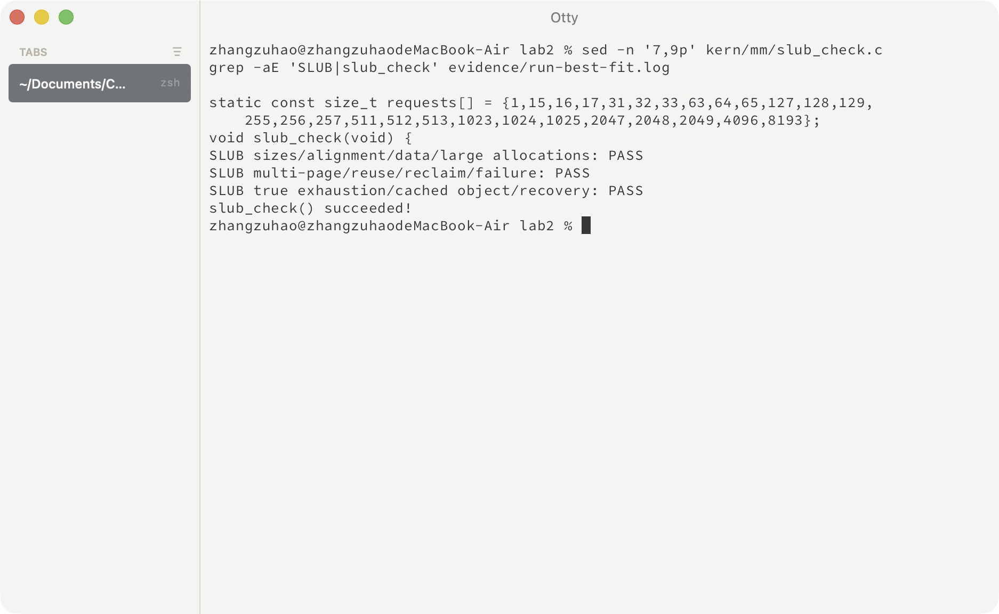

同一套对象测试在 Best-Fit、First-Fit 和 Buddy 三种底层分配器下均通过。测试证明当前用例覆盖的功能成立，但没有进行性能基准测试，也不把简化实现等同于 Linux 完整 SLUB。

### 分支任务：GDB 调试页表查询过程（要求 1、2）

**负责人：** 2410878-吕明诺

#### 1. 调试环境与实验思路

本次实验使用 QEMU 4.1.1 和 GDB 对 Lab2 中的 Sv39 页表查询过程进行调试。

由于真实 CPU 的地址转换主要由 MMU 硬件完成，普通的内核调试无法直接观察这一过程。而 QEMU 通过软件模拟 RISC-V CPU，因此可以使用 GDB 调试 QEMU 的源码，观察虚拟地址是怎样转换为物理地址的。

实验中使用三个终端：

- 终端一：通过 `make debug` 启动 QEMU。
- 终端二：通过普通 GDB 附加 QEMU 进程，调试地址转换相关的 C 语言代码。
- 终端三：通过 `make gdb` 连接 QEMU 内部的 RISC-V CPU，控制 ucore 内核的运行。

本次主要分析 `target/riscv/cpu_helper.c` 文件中的 `riscv_cpu_tlb_fill()` 和 `get_physical_address()` 函数。

#### 2. GDB 调试要求 1：关键调用路径及地址转换分析

**（1）定位 QEMU 地址转换相关函数**

首先，在终端一通过 `make debug` 启动 QEMU，然后在终端二使用普通 GDB 附加 QEMU 进程。

为了观察内核高虚拟地址对应的转换过程，在 `riscv_cpu_tlb_fill()` 函数设置条件断点：

```gdb
break riscv_cpu_tlb_fill if address >= 0xffffffffc0000000
```

随后通过 `continue` 继续执行。

当 QEMU 处理内核高虚拟地址的取指请求时，成功命中 `riscv_cpu_tlb_fill()` 断点。

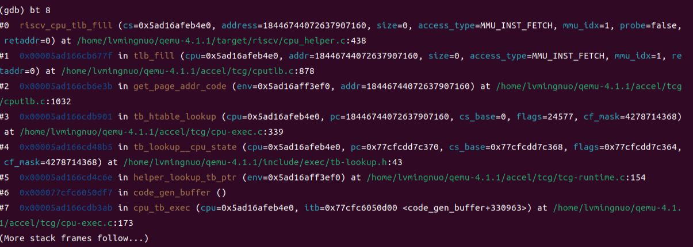

使用 `bt 8` 查看函数调用栈，得到主要调用路径：

```text
get_page_addr_code()
        ↓
tlb_fill()
        ↓
riscv_cpu_tlb_fill()
```

其中，`get_page_addr_code()` 负责获取取指地址对应的页面信息，`tlb_fill()` 负责处理需要填充地址转换缓存的情况，最后进入 RISC-V 对应的 `riscv_cpu_tlb_fill()` 函数。

接下来继续进入 `get_physical_address()`，通过 `bt 4` 查看调用关系：

```text
get_page_addr_code()
        ↓
tlb_fill()
        ↓
riscv_cpu_tlb_fill()
        ↓
get_physical_address()
```

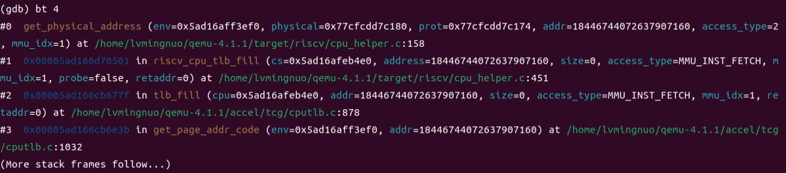

通过这次调试可以看出，QEMU 在处理本次取指访问时，会进入 TLB 填充处理函数，并进一步调用 `get_physical_address()` 完成地址转换。

**（2）确认当前使用 Sv39 分页机制**

在断点处，通过 GDB 查看当前访问的虚拟地址和模拟 CPU 的 `satp` 寄存器：

```gdb
p/x address
p/x ((RISCVCPU *)cs)->env.satp
p/x (((RISCVCPU *)cs)->env.satp >> 60)
```

实际得到：

```text
address = 0xffffffffc02000d8
satp    = 0x8000000000080205
MODE    = 0x8
```

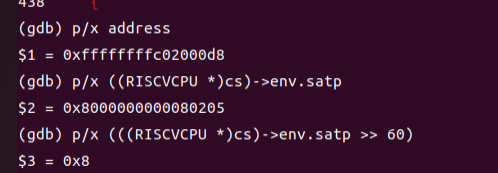

其中，`address` 是本次 CPU 需要访问的虚拟地址；`satp` 保存了当前分页模式和根页表的物理页号。

由于 MODE 为 8，说明当前使用的是 Sv39 分页机制。

从 `satp` 中提取根页表物理页号：

```text
satp.PPN = 0x80205
```

由于每个物理页面大小为 4KB，因此根页表的物理地址为：

```text
0x80205 << 12 = 0x80205000
```

这说明当前根页表位于物理地址 `0x80205000`。

通过上述调试，我们找到了本次地址转换的主要调用路径，并确定了当前虚拟地址和根页表位置。

#### 3. GDB 调试要求 2：Sv39 页表查询过程分析

**（1）分析 Sv39 页表参数**

在 QEMU 的 `get_physical_address()` 函数中，可以找到 Sv39 对应的配置：

```c
case VM_1_09_SV39:
    levels = 3;
    ptidxbits = 9;
    ptesize = 8;
    break;
```

随后通过 GDB 查看相关变量，实际得到：

```text
addr      = 0xffffffffc02000d8
base      = 0x80205000
levels    = 3
ptidxbits = 9
ptesize   = 8
ptshift   = 18
```

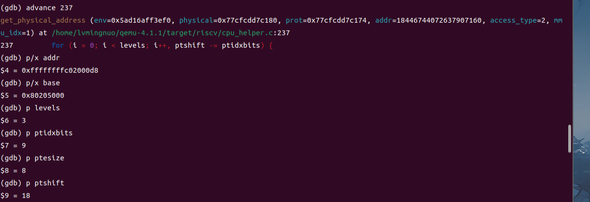

其中，`levels=3` 表示 Sv39 最多使用三级页表；`ptidxbits=9` 表示每一级页表索引占 9 位；`ptesize=8` 表示每个页表项占 8 字节。

`ptshift=18` 表示当前处于根页表查询阶段，需要从虚拟地址中提取 VPN[2]。

**（2）计算页表索引和 PTE 地址**

接下来，在 `get_physical_address()` 中找到页表查询循环：

```c
for (i = 0; i < levels; i++, ptshift -= ptidxbits) {
    target_ulong idx = (addr >> (PGSHIFT + ptshift)) &
                       ((1 << ptidxbits) - 1);

    target_ulong pte_addr = base + idx * ptesize;
```

这段代码主要完成两个操作。

第一，通过虚拟地址和当前页表层数计算页表索引 `idx`。

第二，通过当前页表的起始地址 `base`、页表索引 `idx` 和页表项大小 `ptesize`，计算 PTE 所在的物理地址。

由于当前处于 Sv39 根页表阶段：

```text
PGSHIFT = 12
ptshift = 18
ptidxbits = 9
```

所以页表索引计算公式为：

```text
idx = (addr >> 30) & 0x1ff
```

通过 GDB 计算，实际得到：

```text
idx = 511
```

说明当前虚拟地址对应根页表的最后一个页表项，即 VPN[2] = 511。

接下来计算 PTE 地址：

```text
pte_addr = base + idx × ptesize

         = 0x80205000 + 511 × 8

         = 0x80205ff8
```

GDB 的实际计算结果也为：

```text
pte_addr = 0x80205ff8
```

![图5：VPN[2] 索引及 PTE 地址计算结果](./images/pic5.png)

这一步说明 QEMU 已经能够根据虚拟地址中的 VPN[2]，找到根页表中需要读取的页表项。

**（3）读取 PTE 并分析页表项内容**

接下来，在 QEMU 源码中找到读取页表项的代码：

```c
target_ulong pte = ldq_phys(cs->as, pte_addr);
target_ulong ppn = pte >> PTE_PPN_SHIFT;
```

其中，`ldq_phys()` 会从 `pte_addr` 对应的物理地址读取 8 字节数据，也就是当前页表项的内容。

通过 GDB 单步执行到第 254 行后，实际得到：

```text
addr     = 0xffffffffc02000d8
idx      = 0x1ff
pte_addr = 0x80205ff8
pte      = 0x200000cf
```

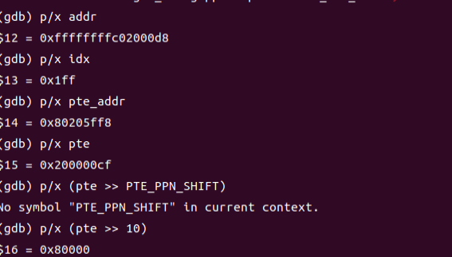

其中，`pte=0x200000cf` 与 Lab2 在 `entry.S` 中建立的启动页表项一致：

```asm
.quad (0x80000 << 10) | 0xcf
```

根据 RISC-V 页表项的结构，PPN 从第 10 位开始，因此：

```text
PPN = 0x200000cf >> 10
    = 0x80000
```

PTE 的低位标志为 `0xcf`，其中 V、R、W、X 均为 1，说明这是一个有效的叶子页表项。

由于当前正在查询根页表，因此该叶子项对应的是一个 1GiB 大页映射。

这也解释了为什么本次地址转换不需要继续查询第二级和第三级页表：QEMU 在根页表中就已经找到了有效的叶子项。

**（4）计算最终物理地址**

在 `get_physical_address()` 中，QEMU 使用以下代码计算物理页基址：

```c
*physical = (ppn | (vpn & ((1L << ptshift) - 1))) << PGSHIFT;
```

对于本次访问，页表项中的 PPN 为 `0x80000`，对应的 1GiB 物理区域起点为 `0x80000000`。

原虚拟地址为：

```text
0xffffffffc02000d8
```

它位于对应的 1GiB 虚拟区域起点之后 `0x2000d8` 字节处。

因此，理论上应得到：

```text
物理地址 = 0x80000000 + 0x2000d8
         = 0x802000d8
```

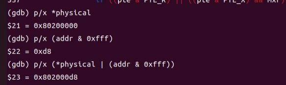

通过这个过程，我们能够将前面学习的 Sv39 地址结构、`satp`、VPN、PTE 和物理页号联系起来，更直观地理解 QEMU 如何模拟 CPU 完成虚拟地址到物理地址的转换。

#### 4. 调试总结

通过这次 GDB 调试，我对 Sv39 页表查询过程有了更具体的理解。

之前学习分页机制时，主要是通过指导书了解 MMU、TLB 和多级页表的基本原理。这次通过调试 QEMU 的源码，能够看到这些功能在模拟器中对应的实际代码。

特别是在 `get_physical_address()` 中，我们观察了根页表地址的获取、VPN[2] 的计算、PTE 物理地址的确定以及页表项的读取过程。

另外，这次还发现 Lab2 使用的是 1GiB 大页映射，因此虽然 Sv39 最多支持三级页表，但实际查询时不一定需要经过全部三级。

总体来说，这次调试让我对虚拟地址与物理地址之间的转换关系理解得更清楚了，也熟悉了使用 GDB 查看调用栈、设置断点和单步分析源码的方法。

---

### 分支任务：GDB 调试要求 3、4

**负责人：** 2410849-张祖浩

#### 调试准备与固定访存探针

调试使用单独编译、包含调试信息的 QEMU 4.1.1，不执行 `make install`，因此不会覆盖系统 QEMU。宿主 GDB 调试 QEMU 进程，多架构 GDB 通过 QEMU stub 调试 RISC-V 内核，两个调试器面对的程序、指令集和地址空间不同。

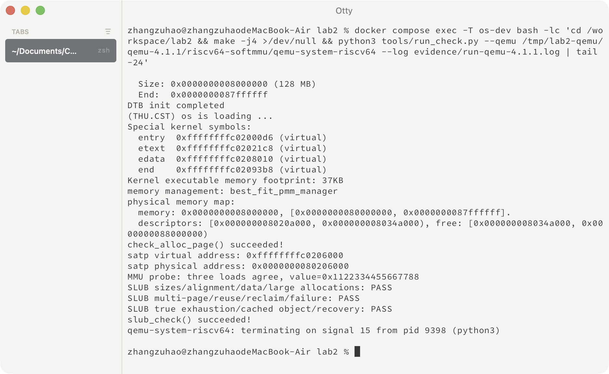

为了稳定触发同一地址的访问，`mmu_probe()` 对按页对齐的 `lab2_probe_value` 执行三次真实 `ld`：第一次前刷新 TLB，第二次直接重复，第三次前再次刷新。三次结果都必须等于 `0x1122334455667788`。符号 `lab2_probe_first`、`lab2_probe_second`、`lab2_probe_third` 用于让客体 GDB 准确定位指令。

```c
void mmu_probe(void) {
    uint64_t first, second, third;
    uintptr_t address = (uintptr_t)&lab2_probe_value;
    asm volatile(
        "sfence.vma\n"
        ".global lab2_probe_first\nlab2_probe_first:\nld %0, 0(%3)\n"
        ".global lab2_probe_second\nlab2_probe_second:\nld %1, 0(%3)\n"
        "sfence.vma\n"
        ".global lab2_probe_third\nlab2_probe_third:\nld %2, 0(%3)\n"
        : "=&r"(first), "=&r"(second), "=&r"(third)
        : "r"(address) : "memory");
}
```

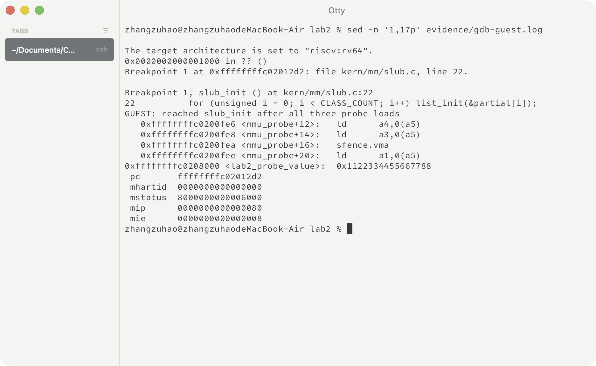

#### 最终提示词

````markdown
[PROMPT]
**任务**：我负责指导书 GDB 要求 3、4。请基于带调试符号的 QEMU 4.1.1，帮我实际观察 TLB 查询、未命中后的翻译与填充，以及 Bare 模式下 QEMU 为什么仍使用软件 TLB。用 `kern/mm/mmu_probe.c` 提供可重复的访存，用 `tools/trace_mmu.py` 保存两个 GDB 会话的记录。

**操作要求**：必须修改项目实际文件，在 `kern/init/init.c` 声明并调用探针；保留现有内核和分配器自检。QEMU 使用单独的调试构建，不改它的地址翻译源码，不替换系统安装。只分析指导书要求 3、4 所需路径。

**输出要求**：给出真实命令、日志和相关源码位置；把观察到的值与解释对应起来。分清宿主 GDB 和客体 GDB，说明命中与未命中的差别，以及软件 TLB 和硬件 TLB 的用途差别。不能用写死的打印代替真实断点，也不能预先假定本次一定走完三级页表。

[RELY]
实验在 ARM64 Ubuntu 容器运行，内核为 RISC-V 64 位。宿主 `gdb` 调试 ARM64 的 QEMU 进程，`gdb-multiarch` 通过 QEMU stub 调试 `bin/kernel`。已有 `tools/build_debug_qemu.sh` 可构建 QEMU 4.1.1，默认源码目录为 `/tmp/lab2-qemu/qemu-4.1.1`。

需要查看的 QEMU 4.1.1 源码主要是 `accel/tcg/cputlb.c`、`target/riscv/cpu_helper.c` 和 ARM64 后端 `tcg/aarch64/tcg-target.inc.c`。关注 `load_helper()`、`riscv_cpu_tlb_fill()`、`get_physical_address()`、`tlb_set_page()`、`tlb_set_page_with_attrs()` 和 `tcg_out_tlb_read()`。

工程已有 `pmm_init()`，SLUB 初始化在它之后；内核符号可用 `riscv64-unknown-elf-nm bin/kernel` 读取。`boot_hartid` 在开启分页前写入，可以用来观察 Bare 模式。当前高地址映射使用根层的 1 GiB 叶子项。

[GUARANTEE]
内核接口：
```c
void mmu_probe(void);
int kern_init(void);
```
新增探针数据符号 `lab2_probe_value`，以及三条读取指令的位置符号 `lab2_probe_first`、`lab2_probe_second`、`lab2_probe_third`。

脚本接口：`python3 tools/trace_mmu.py --qemu-root <QEMU源码目录>`。生成 `evidence/host-trace.gdb`、`guest-trace.gdb`，记录 `gdb-host-tlb.log`、`gdb-guest.log`、`gdb-qemu-console.log`。可以增加脚本内部辅助逻辑，不改变原有内核接口。

[SPECIFICATION]
## mmu_probe
**Pre-Condition**：启动映射和页管理初始化已完成，探针数据可访问；当前为单核环境。
**Post-Condition**：对同一个、按页对齐的 `volatile uint64_t` 数据执行三条实际 `ld`，三次结果均为 `0x1122334455667788`，用断言核对并打印结果。
**Case 1**：第一次读取前执行 `sfence.vma`。
**Case 2**：第二次直接读取同一地址，不主动刷新，让它有机会复用已有 TLB 条目。
**Case 3**：第三次之前再执行 `sfence.vma`，观察重新填充。
**Requirements**：通过内联汇编和正确的寄存器约束保留这三次真实读取，避免被编译器合并，也不要让输出寄存器覆盖后续读取所需的地址。

## kern_init 探针接入
**Pre-Condition**：原有初始化和页管理自检不变。
**Post-Condition**：在 `pmm_init()` 后、`slub_init()` 前执行 `mmu_probe()`，便于客体 GDB 在 `slub_init()` 停下时检查三次读取已完成。

## trace_mmu.py
**Pre-Condition**：内核已编译，QEMU 4.1.1 调试构建及相应源码可用，两个 GDB 可执行，回环调试端口可用。
**Post-Condition**：从实际内核符号确定探针和 `boot_hartid` 地址，启动两个 GDB 并留下完整记录；结束或失败时清理自己启动的调试进程。日志与判断都来自本次执行。

**Case 1：Sv39 访存。** 用目标地址条件断点记录 C 查询的标签、索引、mmu_idx，以及填充时的 satp、权限模式、实际读取的 PTE 和翻译结果。按 PTE 的真实叶子层级解释物理地址，不能把根层大页也写成三次页表读取。

**Case 2：命中与刷新。** 核对三次读取结果和目标数据填充次数。本探针预期两次填充，第二次读取可走生成的宿主快路径；结合 `tcg_out_tlb_read()` 解释，不能要求每次 load 都进入 C 慢路径。GDB 自己查看内存造成的调试翻译，不算成内核多执行了一条 load。

**Case 3：Bare 模式。** 观察开启分页前保存 `boot_hartid` 时 `satp=0` 的访问，记录客体地址、物理地址和 TLB 安装，并观察 addend 或对应宿主页地址。说明客体不查 Sv39 页表时，QEMU 仍需定位宿主 RAM；宿主地址随进程变化，不能当作固定常量。

**Case 4：运行不符合预期。** 调试器退出、连接超时或缺少必要记录时报告失败，保留已有日志供检查，不补造输出或把失败写成通过。

**Requirements**：stub 只监听回环地址；断点行号与地址以当前源码、符号为准。说明实测支持到什么程度，保留可复核的命令与输出。
````

#### 要求 3：QEMU 中的 TLB 查询

QEMU 4.1.1 的 C 慢路径查询位于 `accel/tcg/cputlb.c` 的 `load_helper()`。它根据地址和 `mmu_idx` 找到 TLB 条目，使用 `tlb_hit()` 判断；普通表未命中时再检查 victim TLB，仍未命中才调用架构相关填充。

本次 64 位加载的实际慢路径为：

```text
code_gen_buffer
  → helper_le_ldq_mmu / load_helper
  → tlb_fill
  → riscv_cpu_tlb_fill
  → get_physical_address
  → tlb_set_page
```

目标访问的记录包括：

```text
C_TLB_CHECK addr=0xffffffffc0208000 cached=0xffffffffffffffff index=8 mmu_idx=1
FILL address=0xffffffffc0208000 access=0 mmu_idx=1
satp=0x8000000000080206 priv=1
PTE index=511 base=0x80206000 pte_addr=0x80206ff8
pte=0x200000cf ppn=0x80000
TRANSLATED va=0xffffffffc0208000 pa_page=0x80208000
```


目标高地址映射在根层就是 1 GiB 叶子项，所以本次只读取一个 PTE，没有继续走完三级。三条 `ld` 只触发两次目标填充：第二次没有进入 C 慢路径，第三次在 `sfence.vma` 后重新填充。命中时 QEMU 可以直接执行 TCG 生成的宿主快路径，因此“没有再次停在 `load_helper()`”不等于没有执行第二条客体 `ld`。

#### 要求 4：QEMU 软件 TLB 与真实 CPU TLB

真实 CPU 的 TLB 是硬件结构，用于缓存虚拟页到物理页的翻译和权限。QEMU 的软件 TLB 除了保存客体翻译信息，还要帮助模拟器定位宿主进程中的 RAM。`CPUTLBEntry.addend` 等字段可让快路径由客体地址快速得到宿主地址。

分页开启前保存 `boot_hartid` 时记录为：

```text
FILL address=0x80207000 access=1 mmu_idx=1 satp=0x0 priv=1
TLB_INSTALL va_page=0x80207000 pa_page=0x80207000 prot=7 mmu_idx=1 size=4096
```


此时 `satp=0`，客体地址翻译阶段不遍历 Sv39 页表，客体虚拟地址与物理地址相同；但 QEMU 仍要找到宿主进程中的 RAM，所以仍会安装软件 TLB 条目。宿主地址受进程地址布局影响，不能当作固定实验常量。

| 对比项 | 真实 CPU TLB | QEMU 软件 TLB |
| --- | --- | --- |
| 实现 | 芯片内部硬件结构 | C 数据结构与 TCG 生成的宿主指令 |
| 主要用途 | 缓存地址翻译和权限 | 同时缓存客体翻译并定位宿主 RAM |
| Bare 模式 | 不进行 Sv39 页表翻译 | 仍可缓存客体物理地址到宿主地址的映射 |


#### 调试中遇到的问题

最初内核在写入 `satp` 后无法继续执行。检查启动页表发现只映射了高虚拟地址，但切换 `satp` 后，CPU 仍需在低地址完成 `sfence.vma` 和跳转准备。增加覆盖 `0x80000000` 区域的临时恒等映射后，当前 QEMU 与 QEMU 4.1.1 都能进入内核，高地址根页表项仍保留在索引 511。

调试还需避免把 GDB 自己读取客体内存产生的翻译日志误认为内核额外执行了访存。最终通过目标地址条件断点、三条指令符号和填充计数相互核对。


### 功能模块二任务三：Buddy System 伙伴系统

**负责人：2410625－吴宇轩（组员 C）**

实验在 WSL2 Ubuntu 24.04 中完成，工作目录为 `/home/siamese/oslab/lab2/Operating-System/code`。

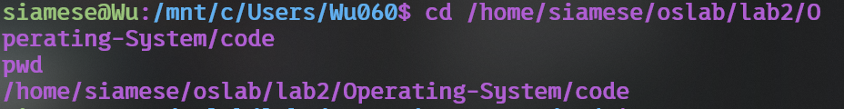

#### 1. 设计与接入

Buddy System 只管理 2 的幂大小的连续页块。实现为每个阶维护一条空闲链表：第 `order` 阶中的每个块包含 `2^order` 页。`Page.property` 在 Buddy 模块中记录块阶，`PageProperty` 只标记空闲块头，额外的 `BUDDY_ALLOCATED` 位标记已分配块头，以便释放时发现重复释放或错误块。

`buddy_init_memmap()` 不能假设 `page_init()` 交来的起点或页数恰好是 2 的幂。因此它从低地址开始，每次选取“不越过剩余范围且满足全局页索引对齐”的最大块，直到完整覆盖初始空闲区。这样不会把描述符数组前的保留页或可管理上界外的页放入 Buddy。

`buddy_alloc_pages(n)` 先计算不小于 `n` 的最小阶。若该阶为空，就寻找更高阶空闲块并逐级拆成两半：左半继续拆分，右半加入当前阶链表。请求 3 页时实际占用 4 页，因此空闲计数减少 4，而不是 3。这会产生内部碎片，但换来了按阶快速定位和合并。

`buddy_free_pages(base, n)` 根据相同的向上取整规则确定实际块大小。若块的全局页索引为 `index`，则同阶伙伴索引为：

```text
buddy_index = index XOR (1 << order)
```

只有伙伴位于管理范围内、是空闲块头且记录相同阶时才能合并。合并后取两者较低地址作为新块头并继续向上一阶尝试，直到伙伴忙、越界或达到最大阶。

模块通过 `struct pmm_manager` 注册为 `buddy_pmm_manager`。默认配置仍为成员 B 的 Best-Fit；使用下面的命令显式选择成员 C 的实现：

```bash
cd /home/siamese/oslab/lab2/Operating-System/code
make clean
make -j2 EXTRA_CFLAGS=-DPMM_BUDDY
make qemu EXTRA_CFLAGS=-DPMM_BUDDY
```

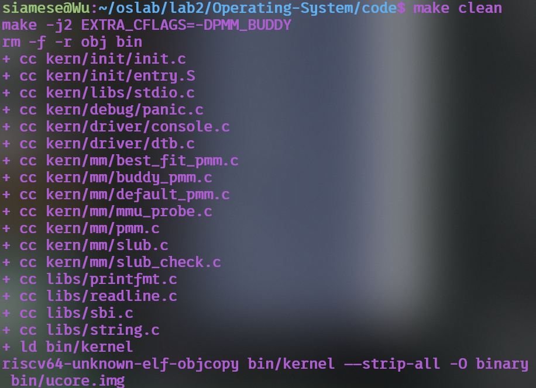

#### 最终提示词一：Buddy 实现与接入

````markdown
[PROMPT]
**任务**：在 Lab2 的 `kern/mm/` 中从零实现 Buddy System 物理页分配模块，并通过现有 `struct pmm_manager` 接入内核。Buddy 以 2 的幂页数管理空闲块，非 2 的幂请求向上取整。

**操作要求**：必须修改实际文件。新增 `buddy_pmm.c`、`buddy_pmm.h`，只在 `pmm.c` 的管理器选择处添加 Buddy 分支；保留 First-Fit、Best-Fit、物理内存初始化和原测试。默认仍使用 Best-Fit，通过 `PMM_BUDDY` 显式选择 Buddy。

**输出要求**：完成代码、交叉编译和 QEMU 运行；说明分阶组织、初始范围分解、分配拆分、伙伴计算、递归合并及实际页数计数。

[RELY]
```c
struct pmm_manager {
    const char *name;
    void (*init)(void);
    void (*init_memmap)(struct Page *base, size_t n);
    struct Page *(*alloc_pages)(size_t n);
    void (*free_pages)(struct Page *base, size_t n);
    size_t (*nr_free_pages)(void);
    void (*check)(void);
};
extern struct Page *pages;
extern size_t npage;
extern const size_t nbase;
```
可使用页面标志、引用计数和链表接口。`Page.property` 可在 Buddy 内记录阶，额外分配标志不能与保留位和空闲块头标志冲突。

[GUARANTEE]
```c
static void buddy_init(void);
static void buddy_init_memmap(struct Page *base, size_t n);
static struct Page *buddy_alloc_pages(size_t n);
static void buddy_free_pages(struct Page *base, size_t n);
static size_t buddy_nr_free_pages(void);
extern const struct pmm_manager buddy_pmm_manager;
```

[SPECIFICATION]
## buddy_init
**Post-Condition**：全部分阶链表为空，总空闲页数为 0。

## buddy_init_memmap
**Pre-Condition**：`base` 指向连续的 `n > 0` 个保留页描述符。
**Post-Condition**：整个范围无遗漏、无重叠地分解成满足全局页索引对齐的 2 的幂块，总空闲页数增加 `n`。

## buddy_alloc_pages
**Post-Condition**：成功时返回至少 `n` 页的连续块，实际占用为最小的 `2^order >= n`；必要时从高阶逐级拆分。失败返回 `NULL` 且状态不变。

## buddy_free_pages
**Pre-Condition**：参数对应尚未释放的 Buddy 块。
**Post-Condition**：按实际块大小恢复计数，使用 `index XOR (1 << order)` 查找伙伴；同阶伙伴空闲时递归合并。
**Requirements**：检查范围、分配标志和阶，避免重复释放破坏链表。

## buddy_nr_free_pages
**Post-Condition**：返回全部分阶链表代表的空闲页数，不改变状态。
````

#### 最终提示词二：Buddy 测试设计

````markdown
[PROMPT]
**任务**：为 Buddy System 设计 `buddy_check()`，通过 `buddy_pmm_manager.check` 在启动时执行，验证算法而不是只检查一次申请成功。

**操作要求**：修改实际文件，不改其他分配器或官方评分器迎合测试。所有临时分配必须释放，测试结束状态恢复。

**输出要求**：在 `PMM_BUDDY` 下编译运行，并继续运行现有 SLUB 测试；使用 64、128、256 MiB 三种内存配置验证。

[RELY]
可使用 `alloc_pages()`、`free_pages()`、`nr_free_pages()`、单页包装宏、全局页描述符、Buddy 分阶链表、断言和输出函数。非 2 的幂请求按 2 的幂向上取整。

[GUARANTEE]
```c
static void buddy_check(void);
```

[SPECIFICATION]
## buddy_check
**Pre-Condition**：Buddy 已登记空闲区，没有测试遗留块。
**Post-Condition**：断言全部通过，临时块全部释放，计数和链表恢复，并打印成功信息。

**Case 1**：同时申请 3 页和 8 页，检查实际扣除 4+8 页及相应地址对齐。
**Case 2**：申请 32 个单页并检查地址唯一，先释放偶数下标再释放奇数下标，验证合并不依赖释放顺序。
**Case 3**：遍历所有阶，检查块头标志、阶、对齐、链表总页数以及不存在仍可合并的同阶伙伴。
**Case 4**：请求超过全部空闲页，必须返回 `NULL` 且状态不变。

**Requirements**：Buddy 自检后继续执行 SLUB 的尺寸、复用、整页回收和耗尽恢复测试；三种内存配置均不得出现 panic。
````

完整提示词另存于[成员 C 提示词汇总](prompt_c.md)，便于单独提交和复用。

#### 2. Buddy 测试设计

`buddy_check()` 覆盖以下核心行为：

| 测试 | 检查内容 | 能发现的问题 |
|---|---|---|
| 3 页与 8 页同时申请 | 3 页实际扣除 4 页；地址分别按 4、8 页对齐 | 阶计算错误、计数按请求值而非实际块值扣减 |
| 连续申请 32 个单页 | 地址两两不同 | 同一块被重复返回、拆分链表损坏 |
| 先释放偶数页、再释放奇数页 | 最终空闲计数恢复 | 合并依赖释放顺序、伙伴计算错误 |
| 遍历全部阶链表 | 块头标志、阶、对齐和链表页数总和一致 | 元数据错误、空闲页泄漏、重复计数 |
| 检查同阶伙伴不同时残留 | 可合并伙伴应已进入更高阶 | 递归合并遗漏 |
| 请求超过全部空闲页 | 返回 `NULL` 且状态不变 | 失败路径越界或破坏计数 |

此外，Buddy 自检完成后继续运行成员 B 的整套 SLUB 测试，验证大对象申请时向上取整的实际页数能够被正确记录并完整释放。这一联动测试比只运行 Buddy 自己的检查更能发现接口语义不一致。

#### 3. 实际验证结果

默认 128 MiB 配置输出为：

```text
memory management: buddy_pmm_manager
buddy_check() succeeded! (rounding, split, merge, count)
check_alloc_page() succeeded!
MMU probe: three loads agree, value=0x1122334455667788
SLUB sizes/alignment/data/large allocations: PASS
SLUB multi-page/reuse/reclaim/failure: PASS
SLUB true exhaustion/cached object/recovery: PASS
slub_check() succeeded!
```

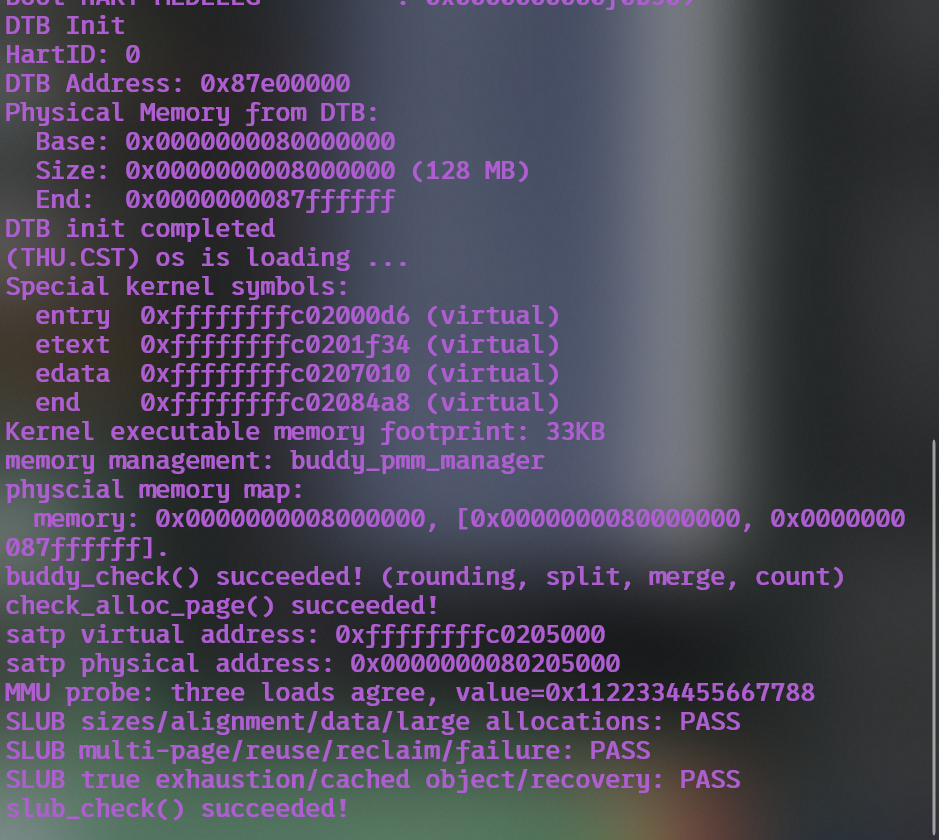

64 MiB 和 256 MiB 也实际启动验证：两种配置均打印 `buddy_check() succeeded!` 与 `slub_check() succeeded!`，没有 panic 或 assertion failure。原始摘录保存在[成员 C Buddy 验证记录](evidence/member_c/buddy-validation.txt)。

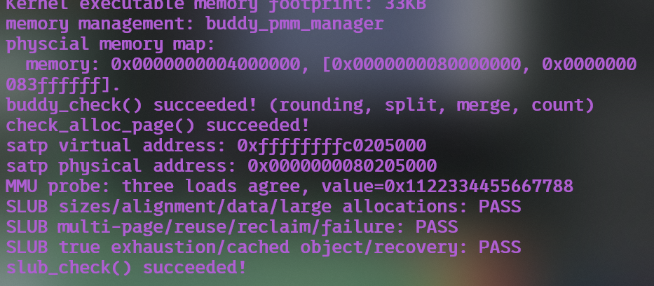

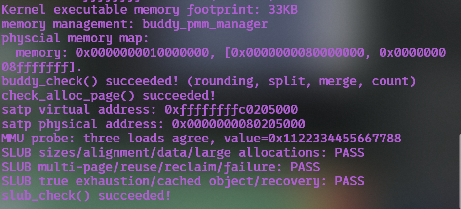

#### 4. 算法特点与改进空间

本实现查找可用块最多扫描固定数量的阶，分裂与合并次数也受最大阶限制；相比顺序遍历全部空闲块，时间更稳定。代价是非 2 的幂请求会向上取整，例如申请 5 页实际占用 8 页，产生内部碎片。当前版本面向单核实验，没有加锁、每 CPU 缓存、迁移类型、内存域或 NUMA 支持；这些都是实际内核 Buddy 分配器还需解决的问题。

### 分支任务：GDB 调试要求 5、6

**负责人：2410625－吴宇轩（组员 C）**

#### 对调试要求 1 的协助

组员 A 已在前文完成从 QEMU 访存入口、TLB 查询到 `get_physical_address()` 页表翻译的主要调用路径。组员 C 重点协助核对这条路径能够被稳定复现的启动前提：OpenSBI 的 `Next Address` 必须是 `0x80200000`，启动页表在切换 `satp` 的短暂阶段必须同时提供低地址恒等映射与高地址内核映射。完成这两项核对后，成员 B 的固定地址 `mmu_probe()` 才能稳定产生三次可定位访存，供宿主 GDB 设置条件断点观察 TLB 未命中、页表翻译和再次访问。该协助没有改写前文的调试结论，而是补足了“为什么同一套断点在旧启动参数下完全不触发”的环境原因。

#### 要求 5：调试过程中有趣的细节

本轮最容易误判的现象是：内核镜像已经被 QEMU 的 loader 放到 `0x80200000`，并不等于 OpenSBI 一定会跳到该地址。使用仓库原来的参数：

```bash
-device loader,file=bin/ucore.img,addr=0x80200000
```

QEMU 8.2.2 的 OpenSBI 实际打印：

```text
Domain0 Next Address : 0x0000000000000000
```

屏幕只有 OpenSBI 信息，内核没有获得控制权。把同一镜像改为：

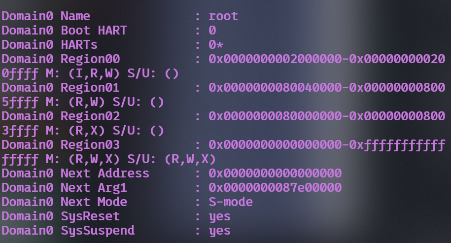

```bash
-kernel bin/ucore.img
```

后，OpenSBI 打印的下一阶段地址变为：

```text
Domain0 Next Address : 0x0000000080200000
```

随后才能观察到 `kern_entry`、物理页管理器和 SLUB 的输出。这个细节说明“镜像被写入内存”和“固件获得下一阶段入口”是启动链中的两个不同条件。调试时应先看固件交接信息，再判断是入口问题、页表问题还是分配器问题。

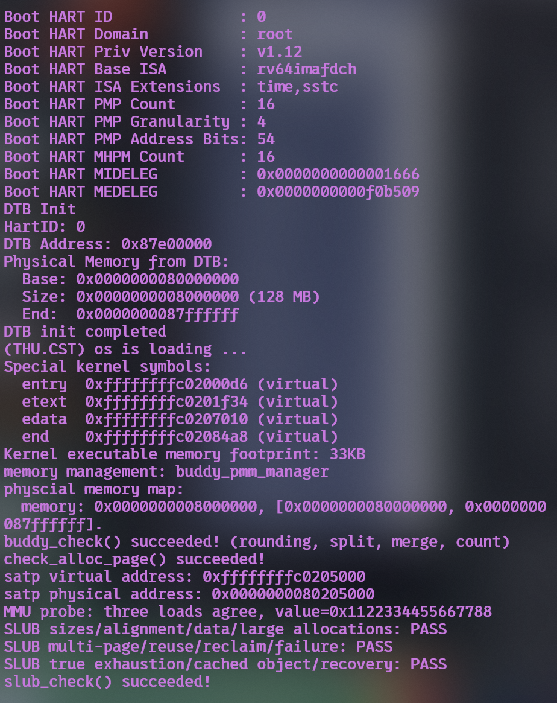

另一个细节发生在 `entry.S`：写入 `satp` 到跳往高虚拟地址之间还有几条指令需要取指。因此启动页表除了高地址映射，还需要暂时保留 `0x80000000` 区域的恒等映射；否则刷新 TLB 后，CPU 可能在完成高地址跳转前就无法取得下一条指令。

#### 要求 6：通过大模型解决问题的真实记录

本次使用 Codex（GPT-5.6 Sol）协助合并和验证。实际过程如下：

1. **情景**：成员 A、B 代码合并后能够交叉编译，但 `make qemu` 只显示 OpenSBI，既没有内核输出，也没有断言。
2. **最初思路**：怀疑合并后的 `entry.S`、页表或分配器破坏了启动。
3. **与模型交互的核心请求**：要求模型检查启动输出与 QEMU 命令的关系，判断为什么内核没有执行，而不是直接改 Buddy 或 `page_init()`。
4. **模型给出的排查方向**：先检查 OpenSBI 的 `Domain0 Next Address` 是否等于 `0x80200000`；保持内核镜像不变，只对比 `-device loader` 与 `-kernel`；同时检查独立的 `tools/grade.sh` 是否仍有旧参数。
5. **操作与结果**：只替换加载参数后，Next Address 从 0 变为 `0x80200000`，内核全部检查开始执行；评分脚本同步修改后从“缺少两个 PASS 标记”变为 `20/20`。
6. **结论**：问题属于 QEMU/OpenSBI 版本间的启动参数兼容性，与 Buddy 算法无关。大模型的价值在于把“没有内核输出”拆成固件交接、入口取指、页表切换、分配器初始化几个阶段，再用输出证据逐层排除。

实际进行客体 GDB 调试时还出现过一次命令输入问题：将多条 GDB 命令一次性粘贴到交互终端后，`set pagination off` 的参数被后续文本干扰，GDB 报出 `"on" or "off" expected`。这张图记录的是失败现象，不作为断点命中的证据。修正方法是在 `(gdb)` 提示符下逐行执行 `set pagination off`、`set architecture riscv:rv64`、`target remote localhost:1234`、`break *0x80200000` 和 `continue`，并逐条确认返回结果。

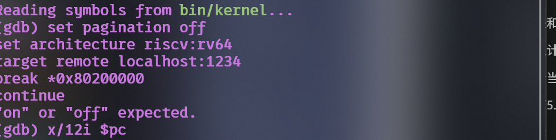

对应的简要记录保存在[GDB 要求 5、6 记录](evidence/member_c/gdb-requirements-5-6.txt)。报告只记录本轮真实发生的诊断过程，没有把多个现象事后虚构成多轮提示词迭代。

---

## 五、测试与验证

图 B-1 至 B-13 来自成员 B 的独立实验记录，采集方式见 [B 截图索引](images/member-b/README.md)。原始测试函数、测试源和注入器保持原文；整合版 `grade.sh` 已有的区别仅是 QEMU 加载参数改为 `-kernel`。完整性脚本会把这项已知修改还原后，再与原始哈希比较，不把它表述成整份评分脚本从未修改。

### 5.1 编译与运行

| 验证内容 | 结果与含义 | 材料归属 |
|---|---|---|
| 全量编译 | `entry.S`、Page Init、Best-Fit、Buddy、MMU probe、SLUB 均在 `-Wall -Werror` 下通过 | 图 C-2、图 B-1 |
| 默认管理器 | 输出 `memory management: best_fit_pmm_manager`，Best-Fit 自检通过 | 图 B-1 |
| 官方评分 | Page Init 与 Best-Fit 均为 OK，总分 `20/20` | 图 B-2 |
| First-Fit 切换 | `EXTRA_CFLAGS=-DPMM_FIRST_FIT` 下页分配检查、MMU probe、SLUB 均通过 | 成员 B 原始验证记录 |
| Buddy 切换 | `EXTRA_CFLAGS=-DPMM_BUDDY` 下拆分、合并、计数及 SLUB 联动通过 | 图 C-3 |
| 内存边界 | Buddy 在 64、128、256 MiB 配置下均无 panic，检查全部通过 | 图 C-3～C-5 |
| SLUB | 尺寸、对齐、隔离、多页、复用、回收、耗尽与恢复全部通过 | 图 B-3、图 C-3 |
| MMU 调试 | 固定三次读取一致；记录 Sv39 根层大页翻译和 Bare 模式软件 TLB | 图 B-5～B-8 |
| 启动兼容 | 对比 `Next Address=0` 与 `0x80200000`，确认 `-kernel` 修复交接 | 图 C-6、C-7 |

默认构建和 Buddy 构建分别使用：

```bash
# 默认 Best-Fit 与官方评分
make clean
make -j2
make grade

# 成员 C 的 Buddy 配置
make clean
make -j2 EXTRA_CFLAGS=-DPMM_BUDDY
make qemu EXTRA_CFLAGS=-DPMM_BUDDY
```

成员 B 还保留了全模块编译、三种分配器切换和不同物理内存大小的独立运行记录：

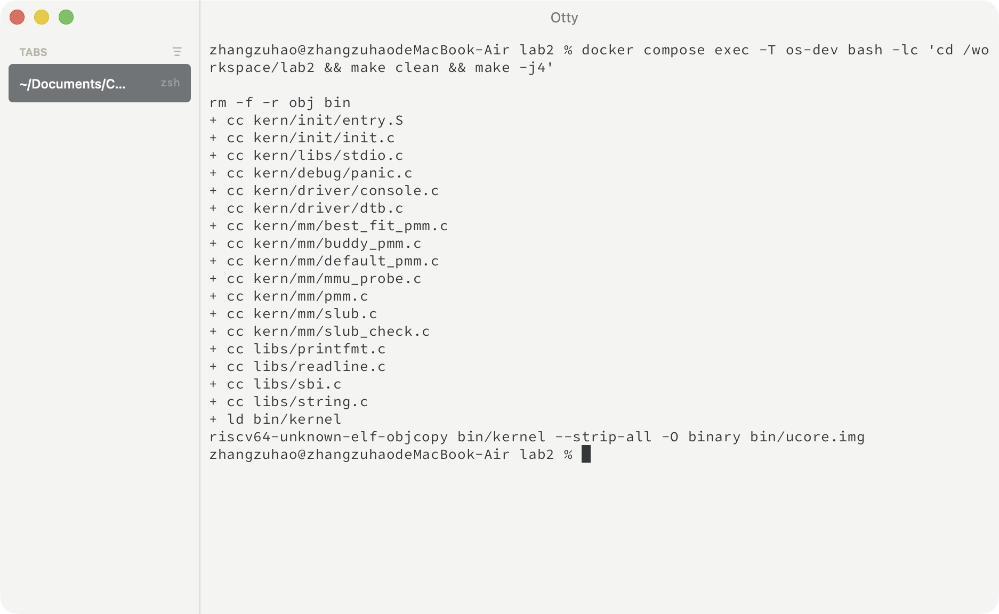


需要强调：官方 `20/20` 只覆盖 Page Init 与 Best-Fit。Buddy 和 SLUB 的结论来自各自自检、跨分配器联动测试和不同内存大小测试，不能把官方分数扩大解释成所有扩展任务的评分。

### 5.2 单元级验证思路

- **Page Init**：`check_alloc_page()` 反复申请、释放并核对描述符状态与空闲数；64/256 MiB 配置进一步检查管理上界和描述符数组边界。
- **Best-Fit**：构造多个大小不同的空闲块，确认选择最小可满足块，并验证拆分、前后合并与失败不修改状态。
- **Buddy**：3 页请求验证向上取整为 4 页；32 个单页乱序释放验证递归合并；遍历所有阶检查对齐、阶、计数和“同阶伙伴不应同时残留”。
- **SLUB**：同时保留不同大小对象并写入不同字节，检查对齐、不重叠和数据隔离；600 个小对象检查跨页、复用和整页回收；耗尽页面后检查已有 slab 的空槽仍可使用。
- **MMU/GDB**：三条明确标号的 `ld` 与填充计数相互核对，避免把 GDB 自身读取内存产生的翻译误算为内核访存。
- **反向验证**：旧 loader 参数产生 `Next Address=0`，说明内核镜像被放入内存并不足以完成固件交接；GDB 错误输入截图也明确作为失败过程保留，而不是冒充成功证据。

---

## 六、实验总结与收获

### 6.1 重要知识点与 OS 原理的联系、差异

| 实验知识点 | 对应 OS 原理 | 含义、联系与差异 |
|---|---|---|
| DTB 探测物理内存 | 内存发现与启动（boot） | 固件（OpenSBI）扫描并告知布局，内核只做解析；真实系统还可能用 E820/UEFI 内存表，或退化到主动探测。 |
| `Page` 描述符数组 | 物理页框管理（page frame） | 每页一个描述符记录状态与引用计数，是"以页为单位管理内存"的最小实现；真实系统还分 zone、按 node 组织。 |
| 内核镜像与描述符数组不进空闲区 | 内核内存布局与保留区 | 本实验用"起点从 `end` 之后算、全置 reserved"排除；真实系统用 memblock/reserve 机制标记。 |
| 空闲链表 `free_area_t` | 空闲空间管理 | 以块为单位组织空闲页，块头记录大小；与位图法、分级空闲链表是同类问题的不同实现。 |
| First-Fit 分配与合并 | 连续内存分配、碎片 | 首次适配 + 相邻合并抑制外部碎片；真实系统还要处理内部碎片、迁移类型与碎片整理。 |
| `alloc_pages(n)` 必须连续 | 物理连续内存（DMA/页表） | 分配算法只保证"连续 n 页"，不保证虚拟连续；虚拟连续由页表映射解决。 |
| Best-Fit / Buddy / SLUB | 分配器设计 | 分别对应"减小残块""分级快速定位与合并""页内小对象"三个不同层次的优化。 |
| `pmm_manager` 函数指针表 | 接口抽象与多态 | 用结构体函数指针实现同一接口的多种实现；C 语言中常见的"面向对象"手法。 |
| Sv39 三级页表与 TLB | 分页与地址翻译 | 本实验后半用 QEMU 观察 MMU 查表与 TLB 填充；真实 CPU 由硬件完成，操作系统只负责建表与刷新。 |

### 6.2 OS 原理中很重要、但本实验没有对应上的知识点

1. **虚拟内存的完整机制**：本组 A 部分只做到物理内存管理，尚未实现页表建立、缺页异常处理、按需分页与页面置换（交换）。
2. **进程与调度**：没有 PCB、没有多执行流、没有上下文切换，因此也没有"每个进程独立地址空间"的验证。
3. **用户态隔离与系统调用**：没有用户程序，特权级切换与地址空间保护未被覆盖。
4. **内存回收与 swap**：没有物理页回收策略、水位控制、LRU/clock 置换算法。
5. **共享内存与写时复制（COW）**：需要页表项权限位与引用计数的配合，本实验尚未涉及。
6. **多核与并发**：所有代码在单核、关中断下运行，没有 per-CPU 页缓存、没有锁竞争。
7. **文件系统与设备驱动**：物理页仅由内核自用，没有映射到文件缓存或设备 DMA 的完整链路。

### 6.3 AI 协作开发的经验

1. **先核对"讲义 vs 代码"，再动手。** 讲义里的示例输出与当前框架并不完全一致（例如 `page_init` 在讲义中被省略、参考实现里还把物理地址 `maxpa` 与虚拟地址 `KERNTOP` 相比，那是无效比较）。让 AI 生成代码前，必须把真实文件路径、真实宏名、真实全局变量列清楚，并要求它"只使用列出的符号"。
2. **默认配置下的"跑通"不算验证。** `page_init` 第一次就通过了默认 128 MiB 的测试，但 `-m 256M` 立刻炸出 `assertion failed: PageReserved(p)`。把"边界参数"（内存大小、页数、对齐情形）作为验收标准写进提示词，才能真正暴露布局类错误。
3. **AI 会写出内核里不存在的宏。** `UINT64_MAX` 在 `-nostdinc` 的内核里根本不存在，编译直接失败。这类错误必须靠"编译 + 运行"暴露，不能靠阅读判断。
4. **"更稳健"的代码要审边界。** 另一版 AI 生成的实现加了 `mem_begin != DRAM_BASE` 的强校验，看起来更安全，实际上把"DRAM 起点不同的环境"全部判死；而它想防的无符号下溢，恰恰因为没先判 `pages_pa >= maxpa` 而失效。防御性检查本身也要被验证。
5. **每次只改一个变量，并保留对照实验。** 256M 的 bug 之所以能快速定位，是因为"改一行 → 重编 → 重跑三种内存规格"的流程固定，且改前改后的日志都留着。
6. **AI 负责产出与核对，判断与责任仍在自己。** 提示词设计、边界取舍、是否采用某个"改进"，都要结合实测结果决定；报告里每一条结论都应有对应的运行输出或代码位置支撑。
