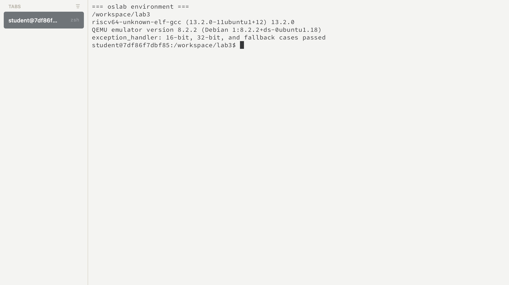
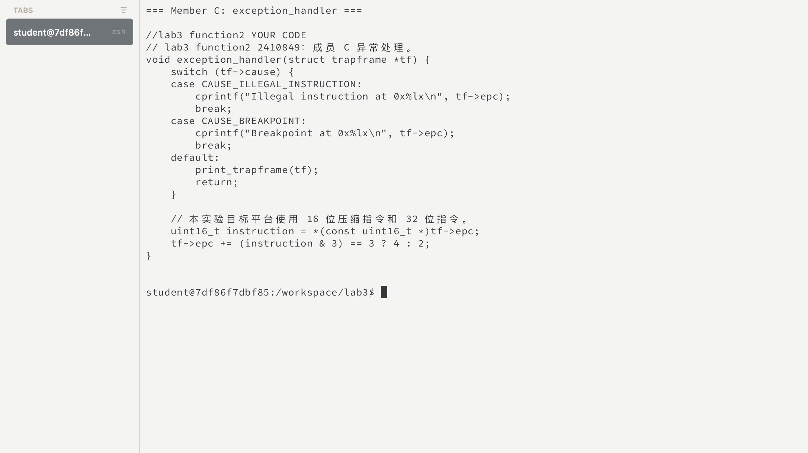
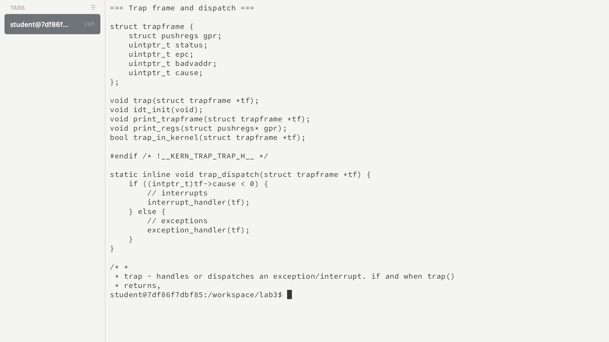
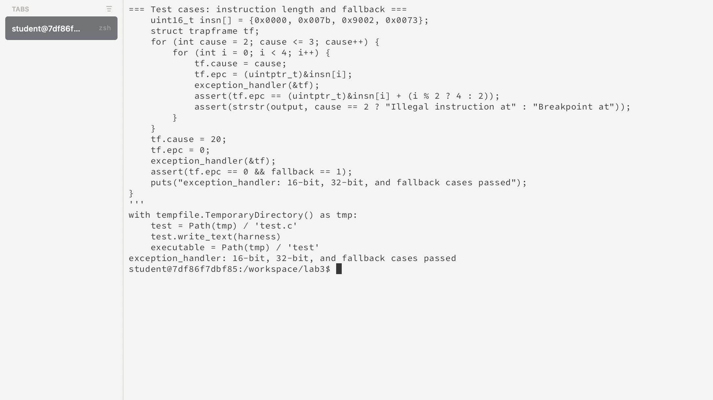
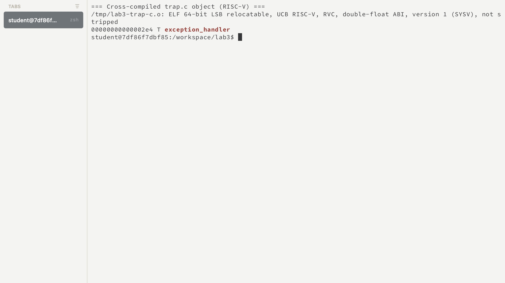

# 操作系统实验报告

## 实验基本信息

| 项目 | 内容 |
|------|------|
| **实验名称** | Lab 3：断，都可以断 |
| **小组成员** | 2410849-张祖浩 |
| **完成日期** | 2026-11-04 |

### 小组分工

| 成员 | 负责的练习/模块 |
|------|----------------|
| 成员 A | `RESTORE_ALL`、`__alltraps` |
| 成员 B | `interrupt_handler()` 与时钟中断 |
| 2410849-张祖浩（成员 C） | `exception_handler()`、异常测试和整合测试记录 |

报告分工：张祖浩负责异常处理部分的实现和实验记录。

---

## 一、实验目的

1. 理解 RISC-V 中断、异常与 Trap frame 之间的关系。
2. 理解保存现场、分发处理、恢复现场及 `sret` 返回的完整流程。
3. 实现非法指令和断点异常处理，根据指令长度更新返回地址。
4. 使用 AI 辅助编写代码，并通过交叉编译和 QEMU 测试核对结果。

---

## 二、实验环境

| 项目 | 内容 |
|------|------|
| 宿主环境 | macOS，使用 `oslab` 进入课程 Docker 容器 |
| 交叉编译器 | riscv64-unknown-elf-gcc 13.2.0 |
| 模拟器 | QEMU 8.2.2，RISC-V virt 平台，OpenSBI |

| 成员 | AI 编程工具 | 底层模型 | 备注 |
|------|------------|---------|------|
| 2410849-张祖浩 | Codex 桌面应用 | GPT-6 | 根据课程框架和测试结果实现成员 C 部分 |

---

## 三、实验整体逻辑分析

### 3.1 本章节的逻辑主线

本实验围绕 Trap 处理展开。CPU 遇到异常或中断时进入内核，内核需要保存被打断的上下文，识别原因并处理，最后恢复上下文并返回。异常处理还需要考虑返回地址：如果重新执行已经触发异常的指令，可能反复进入 Trap。

### 3.2 功能的逐步实现

1. 已有的 `SAVE_ALL` 将通用寄存器和相关 CSR 保存到 Trap frame；成员 A 负责 `__alltraps`，将 frame 传给 C 层 `trap()`。
2. `trap()` 根据 `cause` 的中断标志分发。成员 B 处理中断，设置后续时钟事件并累计 ticks。
3. 成员 C 实现异常处理，识别非法指令和断点，打印信息并更新 frame 中的 `epc`；未指定的异常打印 frame。
4. `trap()` 返回后，由成员 A 实现的恢复流程装回上下文，通过 `sret` 返回。该环节与前面的处理必须使用相同的 frame 布局。

---

## 四、实验内容与实现

### 功能模块：异常处理与返回地址调整

**负责人：** 2410849-张祖浩

#### 模块功能描述

需要实现的函数：

```c
void exception_handler(struct trapframe *tf);
```

函数依据 `tf->cause` 处理 `CAUSE_ILLEGAL_INSTRUCTION` 和 `CAUSE_BREAKPOINT`，输出异常地址并跳过引发异常的指令。其他异常调用 `print_trapframe(tf)`；函数本身不负责恢复寄存器，而是将调整后的 frame 交给统一返回流程。

**Spec：**

- 两类指定异常分别输出 `Illegal instruction at`、`Breakpoint at` 和异常地址。
- 读取 `tf->epc` 指向指令的前 16 位，低两位不为 `11` 时按 2 字节更新 `epc`，否则按 4 字节更新。
- 其他异常输出 trapframe，保持 `epc` 原值，不解引用该地址。
- 保持接口及既有函数不变；本实验测试前提是异常指令位于内核可读取地址，指令长度为 16 或 32 位。

#### 异常处理与返回流程

异常发生后，处理器将异常原因和指令位置分别保存在 `scause`、`sepc` 中。入口汇编保存这些寄存器，形成 `struct trapframe`，再将其地址传给 `trap()`。`trap_dispatch()` 根据 `cause` 的最高位将中断和异常分开；对于异常，将同一个 `tf` 交给 `exception_handler()`。因此，这个函数中的 `tf->epc` 是返回地址在内存中的副本，后续恢复代码需要将修改后的值写回 `sepc`，`sret` 才能从新的位置继续执行。

这里的处理目标是跳过实验要求的两类异常指令。假设某条 4 字节非法指令的地址为 `0x1000`，如果处理后 `epc` 仍为 `0x1000`，返回后会再次执行这条指令，可能反复进入异常。将 `epc` 调整为 `0x1004` 后，统一返回流程才能继续执行下一条指令。这个处理策略只针对实验指定的非法指令和断点，不能推广到所有异常。

#### 关键代码与分支分析

```c
switch (tf->cause) {
case CAUSE_ILLEGAL_INSTRUCTION:
    cprintf("Illegal instruction at 0x%lx\n", tf->epc);
    break;
case CAUSE_BREAKPOINT:
    cprintf("Breakpoint at 0x%lx\n", tf->epc);
    break;
default:
    print_trapframe(tf);
    return;
}

uint16_t instruction = *(const uint16_t *)tf->epc;
tf->epc += (instruction & 3) == 3 ? 4 : 2;
```

`switch` 首先识别异常类型。两个指定分支分别输出异常名称和当前地址，`break` 结束 `switch`，然后共同执行下面的地址更新；输出发生在地址更新之前，所以打印的是触发异常的指令地址。默认分支调用 `print_trapframe(tf)` 输出现场，再用 `return` 结束函数，避免对未知异常读取指令或擅自修改返回地址。打印现场只提供诊断信息，并不表示未知异常已经恢复。

判断指令长度时，`(const uint16_t *)tf->epc` 将保存的地址解释为指向 16 位数据的指针，解引用取得指令的第一个半字。`instruction & 3` 保留最低两位：在本实验的 16 位、32 位指令范围内，最低两位不是 `11` 时将 `epc` 增加 2 字节，是 `11` 时增加 4 字节。例如 `0x9002 & 3` 的结果为 2，因此前进 2 字节；`0x007b & 3` 的结果为 3，因此前进 4 字节。

直接读取 `epc` 所指地址依赖本实验中的内核指令可读取这一前提。若地址不可读取，读取过程本身可能再次触发异常；而 48 位及更长指令也不在当前长度判断的覆盖范围内。这些情况不能因为现有测试通过就认为已经解决。

#### 最终提示词

根据实验要求和现有代码，我将异常处理的目标、依赖接口和边界条件整理为以下提示词，供实现和复核使用：

````text
[PROMPT]
我负责 Lab 3 的异常处理部分。请先阅读课程提供的 RISC-V ucore 代码框架，
再在 kern/trap/trap.c 中实现 exception_handler(struct trapframe *tf)。
函数需要识别非法指令异常和断点异常，输出异常信息，调整返回地址，
使 Trap 返回后继续执行后续指令。请说明代码中每个分支和返回地址调整的原因。

[RELY]
1. kern/trap/trap.h 中的 struct trapframe 保存了本次 Trap 的上下文：
   tf->cause 表示异常原因，tf->epc 保存异常发生时的指令地址。
2. kern/trap/trap.c 中的 trap_dispatch() 已经区分中断和异常；
   exception_handler() 接收到的是需要处理的异常。
3. libs/riscv.h 已定义 CAUSE_ILLEGAL_INSTRUCTION、CAUSE_BREAKPOINT；
   可使用 cprintf() 输出信息，使用 print_trapframe(tf) 输出完整现场。
4. 本实验的测试指令位于内核可以读取的地址，考虑 16 位压缩指令和
   32 位指令；Trap frame 的恢复和 sret 由统一返回流程完成。

[GUARANTEE]
保持现有函数接口：
    void exception_handler(struct trapframe *tf);
只实现异常处理所需的代码，保留已有函数、结构体和实验注释，
不要更改 Trap frame 布局、trap_dispatch() 或其他成员负责的函数。

[SPECIFICATION]
前置条件：tf 指向当前有效的 Trap frame；对于需要跳过的实验指令，
tf->epc 指向内核可以读取的指令地址。

情况一：tf->cause 为 CAUSE_ILLEGAL_INSTRUCTION。
输出以 Illegal instruction at 开头的信息及原异常地址，随后根据
触发异常的指令长度更新 tf->epc，避免返回后再次执行同一条指令。

情况二：tf->cause 为 CAUSE_BREAKPOINT。
输出以 Breakpoint at 开头的信息及原异常地址，同样根据指令长度
更新 tf->epc，使断点处理结束后可以继续执行。

返回地址的计算：读取异常地址处的第一个 16 位半字，检查最低两位。
在本实验的 16 位和 32 位指令范围内，最低两位不是二进制 11 时加 2
字节，是 11 时加 4 字节。不能对两种指令都使用固定的地址增量。

情况三：其他异常。
调用 print_trapframe(tf) 输出异常现场，保持 tf->epc 不变，
不尝试读取该地址处的指令，也不假设其他异常已经被恢复。

后置条件：两类指定异常输出原地址并正确更新 frame 中的 epc；
其他异常保留原 epc。不得直接改写与本任务无关的上下文。

[验证要求]
分别检查非法指令和断点在 16 位、32 位两种编码下的地址变化，
验证输出前缀；再检查未知异常是否调用 print_trapframe() 且不修改 epc。
使用课程提供的 RISC-V 交叉编译器检查代码，并记录实际执行的测试及结果。
````

#### 实现和调试过程

根据实验要求在 `kern/trap/trap.c` 中实现异常处理，增加学号标记。针对指令长度建立宿主机测试，覆盖两类异常、两种长度及未知异常。最初在宿主机用 Apple Clang 做检查时，因 `-Wunused-function` 被 `-Werror` 升级而失败；调整警告选项顺序后，RISC-V 目标语法检查通过。随后发现本机 Clang 没有 RISC-V 代码生成后端，因此进入 `oslab` 容器，使用课程交叉编译器编译该源文件。


---

## 五、测试与验证


### 5.1 课程环境与独立分支测试

在 `oslab` 容器内执行 `python3 tests/test_exception_handler.py`。测试直接提取当前异常处理函数，用构造的 Trap frame 检查非法指令、断点在 16 位和 32 位编码下的地址变化，并检查未知异常的兜底分支。测试通过；这是宿主进程中的逻辑检查，不代表真实 Trap 返回已验证。



异常处理函数根据 `cause` 选择分支，并在指定异常中根据指令长度更新 `epc`：



Trap frame 保存异常现场，`trap_dispatch()` 根据最高位将处理交给对应函数：



下图展示具体的两种指令长度、异常类型及兜底检查，测试脚本输出通过：



本次测试用构造的半字数据检查地址计算，并不把每个数组元素都当成一次真实的 CPU 异常。两类异常分别执行下列长度判断：

| 输入的首半字 | 最低两位 | 预期地址增量 | 检查内容 |
| --- | --- | --- | --- |
| `0x0000` | `00` | 2 字节 | 非法指令和断点分支分别检查返回地址与输出前缀 |
| `0x007b` | `11` | 4 字节 | 同上 |
| `0x9002` | `10` | 2 字节 | 同上 |
| `0x0073` | `11` | 4 字节 | 同上 |

测试还构造 `cause = 20`、`epc = 0` 的情况：预期调用兜底函数且 `epc` 保持为 0。若代码错误地进入指令读取，零地址也能帮助暴露该问题。实际执行命令与结果如下：

```text
$ python3 tests/test_exception_handler.py
exception_handler: 16-bit, 32-bit, and fallback cases passed
```

脚本使用 `assert` 检查地址增量、输出前缀、兜底调用次数；任何断言失败都不会输出以上通过信息。它验证的是函数在这些构造输入下的行为，并不包含寄存器保存、恢复和 `sret` 的真实执行。

在课程环境使用 RISC-V 交叉编译器编译 `trap.c`，通过临时头文件提供 `interrupt_handler()` 声明，生成的目标文件包含 `exception_handler` 符号。该检查针对单个源文件，尚不等同于完整内核链接。



`file` 将产物识别为 64 位 RISC-V 可重定位 ELF 文件，`nm` 显示其中包含 `exception_handler` 符号。交叉编译确认了该源文件能够生成目标架构的目标文件；链接成完整内核及实际 Trap 返回还需要结合其余模块进行验证。


---

## 六、实验总结与收获

### 对操作系统的理解

- **Trap 与上下文**：硬件进入内核后，需要软件保存寄存器和 CSR。Trap frame 是这些状态的软件表示；只有保存和恢复布局一致，原执行流才能正确继续。
- **中断与异常**：时钟中断由时钟事件引起；非法指令和断点与正在执行的指令有关。两者可以共用入口和分发机制，但处理目标不同。
- **异常返回地址**：RISC-V 的 `sepc` 保存异常位置。本实验通过 frame 更新它，让返回跳过指令；压缩指令使步长可能为 2 字节，也可能为 4 字节。
- **虚拟内存与启动**：设置 `satp` 后，指令提取也需要有效映射。分页切换期间必须确保当前指令地址仍有有效映射。
- **本实验没有覆盖的内容**：用户态地址安全读取、完整缺页恢复、进程调度以及不同硬件上的中断控制器管理仍需进一步学习。这里直接读取 `epc` 只适用于当前内核测试前提，也不处理 48 位及更长的指令。

### AI 协作开发的经验

给出数据结构、允许修改的范围和返回条件，比只要求“完成异常处理”更容易得到可检查的实现。测试需要区分函数逻辑检查与系统运行验证，并根据实际结果记录实验过程。
